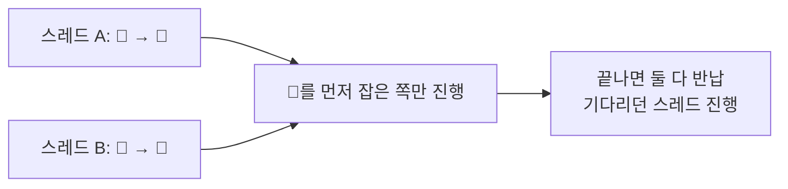
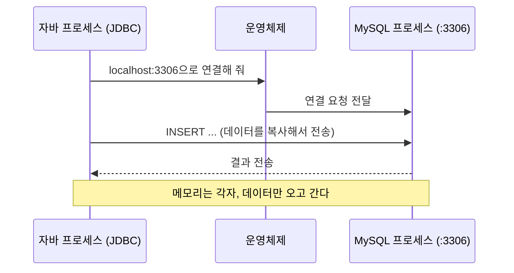

## 들어가며

[이전 글]({{ site.baseurl }}/posts/servlet-thread-process/)에서 서블릿 예제로 스레드와 프로세스를 정리했다. 결론은 두 가지였다.

- 스레드끼리 **필드를 공유**하면 경쟁 상태(race condition)가 생기고, `synchronized`로 한 번에 한 스레드만 들어가게 막을 수 있다.
- **프로세스**는 자기만의 메모리를 가지고, 다른 프로세스와 메모리를 공유하지 않는다.

글 끝의 "더 학습하면 좋은 개념"에 두 가지를 적어 두었다. 이 글은 그 두 질문을 이어서 따라간 기록이다.

| 남겨 둔 질문 | 출발점 |
|---|---|
| 락을 쓰면 반드시 마주친다는 **데드락**은 왜 생길까? | `synchronized` |
| 메모리를 공유하지 않는 프로세스끼리는 어떻게 데이터를 주고받을까? (**IPC**) | 작업 관리자에서 본 두 개의 `java.exe` |

이번에는 코드를 실행해 보기보다 비유와 질문으로 원리를 따라갔다. 글에 나오는 자바 코드는 이해를 돕기 위한 **예시 코드**이고 직접 돌려 본 결과는 아니다.

## 데드락: 열쇠가 두 개가 되면

### 열쇠가 하나일 때는 기다리면 끝난다

이전 글에서 `synchronized`를 화장실 한 칸에 비유했다. 열쇠(락, lock)는 하나뿐이고, 열쇠를 가진 스레드만 들어가고, 나머지는 문 앞에서 기다린다. 기다리는 쪽은 앞사람이 나오면 들어갈 수 있으니 **언젠가는 차례가 온다.**

### 열쇠가 두 개가 되면

조건을 하나 바꿨다. 이번엔 일을 하려면 **두 열쇠가 다 필요하다.** 🔑 화장실 열쇠와 🧻 휴지 창고 열쇠다.

- 스레드 A는 🔑를 먼저 잡고, 그다음 🧻를 기다린다.
- 스레드 B는 🧻를 먼저 잡고, 그다음 🔑를 기다린다.

이 둘은 어떻게 될까? 내 예상은 "서로 상대 열쇠를 기다리면서 둘 다 영원히 멈춘다"였다. 이게 **데드락(deadlock, 교착 상태)**이다. 오라클 튜토리얼의 정의도 같다.

> Deadlock describes a situation where two or more threads are blocked forever, waiting for each other.
> — [The Java Tutorials - Deadlock](https://docs.oracle.com/javase/tutorial/essential/concurrency/deadlock.html)


자바로 옮기면 이런 모양이 된다. 예시 코드다.

```java
Object toilet = new Object();   // 🔑
Object storage = new Object();  // 🧻

// 스레드 A
synchronized (toilet) {
    synchronized (storage) { /* 일 */ }
}

// 스레드 B — 잡는 순서가 반대
synchronized (storage) {
    synchronized (toilet) { /* 일 */ }
}
```

### 왜 "영원히"일까: 양보하면 되지 않나?

여기서 "둘 중 하나가 열쇠를 내려놓으면 풀리지 않나?"라는 질문을 받았다. 답하다 보니 이유가 두 개 나왔다.

- 스레드가 **열쇠를 쥔 채로** 다른 열쇠를 기다린다.
- 다른 스레드가 그 열쇠를 **억지로 뺏을 수 없다.**

`synchronized`가 정확히 이렇게 동작한다. 락을 잡은 스레드는 블록을 끝내기 전에는 락을 놓지 않고, 다른 스레드가 빼앗아 갈 방법도 없다. 그래서 둘 다 기다리기만 하고 아무도 양보하지 않는다.

### 데드락의 4가지 조건

운영체제 수업에서 데드락 조건이 4가지라고 배웠는데 기억이 가물했다. 이름을 외우는 대신 열쇠 이야기 안에서 하나씩 찾아봤다.

| 열쇠 이야기 | 조건 이름 |
|---|---|
| 열쇠는 한 명만 쓸 수 있다 | **상호 배제**(mutual exclusion, 자원을 한 번에 하나만 사용) |
| 열쇠를 쥔 채로 다른 열쇠를 기다린다 | **점유 대기**(hold and wait, 가진 걸 놓지 않고 기다림) |
| 남의 열쇠를 뺏을 수 없다 | **비선점**(no preemption, 강제로 빼앗을 수 없음) |
| A는 B를, B는 A를 기다린다 | **순환 대기**(circular wait, 기다리는 관계가 원을 이룸) |

이 넷이 **전부 동시에** 성립해야 데드락이 생긴다. 그래서 열쇠가 하나일 때는 데드락이 생기지 않는다. 원을 만들 상대 열쇠가 없으니 순환 대기가 성립하지 않기 때문이다.

### 조건 하나만 깨면 된다: 락 순서 정하기

반대로 말하면 넷 중 **하나만 깨도** 데드락은 생기지 않는다. 코드에서 가장 손대기 쉬운 건 순환 대기다. 원이 생기지 않게 하려면 어떻게 해야 할까?

내 답은 "둘 다 🔑 화장실 열쇠부터 잡게 순서를 똑같이 맞춘다"였다. 그러면 🔑를 못 잡은 스레드는 🧻도 아직 안 잡은 상태로 기다린다. 쥔 것 없이 기다리는 스레드는 누구도 막지 않으니 원이 생길 수가 없다. 이 방법을 **락 순서 정하기**(lock ordering, 모든 스레드가 같은 순서로 락을 잡게 하는 방법)라고 한다.

```java
// 스레드 A, B 모두 같은 순서: toilet → storage
synchronized (toilet) {
    synchronized (storage) { /* 일 */ }
}
```



처음엔 "나중에 잡는 사람은 **다음 사람**이 끝나고 바로 잡는다"고 말했는데, 정확히는 **앞사람**이다. 먼저 열쇠를 잡은 스레드가 일을 끝내야 뒤에서 기다리던 스레드가 잡을 수 있다.

## IPC: 메모리를 나누지 않는 프로세스끼리 대화하기

### 출발점: JDBC URL

이전 글에서 작업 관리자를 열었을 때 `java.exe`가 두 개 떠 있었고, 프로세스끼리는 메모리를 공유하지 않는다는 걸 확인했다. 그럼 서로 다른 프로세스는 어떻게 데이터를 주고받을까? 이걸 **IPC**(Inter-Process Communication, 프로세스 간 통신)라고 한다.

예전에 JDBC로 MySQL을 다뤄 본 적이 있다. 내 자바 프로그램과 MySQL 서버도 **서로 다른 프로세스**다. 그런데 자바에서 `INSERT`를 실행하면 데이터가 MySQL에 들어간다. 힌트는 연결할 때 썼던 URL에 있었다.

```text
jdbc:mysql://localhost:3306/...
```

- `localhost`: 내 컴퓨터 자신
- `3306`: 포트 번호(port, 컴퓨터 안에서 프로그램을 찾아가는 문 번호). MySQL의 기본 포트다([MySQL 8.4 Reference Manual - Connecting to the MySQL Server](https://dev.mysql.com/doc/refman/8.4/en/connecting.html)).

### 같은 컴퓨터인데 왜 주소와 포트가 필요할까

이 질문의 힌트는 이전 글에서 이미 봤다. 톰캣 스레드 이름이 `http-nio-8080-exec-4`였고, 브라우저에서는 `localhost:8080/life-cycle`로 접속했다.

| | 기다리는 쪽 (서버) | 찾아가는 쪽 (클라이언트) |
|---|---|---|
| 웹 | 톰캣 `:8080` | 브라우저 |
| DB | MySQL `:3306` | 내 자바 프로그램 (JDBC) |

브라우저와 톰캣, 자바 프로그램과 MySQL 모두 **포트를 통해 다른 프로세스와 통신**하고 있었다. 이렇게 포트로 연결해서 데이터를 주고받는 통로가 **소켓**(socket)이고, 대표적인 IPC 방법이다.

> A socket is one endpoint of a two-way communication link between two programs running on the network.
> — [The Java Tutorials - What Is a Socket?](https://docs.oracle.com/javase/tutorial/networking/sockets/definition.html)



### 내가 고친 두 가지 표현

처음엔 "서로 포트 번호를 알아야 데이터 **공유**가 가능하다"라고 정리했다. 방향은 맞았지만 두 단어가 틀렸다.

**1. "공유"가 아니라 "주고받기"다.** 스레드는 같은 힙을 공유했지만, 프로세스는 메모리를 공유하지 않는다. 소켓은 데이터를 **복사해서 보낸다.** 편지를 부치는 것과 비슷하다. 같은 종이를 둘이 같이 들고 있는 게 아니다.

**2. "서로" 알 필요는 없다.** 먼저 연결하는 클라이언트만 서버의 포트를 알면 된다. 서버는 자기 포트를 열어 두고 기다리고, 클라이언트 쪽 포트는 보통 운영체제가 정해 준다.

> The client also needs to identify itself to the server so it binds to a local port number that it will use during this connection. This is usually assigned by the system.
> — [The Java Tutorials - What Is a Socket?](https://docs.oracle.com/javase/tutorial/networking/sockets/definition.html)

### 복사라면 경쟁 상태는?

"복사해서 보낸다"는 걸 확인하려고 질문을 하나 더 했다. 자바가 MySQL에 `name = "마린"`을 보낸 뒤 자바 쪽 변수 `name`을 `"고조"`로 바꾸면, MySQL에 저장된 값도 바뀔까?

바뀌지 않는다. 복사해서 보냈으니 둘은 별개의 값이다. 자바에서 다시 `UPDATE`를 보내기 전까지 MySQL 값은 그대로다.

그럼 프로세스끼리 소켓으로 주고받을 때도 경쟁 상태가 생길까? 경쟁 상태의 원인은 "두 스레드가 **공유하는** 변수를 동시에 건드려서"였다. 소켓 통신에는 공유하는 변수가 없다. 각자 자기 복사본을 쓰는 건 **지역 변수**가 스레드마다 따로 생기는 것과 같은 구조라서, 경쟁 상태가 생길 자리가 없다.

## 기존 지식과 연결: 결국 "무엇을 공유하는가"

이전 글과 이번 글을 합쳐 보니 모든 문제가 같은 질문으로 돌아왔다.

> **공유하는 게 있는 곳에서 동시성 문제가 생긴다.**

| 주제 | 공유하는 것 | 생기는 문제 | 막는 방법 |
|---|---|---|---|
| 스레드 + 필드 | 힙의 변수 | 경쟁 상태 | `synchronized`, 필드 안 만들기 |
| 스레드 + 지역 변수 | 없음 (스레드마다 따로) | 없음 | — |
| 락 2개 이상 | 락 | 데드락 | 락 순서 정하기 |
| 프로세스 + 소켓 | 없음 (복사) | 없음 | — |
| 여러 프로세스 + DB | DB의 같은 행 | 동시 수정 충돌 | 트랜잭션, DB 락 |

마지막 줄은 정리하면서 알게 된 함정이다. 소켓 통신 자체에는 공유가 없지만, 공유가 사라진 게 아니라 **자리를 옮긴 것**일 수 있다. 자바 프로그램 여러 개가 MySQL의 **같은 행**을 동시에 `UPDATE`하면, 이번엔 MySQL 안의 그 데이터가 공유 변수 역할을 한다. 그래서 DB는 안에서 트랜잭션(transaction, 한 덩어리로 처리되는 작업 묶음)과 락으로 이 문제를 막는다.

## 활용과 발전 방향

이번 정리로 동시성 코드를 볼 때 던질 질문이 두 개로 정리됐다.

1. **이 데이터는 누가 같이 쓰는가?** 같이 쓰는 게 없으면 경쟁 상태도 없다.
2. **락이 두 개 이상이라면, 모두 같은 순서로 잡는가?** 순서가 엇갈리면 데드락의 원이 생긴다.

다음에 직접 해 보고 싶은 것도 생겼다.

- 위의 데드락 예시 코드를 실제 스레드 두 개로 돌려서 정말 멈추는지 확인하기
- 멈춘 프로그램을 `jstack`으로 들여다보고, 어떤 스레드가 어떤 락을 기다리는지 직접 보기

이번에는 둘 다 머릿속으로만 따라갔기 때문에, 실행해 보면 이 글에 결과를 덧붙이려고 한다.

## 더 학습하면 좋은 개념

- **`jstack`과 스레드 덤프**: 실행 중인 자바 프로세스의 스레드 상태를 출력해 준다. 데드락이 생기면 어떤 스레드가 어떤 락을 쥐고 무엇을 기다리는지 보여 줘서, 이번에 비유로 이해한 원을 실제로 확인할 수 있다.
- **`ReentrantLock`의 `tryLock`**: `synchronized`와 달리 락을 일정 시간만 기다리다 포기할 수 있다. 데드락 조건 중 "점유 대기"를 깨는 방법이라서, 락 순서 정하기 말고 다른 조건을 깨는 예로 볼 만하다.
- **공유 메모리(shared memory)**: 프로세스끼리 메모리를 진짜로 공유하는 IPC 방법이다. 복사가 없어서 빠르지만 공유가 생기는 만큼 경쟁 상태가 다시 돌아온다. "공유하면 동시성 문제가 생긴다"는 원칙을 프로세스 수준에서 확인할 수 있다.
- **DB 트랜잭션과 격리 수준(isolation level)**: 여러 프로세스가 DB의 같은 데이터를 건드릴 때 DB가 어떻게 막는지 알려 준다. 위 표의 마지막 줄을 제대로 이해하려면 필요하다.
- **TCP와 포트**: 소켓이 포트로 프로그램을 구분한다는 걸 봤다. TCP가 데이터를 어떻게 순서대로, 빠짐없이 전달하는지 알면 브라우저↔톰캣, 자바↔MySQL 통신이 더 구체적으로 보인다.

## 참고 자료

- [The Java Tutorials - Deadlock](https://docs.oracle.com/javase/tutorial/essential/concurrency/deadlock.html)
- [The Java Tutorials - Intrinsic Locks and Synchronization](https://docs.oracle.com/javase/tutorial/essential/concurrency/locksync.html)
- [The Java Tutorials - What Is a Socket?](https://docs.oracle.com/javase/tutorial/networking/sockets/definition.html)
- [The Java Tutorials - Processes and Threads](https://docs.oracle.com/javase/tutorial/essential/concurrency/procthread.html)
- [MySQL 8.4 Reference Manual - Connecting to the MySQL Server](https://dev.mysql.com/doc/refman/8.4/en/connecting.html)
