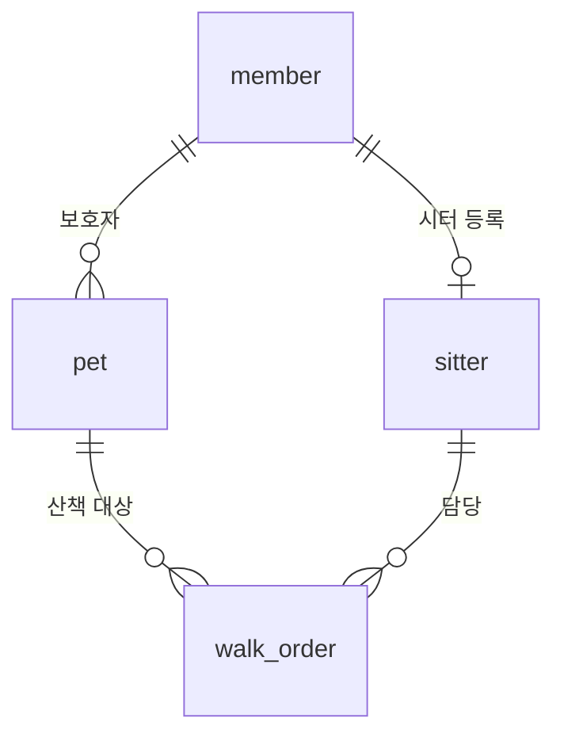
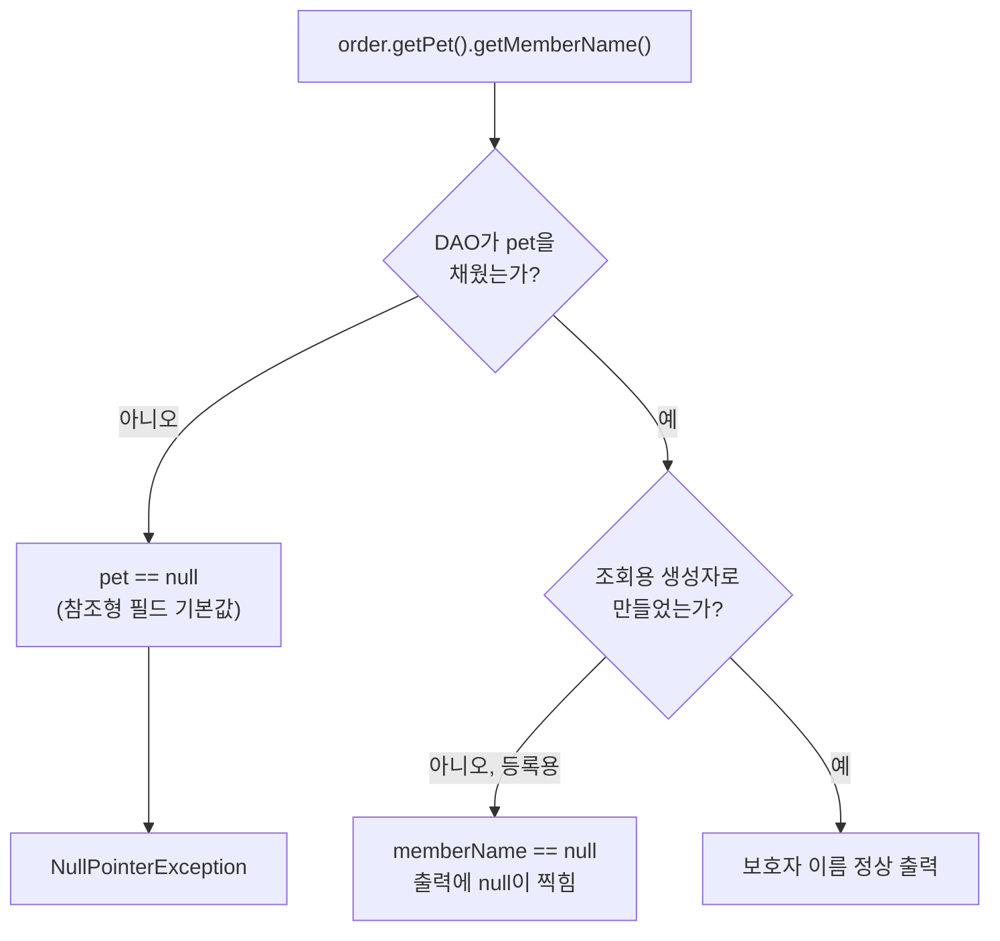

## 들어가며

JDBC 수업에서 DTO(테이블 한 행을 담아 옮기는 객체)를 만들 때 외래키(FK, 다른 테이블의 기본키를 가리키는 컬럼)를 다루는 방법을 배웠다. 수업 예제는 메뉴와 카테고리였다.

```java
public class MenuDTO {

    private int menuCode;
    private String menuName;
    private int menuPrice;
    private CategoryDTO categoryDTO;   // int categoryCode가 아니다
    private String orderableStatus;

}
```

`tbl_menu` 테이블에는 `category_code`라는 FK 컬럼이 숫자로 들어 있다. 그런데 DTO에서는 이걸 `int categoryCode`가 아니라 `CategoryDTO categoryDTO`로 잡았다. **FK 한 칸은 사실 그 테이블의 한 행 전체를 가리키는 것**이니, 타입도 그 행을 담는 객체로 잡는다는 설명이었다.

듣고 나서 고개는 끄덕였는데, 솔직히 수업에서 본 건 **DTO에 필드를 선언하는 부분까지**였다. 그 필드에 실제로 값을 넣는 DAO 코드는 아직 보지 못했다. 그래서 지금 하고 있는 팀 프로젝트 코드에 대 보기로 했다.

## 우리 주문 DTO는 어떻게 생겼나

팀 프로젝트는 반려동물 산책 매칭 서비스의 관리자 콘솔이다. 테이블 관계는 이렇다.



`walk_order`(산책 주문)에는 보호자 번호가 없다. 보호자는 `pet`을 거쳐서 찾는다. 그리고 현재 주문 DTO는 FK를 전부 `int`로 들고 있다.

```java
// walk_order 한 행 + 목록 출력용 JOIN 값
public class WalkOrderDTO {
    // walk_order 컬럼
    private int orderId;
    private int petId;
    private int sitterId;
    // ... 산책일시, 요금방식, 상태 등

    // 목록 출력용 (pet, member, sitter JOIN)
    private String petName;
    private int guardianId;             // 보호자 회원번호
    private String guardianName;
    private String sitterName;
}
```

아래쪽 네 줄이 눈에 들어왔다. 주문 목록을 출력할 때 반려동물 이름, 보호자 번호·이름, 시터 이름을 같이 보여 줘야 해서 JOIN 결과를 **낱개 필드로 펼쳐서** 들고 있는 것이다.

## 흥미로운 지점: `petId`를 `PetDTO pet`으로 바꾸면 무엇이 사라질까

수업 방식대로 `int petId`를 `PetDTO pet`으로 바꾼다고 가정하고, 아래 네 줄 중 필요 없어질 것을 골라 봤다. 내가 고른 건 **`petName`과 `guardianName`** 이었다.

`petName`은 쉬웠다. 반려동물 이름은 `pet` 테이블 컬럼이니 `PetDTO` 안에 당연히 있다.

`guardianName`은 조금 달랐다. 보호자 이름은 `walk_order`도 `pet`도 아닌 `member` 테이블의 값이다. 그런데도 고른 이유는 `PetDTO`에 이미 이런 필드가 있었기 때문이다.

```java
public class PetDTO {
    private int petId;
    private int memberId;
    private String name;
    private String breed;
    private BigDecimal weight;      // DECIMAL(4,1)
    private int activityLevel;      // 1~5
    private String memberName;      // 조회용, pet JOIN member

    public String getMemberName() {
        return memberName;
    }
    // ...
}
```

반려동물 담당 팀원이 목록 조회를 위해 `memberName`을 넣어 둔 것이다. 그러니 주문 DTO에서는 `pet.getMemberName()`으로 보호자 이름을 꺼낼 수 있다. 필드가 `private`라서 밖에서 직접 접근할 수 없고, getter(값을 꺼내 주는 메서드)로 접근한다.

| | 지금 (`int petId`) | 바꾼다면 (`PetDTO pet`) |
|---|---|---|
| 반려동물 이름 | `order.getPetName()` (별도 필드) | `order.getPet().getName()` |
| 보호자 이름 | `order.getGuardianName()` (별도 필드) | `order.getPet().getMemberName()` |
| 주문 DTO의 필드 수 | JOIN할 때마다 늘어남 | 객체 하나로 묶임 |

## 잠깐, 용어부터 바로잡기

이 설명을 하면서 나는 계속 "객체의 **매개변수**에 접근한다"라고 말했다. 그런데 `memberName`, `petId`처럼 클래스 안에 선언한 변수는 매개변수가 아니라 **필드**(멤버 변수)다.

| 용어 | 뜻 | 예 |
|---|---|---|
| 필드 | 클래스 안에 선언되어 객체가 들고 있는 값 | `private String memberName;` |
| 매개변수 | 메서드·생성자를 호출할 때 넘겨받는 값 | `setPetId(int petId)`의 괄호 안 `petId` |
| 지역 변수 | 메서드 안에서 선언해 그 안에서만 쓰는 변수 | 메서드 본문의 `int count = 0;` |

Oracle 튜토리얼도 변수를 인스턴스 변수(필드), 클래스 변수, 지역 변수, 매개변수로 나눠서 설명한다. 이름이 같아도(`petId` 필드와 `petId` 매개변수) 서 있는 자리가 다르면 다른 것이다.

## 핵심 원리: 그 객체는 항상 꽉 차 있을까?

`pet.getMemberName()`으로 꺼내면 된다는 건 맞다. 그런데 **언제나 값이 들어 있을까?** `PetDTO`의 생성자 두 개를 비교해 봤다.

```java
// 등록용 (petId는 DB AUTO_INCREMENT)
public PetDTO(int memberId, String name, String breed, BigDecimal weight, int activityLevel) {
    this.memberId = memberId;
    this.name = name;
    this.breed = breed;
    this.weight = weight;
    this.activityLevel = activityLevel;
}

// 조회용 (보호자 이름 포함)
public PetDTO(int petId, int memberId, String name, String breed, BigDecimal weight, int activityLevel,
              String memberName) {
    this(memberId, name, breed, weight, activityLevel);
    this.petId = petId;
    this.memberName = memberName;
}
```

등록용 생성자는 `petId`와 `memberName`을 채우지 않는다. 그럼 등록용으로 만든 `PetDTO`에서 `getMemberName()`을 부르면? **`null`** 이 나올 거라고 예상했다. 그럼 `getPetId()`는? 같은 원리로 **`0`** 이다.

이유는 필드의 기본값이다. 필드는 아무것도 넣지 않아도 객체가 만들어질 때 자동으로 기본값이 들어간다.

> Each class variable, instance variable, or array component is initialized with a default value when it is created
> — [JLS §4.12.5](https://docs.oracle.com/javase/specs/jls/se21/html/jls-4.html#jls-4.12.5)

| 필드 타입 | 기본값 |
|---|---|
| `int` 같은 기본형 | `0` |
| `String`, `PetDTO` 같은 참조형 | `null` |

여기서 원래 질문으로 돌아가면 이야기가 커진다. `WalkOrderDTO`의 `pet` 필드도 **참조형**이다. DAO가 `pet`을 채우지 않으면 그 자리에는 `null`이 들어 있다. 그 상태에서 아래 코드를 실행하면?

```java
order.getPet().getMemberName()
```

`getPet()`이 `null`을 돌려주고, `null`에 `.getMemberName()`을 호출하니 **NullPointerException**이 날 것이라고 예상했다.

정리하면서 예상이 맞는지 확인용 코드를 돌려 봤다. 실제 프로젝트의 `PetDTO`를 그대로 쓰고, 주문 쪽은 `pet` 필드 하나만 둔 실험용 클래스로 만들었다. (예시 코드)

```java
static class OrderSketch {
    private int orderId;
    private PetDTO pet;
    public PetDTO getPet() { return pet; }
}

public static void main(String[] args) {
    PetDTO p = new PetDTO(1, "초코", "푸들", new BigDecimal("3.2"), 3);  // 등록용 생성자
    System.out.println("getPetId() = " + p.getPetId());
    System.out.println("getMemberName() = " + p.getMemberName());

    OrderSketch order = new OrderSketch();                              // pet을 채우지 않음
    System.out.println("getPet() = " + order.getPet());
    System.out.println(order.getPet().getMemberName());
}
```

```text
getPetId() = 0
getMemberName() = null
getPet() = null
Exception in thread "main" java.lang.NullPointerException: Cannot invoke "com.team3.petwalk.model.dto.PetDTO.getMemberName()" because the return value of "demo.Demo$OrderSketch.getPet()" is null
```

예상 세 개가 모두 맞았다. 특히 마지막 줄의 예외 메시지가 친절했다. **`getPet()`의 반환값이 null이라서** `getMemberName()`을 호출할 수 없다고 정확히 짚어 준다.



두 갈래 모두 함정이다. `pet` 자체가 비어 있으면 예외로 프로그램이 터지고, `pet`은 있는데 그 안의 `memberName`이 비어 있으면 예외 없이 **화면에 `null`이 조용히 찍힌다.** 후자가 더 찾기 어렵다.

## 기존 지식과 연결: 편해지는 만큼 책임이 옮겨 간다

여기까지 와서 처음에 배운 문장을 다시 쓰면 이렇게 된다.

> FK를 객체로 잡으면 꺼내 쓰기는 편해지지만, **그 객체를 꽉 채워 넣는 책임이 DAO로 넘어간다.**

`int petId`일 때는 번호 하나만 넣으면 끝이었다. `PetDTO pet`이 되면 DAO가 SELECT 결과에서 반려동물 컬럼과 보호자 이름까지 꺼내 `PetDTO`를 먼저 만들고, 그걸 주문 DTO에 넣어 줘야 한다. 우리 프로젝트의 계층 규칙에서 DAO는 "SQL 실행만" 하는 곳인데, 객체를 조립하는 일도 결국 SQL 결과를 옮겨 담는 일이라 DAO의 몫이 된다.

수업에서 DTO 선언만 보고 넘어갔을 때는 "타입을 객체로 바꾸면 깔끔하다"에서 생각이 멈췄다. 직접 대 보니 진짜 질문은 **"그 객체를 언제, 누가, 얼마나 채우는가"** 였다.

참고로 실제 `WalkOrderDTO`는 주문 담당 팀원의 파일이고 `PetDTO`도 함께 엮이기 때문에, 이번에는 코드를 고치지 않고 머릿속으로만 연습했다. 바꾸려면 팀과 먼저 이야기해야 한다.

## 아직 남은 질문

- `guardianId`와 `sitterName`은 남겨야 할까, 아니면 다른 방법으로 없앨 수 있을까?
- `PetDTO`의 조회용 생성자 7개 매개변수를 채우려면, 주문 목록 SELECT문은 **어떤 테이블의 어떤 컬럼**을 가져와야 할까?
- `pet.name`과 `member.name`처럼 컬럼 이름이 겹칠 때 SELECT에서 어떻게 구분해서 꺼낼까?

## 더 학습하면 좋은 개념

- **컬럼 별칭(`AS`)** — JOIN한 테이블끼리 컬럼 이름이 겹치면 `ResultSet`에서 이름으로 꺼낼 때 헷갈린다. 객체를 채우는 DAO 코드를 쓰기 전에 꼭 필요하다.
- **지역 변수와 기본값** — 필드와 달리 지역 변수에는 기본값이 자동으로 들어가지 않는다. 값을 넣지 않고 쓰면 실행 전에 컴파일 에러가 난다. 필드 기본값과 비교해 두면 `null`이 어디서 생기는지 감이 잡힌다.
- **`Optional`** — "값이 없을 수도 있음"을 타입으로 드러내는 방법이다. `null` 체크를 빠뜨리는 실수를 줄이는 다음 단계다.
- **ORM과 지연 로딩(Lazy Loading)** — JPA 같은 도구는 FK를 객체로 다루는 것을 기본으로 하고, 연결된 객체를 "필요할 때 채우는" 방식을 제공한다. 이번에 만난 "누가 언제 채우는가" 문제를 도구가 대신 풀어 주는 방식이다.

## 참고 자료

- [JLS §4.12.5 Initial Values of Variables](https://docs.oracle.com/javase/specs/jls/se21/html/jls-4.html#jls-4.12.5)
- [The Java Tutorials - Variables](https://docs.oracle.com/javase/tutorial/java/nutsandbolts/variables.html)
- [The Java Tutorials - Primitive Data Types (Default Values)](https://docs.oracle.com/javase/tutorial/java/nutsandbolts/datatypes.html)
- [Java SE 21 API - NullPointerException](https://docs.oracle.com/en/java/javase/21/docs/api/java.base/java/lang/NullPointerException.html)
- [JEP 358: Helpful NullPointerExceptions](https://openjdk.org/jeps/358)
