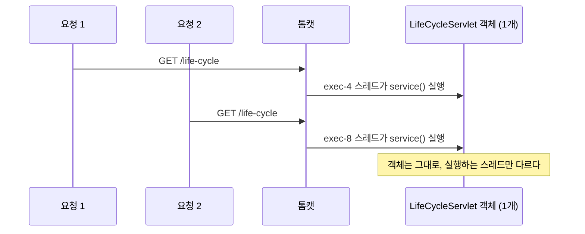
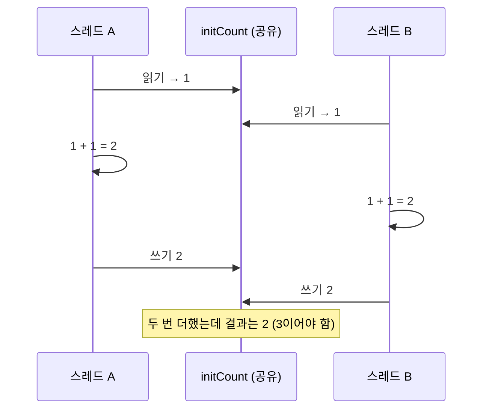
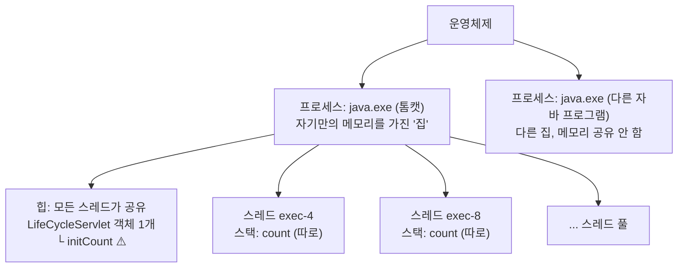

## 들어가며

부트캠프에서 서블릿(Servlet, 웹 요청을 받아 처리하는 자바 클래스)을 처음 배웠다. 첫 예제는 생명주기를 확인하는 `LifeCycleServlet`이었다. 생성자, `init()`, `service()`, `destroy()`에 각각 출력문을 넣어 두고 `/life-cycle` 주소로 접속해 보는 코드다.

```java
@WebServlet(value = "/life-cycle")
public class LifeCycleServlet extends HttpServlet {

    private int initCount = 1;
    private int serviceount = 1;
    private int destroyCount = 1;

    public LifeCycleServlet() {
        System.out.println("기본생성자 호출됨.");
    }

    @Override
    public void init(ServletConfig config) throws ServletException {
        System.out.println("init() 호출됨...: " + initCount++);
    }

    @Override
    protected void service(HttpServletRequest req, HttpServletResponse resp)
            throws ServletException, IOException {
        System.out.println("service() 호출됨...: " + initCount++);
    }

    @Override
    public void destroy() {
        System.out.println("destroy() 호출됨...: " + initCount++);
    }
}
```

수업에서는 "생명주기 메서드가 언제 호출되는지"까지만 다뤘다. 그런데 새로고침을 여러 번 하다 보니 출력 횟수가 메서드마다 다르다는 게 눈에 들어왔고, 거기서 질문이 계속 이어졌다. 이 글은 그 질문들을 따라가면서 **스레드와 프로세스**를 정리한 기록이다.

> 정리하다가 발견한 것: 위 코드는 `service()`와 `destroy()`에서도 `initCount++`를 쓰고 있다. 원래는 `serviceount`, `destroyCount`를 써야 했을 텐데 복사하면서 그대로 남은 것 같다. 그래서 `service()` 옆에 찍히는 숫자는 "service가 몇 번 호출됐는지"가 아니라 `initCount`가 이어서 올라간 값이다. 이 오타는 정리를 마친 뒤에 고쳤다. 아래 코드는 그날 실제로 돌린 원본 그대로 두었다.

## 흥미로운 지점: 생성자는 1번, service()는 매번

`/life-cycle`에 접속하고 새로고침을 여러 번 했을 때 콘솔에서 본 결과는 이랬다.

| 메서드 | 찍힌 횟수 |
|--------|-----------|
| 생성자 | 1번 |
| `init()` | 1번 |
| `service()` | 새로고침할 때마다 |

생성자는 객체가 만들어질 때 딱 한 번 실행된다. 생성자가 한 번만 찍혔다는 건 **서블릿 객체가 1개뿐**이라는 뜻이다. 그 객체를 계속 재사용하면서 요청이 올 때마다 `service()`만 다시 호출하고 있었다.

서블릿 명세에도 이렇게 적혀 있다.

> the servlet container must use only one instance per servlet declaration.
> — [Jakarta Servlet 6.1 §2.2 Number of Instances](https://jakarta.ee/specifications/servlet/6.1/jakarta-servlet-spec-6.1.html#number-of-instances)

처음에는 이걸 "객체 하나를 계속 **반환**한다"라고 이해했다. 그런데 톰캣(Tomcat, 서블릿을 실행해 주는 웹 서버)은 객체를 어디로 돌려주는 게 아니다. 이미 만들어 둔 객체 하나를 여러 요청이 **같이 쓰는** 구조라서, "반환"보다는 **공유/재사용**이 정확한 표현이었다.

여기서 다음 질문이 생겼다.

> 객체가 하나뿐이면, 친구 세 명이 **동시에** 접속했을 때 요청 세 개는 누가 처리할까?

## 핵심 원리

### 1. 같은 객체의 service()를 실행하는 건 매번 다른 스레드다

`service()` 안에 한 줄을 추가해서, 지금 이 코드를 실행하는 스레드(thread, 프로그램 안에서 실제로 일을 하는 작업 단위)의 이름을 찍어 봤다.

```java
System.out.println("일하는 스레드: " + Thread.currentThread().getName());
```

서버를 재시작하고 여러 번 새로고침하니, 찍히는 이름이 **매번 달랐다.** `http-nio-8080-exec-4`, `http-nio-8080-exec-8` 같은 식이었다.

객체는 1개인데, 그 객체의 `service()`를 실행하는 일꾼은 요청마다 바뀌고 있었다.



왜 이렇게 할까? 요청마다 객체를 새로 만들면 메모리(memory, 프로그램이 데이터를 올려 두는 작업 공간)와 생성 시간이 낭비된다. 그래서 객체는 하나만 두고, 일하는 스레드만 바꿔 가며 일을 시킨다.

그런데 스레드도 공짜는 아니다. 스레드 이름 뒤의 숫자(`exec-4`, `exec-8`)가 끝없이 커지지 않는 이유가 여기 있다. 톰캣은 스레드를 미리 만들어 두고 돌려쓰는 **스레드 풀(thread pool, 미리 만들어 두고 돌려쓰는 일꾼 묶음)**을 사용한다. 톰캣 문서를 보면 이 풀의 최대 크기를 정하는 `maxThreads`의 기본값은 200이다.

> The maximum number of request processing threads to be created by this Connector, which therefore determines the maximum number of simultaneous requests that can be handled. If not specified, this attribute is set to 200.
> — [Apache Tomcat 11 - The HTTP Connector](https://tomcat.apache.org/tomcat-11.0-doc/config/http.html)

### 2. 필드는 모든 스레드가 공유한다: 경쟁 상태

객체가 1개라면 그 안의 필드(field, 객체가 가지고 있는 변수)도 1개다. `initCount`는 **모든 스레드가 같이 쓰는 변수 하나**라는 뜻이다.

그럼 두 스레드가 정확히 동시에 `initCount++`를 실행하면 어떻게 될까? 내 예상은 이랬다.

> 두 스레드 모두 처음에 1을 봤으니까, 각자 1에서 2로 만들고 끝난다. 합쳐서 3이 되지는 않고 1만 늘어날 것 같다.

이 예상이 맞았다. `initCount++`는 한 줄이지만 실제로는 세 단계로 나뉜다. 오라클 튜토리얼도 `c++`를 똑같이 설명한다.

> 1. Retrieve the current value of `c`.
> 2. Increment the retrieved value by 1.
> 3. Store the incremented value back in `c`.
>
> — [The Java Tutorials - Thread Interference](https://docs.oracle.com/javase/tutorial/essential/concurrency/interfere.html)

스레드 A가 세 단계를 끝내기 전에 스레드 B가 읽기를 해 버리면 둘 다 1을 보고, 둘 다 2를 쓴다.



이렇게 여러 스레드가 같은 값을 두고 동시에 작업하다가 결과가 꼬이는 상황을 **경쟁 상태(race condition)**라고 부른다.

### 3. 지역 변수는 스레드마다 따로 생긴다

그럼 `service()` **메서드 안에서** 선언한 변수는 어떨까? 아래는 생각해 보려고 만든 예시 코드다.

```java
protected void service(HttpServletRequest req, HttpServletResponse resp) {
    int count = 1;   // 지역 변수(local variable, 메서드 안에서만 쓰는 변수)
    count++;
}
```

꼬이지 않는다는 건 맞혔다. 그런데 처음엔 "그럼 3이 되겠네"라고 답했다. 필드 때의 생각이 남아 있어서 `count`도 하나인 줄 알았던 것이다.

다시 생각해 보면 지역 변수는 **메서드가 실행될 때마다** 새로 만들어진다. 스레드 A가 `service()`를 실행할 때 `count`가 하나 생기고, 스레드 B가 실행할 때 또 하나가 생긴다. 서로 다른 변수라서 **둘 다 2가 된다.** 3이 될 일도, 꼬일 일도 없다.

JVM 명세를 보면 그 이유가 메모리 구조에 있다.

> Each Java Virtual Machine thread has a private *Java Virtual Machine stack*, created at the same time as the thread.
> — [JVMS §2.5.2](https://docs.oracle.com/javase/specs/jvms/se21/html/jvms-2.html#jvms-2.5.2)

> The Java Virtual Machine has a *heap* that is shared among all Java Virtual Machine threads.
> — [JVMS §2.5.3](https://docs.oracle.com/javase/specs/jvms/se21/html/jvms-2.html#jvms-2.5.3)

정리하다가 또 하나 실수했다. "같은 이름을 가진 **필드**라도 스레드마다 따로 볼 수 있다"라고 말했는데, 따로 생기는 건 필드가 아니라 **지역 변수**다. 둘은 완전히 반대로 동작한다.

| 구분 | 선언 위치 | 개수 | 저장 위치 | 스레드끼리 |
|------|-----------|------|-----------|------------|
| 필드 (`initCount`) | 클래스 안, 메서드 밖 | 객체당 1개 | 힙(heap) | **공유**, 꼬일 수 있음 |
| 지역 변수 (`count`) | 메서드 안 | 메서드 실행마다 1개 | 각 스레드의 스택(stack) | **각자 따로**, 안전 |

그래서 서블릿에는 **요청마다 바뀌는 값을 필드로 두지 않는다**는 규칙이 있다. `LifeCycleServlet`의 카운터 필드는 생명주기를 눈으로 확인하려는 수업용 코드라 괜찮지만, 실제 서비스라면 위험한 코드다.

### 4. 프로세스: 스레드들이 사는 집

그럼 이 스레드들은 어디에 있을까? 톰캣을 켜 둔 상태로 작업 관리자의 **세부 정보** 탭을 열어 봤다.

`java.exe`가 **2개** 떠 있었다. 각 줄이 프로세스(process, 실행 중인 프로그램 하나)이고, 옆의 **PID**(Process ID, 운영체제가 프로세스마다 붙이는 번호표)가 서로 달랐다.

| PID | 이름 |
|-----|------|
| 24512 | java.exe |
| 14452 | java.exe |

어느 쪽이 톰캣인지 확인하려고 IntelliJ에서 톰캣을 중지했다.

1. 중지하니 **PID 24512가 사라졌다.** 이게 톰캣 프로세스였다. 14452는 톰캣과 상관없는 다른 자바 프로세스였다.
2. 톰캣을 다시 켜니 `java.exe`가 다시 생겼는데, **PID가 바뀌어 있었다.**

PID가 바뀐 건 아까 그 프로세스가 돌아온 게 아니라는 뜻이다. 톰캣을 끄면 프로세스가 완전히 끝나고, 다시 켜면 **새 프로세스**가 만들어진다.

프로세스가 끝나면 운영체제는 그 프로세스가 쓰던 메모리를 통째로 회수한다. 새 프로세스는 새 메모리 공간을 받아 처음부터 시작한다. 그렇다면 재시작했을 때 서블릿 객체도 새로 만들어지고, 카운터 필드도 1부터 다시 시작해야 한다.

처음에는 여기까지 예상만 했다. 확인하려고 `service()`와 `destroy()`의 `initCount++` 오타부터 고쳐서 메서드마다 자기 카운터(`serviceCount`, `destroyCount`)를 쓰게 했다. 그다음 톰캣을 재시작하고 다시 접속해 보니, **숫자가 실제로 1부터 다시 찍혔다.** 이전 프로세스의 메모리에 쌓여 있던 값은 새 프로세스로 이어지지 않았다.



오라클 튜토리얼의 설명을 짧게 옮기면 이렇다. 프로세스는 자기만의 실행 환경과 메모리 공간을 가지고, 스레드는 프로세스 안에 존재하며 그 프로세스의 자원(메모리 포함)을 공유한다([The Java Tutorials - Processes and Threads](https://docs.oracle.com/javase/tutorial/essential/concurrency/procthread.html)).

| | 프로세스 | 스레드 |
|---|---|---|
| 비유 | 집 | 집 안에서 일하는 일꾼 |
| 메모리 | 자기만의 공간 (다른 프로세스와 공유 안 함) | 같은 프로세스의 힙을 공유, 스택은 각자 |
| 오늘 본 예 | `java.exe` (PID 24512) | `http-nio-8080-exec-4`, `exec-8` |
| 끝나면 | 메모리 전부 회수 → 객체, 필드 값 사라짐 | 스레드 풀로 돌아가 다음 요청 처리 |

## 기존 지식과 연결: synchronized와 스케줄링

경쟁 상태를 막는 방법으로 `synchronized`를 처음 봤다. 아이디어는 화장실 한 칸이다.

- 열쇠는 1개뿐이고, 이걸 **락(lock, 한 번에 한 스레드만 가질 수 있는 열쇠)**이라고 한다.
- 열쇠를 가진 스레드만 들어가서 읽기, 더하기, 쓰기를 끝까지 한다.
- 나머지 스레드는 문 앞에서 기다린다.

처음엔 "이거 스케줄링 같은 개념인가?" 싶었다. 줄을 세운다는 점은 비슷하지만, **누가** 정하고 **무엇을** 정하는지가 다르다.

| | 누가 | 무엇을 |
|---|---|---|
| 스케줄링 | 운영체제(OS) | 지금 **CPU 차례**를 어느 스레드에 줄지 |
| `synchronized` | 개발자 | 이 **코드 구간**에 한 번에 한 스레드만 들어오게 |

둘은 동시에 일어난다. OS가 스레드 B에게 CPU 차례를 줘도, 락을 스레드 A가 쥐고 있으면 B는 결국 기다려야 한다.

아래는 직접 실행하지 않고 머릿속으로 따라가 본 예시 코드다.

```java
private int serviceCount = 1;

protected void service(HttpServletRequest req, HttpServletResponse resp) {
    synchronized (this) {      // 이 서블릿 객체를 열쇠로 삼아 잠근다
        serviceCount++;        // 한 번에 한 스레드만 들어온다
    }
    System.out.println("응답 준비 중...");  // 여러 스레드가 동시에 실행 가능
}
```

두 스레드가 동시에 들어오면 이번엔 2만큼 늘어난다. 먼저 들어간 스레드가 1을 2로 만들고 나온 뒤에야, 다음 스레드가 2를 읽고 3을 쓰기 때문이다.

| | 스레드 A가 읽은 값 | 스레드 B가 읽은 값 | 결과 |
|---|---|---|---|
| `synchronized` 없음 | 1 | 1 (A가 끝나기 전에 읽음) | 2 ❌ |
| `synchronized` 있음 | 1 | 2 (A가 끝날 때까지 기다림) | 3 ✅ |

그런데 왜 `println`까지 잠그지 않고 `serviceCount++`만 감쌌을까? 잠금 안에 있는 시간이 길수록 문 앞 줄이 길어지고, 그동안 다른 스레드는 아무 일도 못 한다. 그래서 **잠금은 꼭 필요한 곳에만, 최대한 짧게** 거는 게 원칙이다. 서블릿 명세도 `service()` 전체를 잠그지 말라고 권한다.

> It is strongly recommended that Developers not synchronize the `service` method
> — [Jakarta Servlet 6.1 §2.3.3.1 Multithreading Issues](https://jakarta.ee/specifications/servlet/6.1/jakarta-servlet-spec-6.1.html#multithreading-issues)

## 활용과 발전 방향

오늘 확인한 것을 순서대로 놓으면 이렇다.

1. 생성자와 `init()`이 1번만 찍힌다 → **서블릿 객체는 1개**
2. 스레드 이름이 매번 다르다 → **요청마다 다른 스레드가 같은 객체를 사용**
3. 필드는 공유된다 → **경쟁 상태**로 값이 꼬일 수 있다. 지역 변수는 스레드마다 따로라서 안전하다
4. 톰캣을 재시작하면 PID가 바뀐다 → **새 프로세스, 새 메모리**라서 값이 초기화된다
5. `synchronized`로 한 번에 한 스레드만 들어가게 할 수 있지만, 범위는 짧게 잡는다

결국 서블릿을 안전하게 짜는 가장 좋은 방법은 `synchronized`를 잘 쓰는 것보다 **공유되는 필드를 애초에 만들지 않는 것**이었다. 요청마다 필요한 값은 지역 변수로 두면 잠글 필요도 없고 줄도 생기지 않는다.

이번에 가장 많이 배운 건 내 실수들이었다. "반환"과 "공유", "필드"와 "지역 변수"를 섞어 쓰거나, 지역 변수인데 3이 된다고 답한 건 모두 **무엇이 하나이고 무엇이 여러 개인지**를 놓친 것이었다. 앞으로 동시성 코드를 볼 때는 "이 변수는 몇 개 있지? 누가 같이 쓰지?"부터 물어보려고 한다.

다음에 해 보고 싶은 것도 남았다.

- 작업 관리자에 **스레드** 열을 추가해서 톰캣 프로세스의 스레드 수 직접 보기

(오타 수정과 재시작 후 카운터 확인은 글을 정리한 뒤에 해 봤고, 4번에 결과를 적었다.)

## 더 학습하면 좋은 개념

- **`AtomicInteger`**: 잠금 없이 숫자 더하기를 원자적(쪼개지지 않고 한 덩어리로 실행되는)으로 처리하는 클래스다. 카운터 하나 때문에 `synchronized`로 줄을 세우는 게 과하다고 느껴질 때 다음 선택지가 된다.
- **데드락(deadlock, 교착 상태)**: 두 스레드가 서로 상대방의 락을 기다리며 영원히 멈추는 상황이다. 락을 쓰기 시작하면 반드시 마주치는 문제라서 `synchronized`와 같이 알아 둬야 한다.
- **스레드 상태(BLOCKED, WAITING 등)**: 락을 기다리는 스레드가 어떤 상태인지 알면 "서버가 느려졌다"는 증상을 스레드 덤프로 분석할 수 있다.
- **IPC(Inter-Process Communication, 프로세스 간 통신)**: 프로세스끼리는 메모리를 공유하지 않는다. 그럼 서로 데이터를 어떻게 주고받는지 알아보면, 나중에 배울 웹 서버와 DB 서버의 통신과도 이어진다.
- **세션(HttpSession)**: 서블릿 필드에 사용자별 값을 저장하면 모든 사용자가 같은 값을 공유해 버린다. 사용자마다 따로 값을 들고 가야 할 때 서블릿이 제공하는 방법이다.

## 참고 자료

- [Jakarta Servlet 6.1 Specification](https://jakarta.ee/specifications/servlet/6.1/jakarta-servlet-spec-6.1.html)
- [Apache Tomcat 11 - The HTTP Connector](https://tomcat.apache.org/tomcat-11.0-doc/config/http.html)
- [The Java Tutorials - Processes and Threads](https://docs.oracle.com/javase/tutorial/essential/concurrency/procthread.html)
- [The Java Tutorials - Thread Interference](https://docs.oracle.com/javase/tutorial/essential/concurrency/interfere.html)
- [The Java Tutorials - Intrinsic Locks and Synchronization](https://docs.oracle.com/javase/tutorial/essential/concurrency/locksync.html)
- [JVMS §2.5 Run-Time Data Areas](https://docs.oracle.com/javase/specs/jvms/se21/html/jvms-2.html#jvms-2.5)
