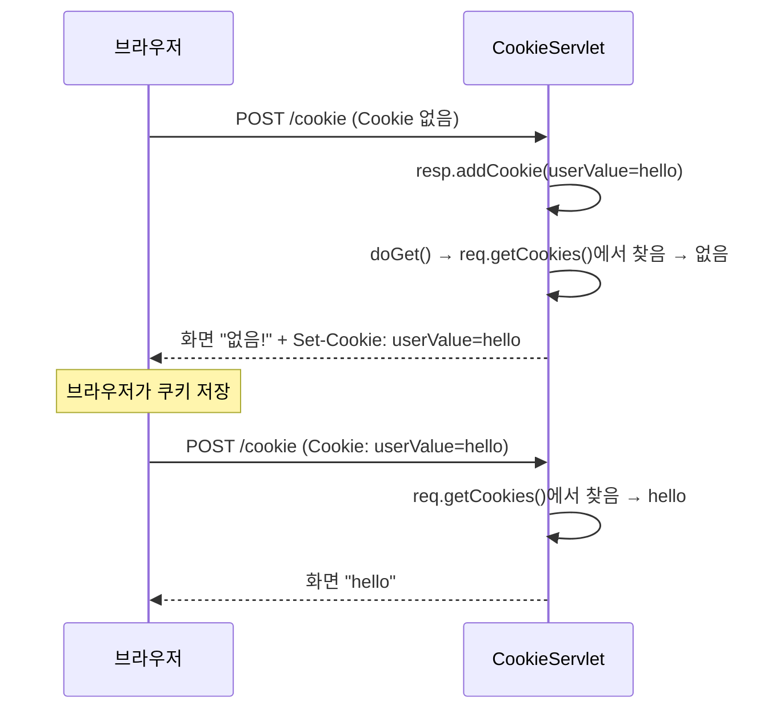
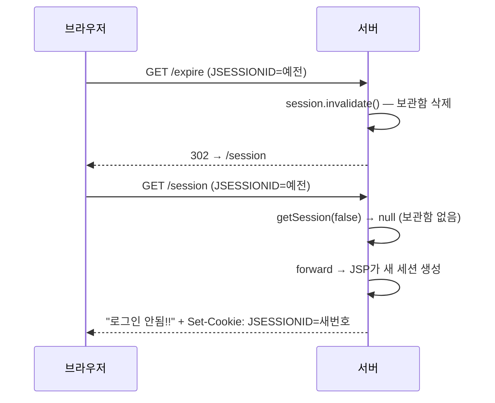
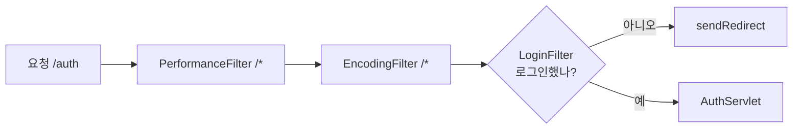

## 들어가며

서블릿 수업에서 쿠키와 세션을 배웠다. "쿠키는 브라우저에 저장되고, 세션은 서버에 저장된다. 그래서 쿠키가 보안에 더 취약하다"까지는 이해했다. 그런데 `doGet()`, `doPost()` 안에서 이게 실제로 **어떻게** 오가는지는 잘 그려지지 않았다.

그래서 수업 예제인 `CookieServlet`, `SessionServlet`, `ExpireServlet`을 실행하면서 브라우저 개발자 도구(F12)의 Network 탭과 Application 탭으로 하나씩 확인해 봤다. 이 글은 그 과정에서 틀렸던 생각과 바로잡은 내용을 순서대로 정리한 것이다.

## 흥미로운 지점: 첫 번째 제출은 왜 "없음!"일까

`CookieServlet`은 폼에서 받은 값을 쿠키로 저장하고, 저장된 쿠키를 화면에 보여주는 예제다.

```java
@WebServlet("/cookie")
public class CookieServlet extends HttpServlet {

    @Override
    protected void doPost(HttpServletRequest req, HttpServletResponse resp) throws ServletException, IOException {
        String cookieValue = req.getParameter("cookieValue");

        Cookie cookie = new Cookie("userValue", cookieValue);
        cookie.setMaxAge(60 * 60); // 만료 1시간

        resp.addCookie(cookie);

        doGet(req, resp);
    }

    @Override
    protected void doGet(HttpServletRequest req, HttpServletResponse resp) throws ServletException, IOException {
        resp.setContentType("text/html; charset=UTF-8");

        String savedValue = "없음!";

        Cookie[] cookies = req.getCookies();
        if (cookies != null) {
            for (Cookie cookie : cookies) {
                if ("userValue".equals(cookie.getName())) {
                    savedValue = cookie.getValue();
                    break;
                }
            }
        }

        req.setAttribute("savedValue", savedValue);
        req.getRequestDispatcher("/h_cookie_session/cookie-result.jsp").forward(req, resp);
    }
}
```

`doPost()`에서 쿠키를 넣고 바로 `doGet()`을 호출하니까 당연히 입력한 값이 보일 거라고 생각했다. 그런데 시크릿 창에서 `hello`를 처음 제출하면 화면에는 **`없음!`** 이 나왔고, 한 번 더 제출해야 `hello`가 나왔다.

## 확인: 요청 헤더와 응답 헤더를 나눠 보기

Network 탭에서 첫 번째 제출을 열어 봤다.

> 처음 확인할 때는 요청 헤더에 `userValue=this`가 들어 있어서 헷갈렸다. 그 전에 `this`를 넣어 본 쿠키가 1시간짜리라 남아 있었던 것이다. Application 탭에서 쿠키를 전부 지우고 다시 확인했다.

깨끗한 상태에서 본 결과는 이랬다.

| 제출 | 요청 헤더 `Cookie` | 응답 헤더 `Set-Cookie` | 화면 |
|------|-------------------|------------------------|------|
| 1번째 | `userValue` 없음 | `userValue=hello` | `없음!` |
| 2번째 | `userValue=hello` | `userValue=hello` | `hello` |

여기서 이유가 보였다. `resp.addCookie()`는 쿠키를 **응답**에 실어 브라우저로 보낸다. 그런데 바로 이어서 호출한 `doGet()`은 같은 `req`에서 쿠키를 찾는다. 그 `req`는 브라우저가 이미 보낸 요청이라 `hello`가 들어 있을 수 없다.



### 틀렸던 생각: savedValue가 값을 저장한다

처음에는 "첫 번째 요청에서 `hello`가 `savedValue`에 들어갔다가 두 번째에 나온 것"이라고 생각했다. 변수 이름에 `saved`가 붙어 있어서 그렇게 읽었다.

하지만 `savedValue`는 `doGet()` 안에서 선언한 **지역 변수**다. 요청이 올 때마다 `"없음!"`으로 새로 만들어지고, 응답이 끝나면 사라진다. 이름은 "저장되어 있던 값을 담는다"는 뜻이지, 이 변수가 값을 오래 저장한다는 뜻이 아니다. 실제로 값을 기억하고 있던 쪽은 **브라우저**였다.

이건 톰캣을 재시작해서 확인했다. 서버 메모리가 전부 초기화됐는데도 `/cookie`에 GET으로 접속하자 `hello`가 그대로 나왔다. 브라우저가 들고 있다가 요청에 다시 실어 보냈기 때문이다.

## 세션: 브라우저에는 번호표만 남는다

`SessionServlet`도 구조는 같다. `doPost()`에서 저장하고 `doGet()`에서 꺼낸다. 차이는 저장하는 곳이다.

| | 쿠키 | 세션 |
|---|---|---|
| 저장 | `resp.addCookie(cookie)` | `session.setAttribute("loggedInUser", userId)` |
| 읽기 | `req.getCookies()` | `session.getAttribute("loggedInUser")` |

로그인한 뒤 Application → Cookies를 열어 보니 아이디와 비밀번호는 없고 **`JSESSIONID`** 하나만 있었다. 값은 서버에 있고, 브라우저는 그 값을 찾는 데 쓰는 번호표만 들고 있는 것이다. 옷 보관소에 옷을 맡기고 번호표만 받는 것과 같다.

세션 코드에 `resp`가 보이지 않는 이유도 여기 있었다. `req.getSession(true)`로 세션을 만들면 톰캣이 `Set-Cookie: JSESSIONID=...`를 응답에 알아서 붙여준다. **세션도 결국 쿠키 하나로 동작한다.**

다음 요청이 오면 `req.getSession(false)`가 요청의 `JSESSIONID`를 읽어서 서버 메모리에서 그 번호의 세션을 찾는다. 찾으면 세션을, 못 찾으면 `null`을 돌려준다. (`true`를 넣으면 없을 때 새로 만든다.)

### 번호표만 지워 보기

로그인한 상태에서 `JSESSIONID`만 삭제하고 `/session`을 새로고침했더니 "로그인 안됨!!"이 나왔다. 서버에는 내 아이디가 아직 남아 있었지만, 번호표가 없으니 찾을 방법이 없었다.

## 시행착오: 한 번 더 새로고침하니 500 에러

그 상태에서 한 번 더 새로고침하자 **500 에러, `NullPointerException`** 이 났다. 원래 `doGet()`은 이랬다.

```java
HttpSession session = req.getSession(false);

String loggedInUser = null;
String pwd = null;

if (session != null) {
    loggedInUser = session.getAttribute("loggedInUser").toString();
    pwd = session.getAttribute("userPwd").toString();
}
```

이유는 두 가지가 겹쳤기 때문이다.

1. 첫 번째 새로고침에서 `session-result.jsp`로 forward했을 때, **JSP가 세션이 없으면 기본으로 하나를 새로 만든다.** Cookies 탭을 보니 `JSESSIONID`가 새 번호로 다시 생겨 있었다.
2. 그래서 두 번째 새로고침에서는 `session != null`을 통과했다. 하지만 새로 만든 세션은 비어 있어서 `getAttribute()`가 `null`을 돌려줬고, 그 `null`에 `.toString()`을 호출해서 터졌다.

처음에는 "`getAttribute()`가 에러를 냈다"고 생각했는데, 정확히는 `getAttribute()`는 `null`을 **정상적으로 반환**했고, 에러는 그 `null`에 메서드를 호출한 순간 났다.

### 해결

같은 파일의 `doPost()`에 이미 수업 때 적어 둔 주석이 있었다. null이 올 수 있는 값은 메서드로 변환하지 말고 캐스트 연산자를 쓰라는 내용이었다.

```java
if (session != null) {
    loggedInUser = (String) session.getAttribute("loggedInUser");
    pwd = (String) session.getAttribute("userPwd");
}
```

`(String)` 캐스트는 메서드 호출이 아니라서 `null`에 붙여도 그냥 `null`이 된다. 고친 뒤 같은 실험을 반복하자 두 번째 새로고침에서도 "로그인 안됨!!"이 나왔다.

다만 캐스트가 항상 더 안전한 건 아니다.

| | 값이 `null` | 값이 `String`이 아닌 타입 |
|---|---|---|
| `.toString()` | `NullPointerException` | 문자열로 변환됨 |
| `(String)` | `null` | `ClassCastException` |

여기서는 `doPost()`가 `req.getParameter()`로 받은 값을 넣는다. `getParameter()`는 항상 `String`(파라미터가 없으면 `null`)을 반환하므로 캐스트가 맞는 선택이다.

## 로그아웃과 만료: 번호표는 남는다

`ExpireServlet`은 `session.invalidate()`로 세션을 없애고 `/session`으로 리다이렉트한다. 로그아웃 전후로 `JSESSIONID` 값을 비교했더니 **값이 바뀌어 있었다.** 새 세션을 만드는 코드는 없는데 왜 바뀌었는지 Network 탭으로 확인했다.

| 요청 | 보낸 `JSESSIONID` | 새 `Set-Cookie`? |
|------|------------------|------------------|
| `/expire` | 예전 번호 | 없음 |
| `/session` | **여전히 예전 번호** | 있음 |



여기서 처음에는 "예전 번호표를 들고 왔으니 세션도 그대로 남아 있다"고 잘못 생각했다. 실제로는 반대였다. `invalidate()`는 서버의 보관함만 없애고, 브라우저의 번호표는 건드리지 않는다. 번호표가 남아 있어도 가리키는 보관함이 없으니 `getSession(false)`는 `null`이다. 새 번호는 리다이렉트가 아니라 마지막에 실행된 **JSP**가 만든 것이었다.

> 번호표가 남아 있다 ≠ 세션이 남아 있다

### 두 개의 "Session"

Application 탭의 Expires 칸을 보면 `userValue`에는 날짜가, `JSESSIONID`에는 `Session`이 적혀 있다. 처음에는 이 `Session`이 코드의 `setMaxInactiveInterval(30)`과 연결돼서 30초 뒤에 사라진다고 생각했다.

| | 관리하는 곳 | 사라지는 시점 |
|---|---|---|
| `setMaxInactiveInterval(30)` | 서버의 세션 | 30초 동안 요청이 없을 때 |
| Expires의 `Session` | 브라우저의 쿠키 | 브라우저를 닫을 때 |

로그인하고 30초 넘게 기다린 뒤 확인했더니, 새로고침 전에는 `JSESSIONID`가 그대로 있었다. 새로고침하자 "로그인 안됨!!"이 나오고 번호가 바뀌었다. 브라우저는 서버가 정한 30초를 모른다. 결과적으로 `invalidate()`와 시간 만료는 같은 상황을 만든다. 서버의 보관함만 사라지고, 브라우저에는 주인 없는 번호표가 남는다.

## 기존 생각과 연결: 쿠키가 더 위험하다?

처음에는 "쿠키는 브라우저에 있으니 위험하다"고만 생각했다. 실험을 마치고 나니 질문이 바뀌었다. **`userValue` 쿠키와 `JSESSIONID` 중 무엇을 도둑맞는 게 더 위험할까?**

답은 `JSESSIONID`였다. 번호표만 있으면 서버는 진짜 주인인지 구분하지 못한다. 아이디와 비밀번호를 몰라도 로그인한 상태가 된다. 이를 **세션 하이재킹**이라고 한다.

| | 약점 |
|---|---|
| 쿠키에 값을 직접 저장 | 사용자가 값을 보고 **고칠 수 있다** |
| 세션 | 값은 서버에 있어 고칠 수 없지만, **번호표를 훔치면** 그대로 뚫린다 |

그래서 세션 보안은 결국 번호표를 지키는 문제다. Application 탭에서 HttpOnly 칸을 보니 `JSESSIONID`에만 체크가 되어 있었고, Console에서 `document.cookie`를 입력하자 `userValue`만 보였다. 톰캣이 `JSESSIONID`에 HttpOnly를 기본으로 켜 두기 때문에, XSS로 심어진 스크립트가 실행되더라도 번호표를 읽어 갈 수 없다. HttpOnly는 자바스크립트만 막고, 브라우저가 요청 헤더에 쿠키를 실어 보내는 건 막지 않으므로 서버는 그대로 읽을 수 있다.

| 방어 수단 | 막는 것 |
|-----------|---------|
| `HttpOnly` | 자바스크립트(XSS)로 쿠키 읽기 |
| `Secure` | HTTPS가 아닌 연결로 쿠키 전송 |
| `req.changeSessionId()` | 로그인 직후 번호를 바꿔 세션 고정 공격 차단 |
| `session.invalidate()` | 로그아웃 후 서버 쪽 세션 제거 |

덧붙여, 수업 예제는 확인용으로 비밀번호까지 세션에 넣고 화면에 보여주지만 실제 서비스에서는 비밀번호를 세션에 넣지 않는다.

## 활용 방향: 같은 검사를 한 곳에 모으는 필터

NPE를 고치면서 배운 건 "`session != null`만으로는 로그인 여부를 알 수 없고, 안의 값까지 확인해야 한다"는 점이었다. 이 검사를 실제로 하고 있는 게 다음 수업에서 배운 `LoginFilter`다.

필터는 요청이 서블릿에 도착하기 전에 거치는 관문이다. 등록된 URL 패턴에 맞는 요청만 가로챈다.

```java
@WebFilter("/auth/*")
public class LoginFilter implements Filter {
    @Override
    public void doFilter(ServletRequest request, ServletResponse response, FilterChain chain) throws IOException, ServletException {
        HttpServletRequest req = (HttpServletRequest) request;
        HttpServletResponse resp = (HttpServletResponse) response;

        HttpSession session = req.getSession(false);

        if (session == null || session.getAttribute("loggedInUser") == null) {
            resp.sendRedirect("/h_cookie_session/cookie-result.jsp");
        } else {
            chain.doFilter(req, resp);
        }
    }
}
```

`chain.doFilter()`를 호출하면 다음 필터나 서블릿으로 넘어가고, 호출하지 않으면 거기서 멈춘다. 처음에는 이 필터를 거꾸로 읽어서 "세션이 있으면 리다이렉트해서 새 세션을 만든다"고 이해했다. 실제로는 **로그인하지 않은 사람을 돌려보내고**, 로그인한 사람만 서블릿으로 통과시키는 출입 통제다.



덕분에 `AuthServlet`은 `session`이 `null`인지 검사하지 않고 바로 `getAttribute()`를 쓴다. 필터가 앞에서 걸러 주기 때문이다.

필터를 쓰면 로그인 확인 코드를 서블릿마다 복사하지 않아도 된다. 로그인이 필요한 페이지가 10개로 늘어도 `/auth/` 아래에 두기만 하면 검사가 자동으로 붙는다. 하나를 빼먹어서 뚫릴 위험이 없고, 정책이 바뀌어도 필터 하나만 고치면 된다. 처음에는 이걸 "로그인 상태가 유지되는 장점"으로 착각했는데, 그건 세션의 역할이다.

| | 편해지는 쪽 | 하는 일 |
|---|---|---|
| 세션 | 사용자 | 로그인 상태를 **기억** |
| 필터 | 개발자 | 그 상태를 **검사**하는 코드를 한 곳에 모음 |

`PerformanceFilter`를 보면 필터는 서블릿에 가기 전뿐 아니라 돌아온 뒤에도 일할 수 있다. `chain.doFilter()` 앞에서 시작 시각을 재고, 뒤에서 종료 시각을 재서 서블릿 전체 실행 시간을 출력한다.

### 정리하다가 발견한 오타 두 개

- `web.xml`의 인코딩 필터 설정이 `charset=URF-8`로 되어 있었다. `UTF-8`로 고쳤다.
- `LoginFilter`의 리다이렉트 경로가 `/h_cookie_sesiion/...`으로 되어 있어서 실제 폴더 이름과 달랐다. `h_cookie_session`으로 고쳤다.

## 배운 점

- 쿠키는 `resp`로 보내고 **다음 요청의** `req`로 돌려받는다. 같은 요청 안에서는 방금 넣은 쿠키를 읽을 수 없다.
- 변수가 얼마나 오래 사는지는 이름이 아니라 **선언한 위치**가 정한다.
- 세션은 값을 서버에 두고 `JSESSIONID`라는 번호표만 브라우저에 준다. 번호표가 남아 있어도 서버의 세션이 없을 수 있다.
- JSP는 기본으로 세션을 만든다. 그래서 `session != null`만으로는 로그인 여부를 판단할 수 없다.
- 필터는 이런 공통 검사를 한 곳에 모아서, 서블릿이 자기 일만 하게 해 준다.

## 더 알아볼 것

- **JSP `page` 지시어의 `session="false"`**: JSP가 세션을 자동으로 만들지 않게 하는 설정. 이번에 만난 NPE와 로그아웃 후 새 번호표 문제의 원인을 직접 끌 수 있다.
- **`request.setCharacterEncoding("UTF-8")`**: 지금 인코딩 필터는 응답 인코딩만 정한다. POST로 보낸 한글이 서버에서 깨지는 건 요청 쪽 설정이 따로 필요하다.
- **세션 고정 공격과 `changeSessionId()`**: 로그인 직후 번호를 바꾸는 게 왜 필요한지 공격 시나리오와 함께 정리해 볼 만하다.
- **필터 실행 순서**: 어노테이션으로 등록한 필터끼리는 순서가 보장되지 않는다. 순서가 중요할 때 `web.xml`의 `<filter-mapping>`으로 정하는 방법.
- **스프링의 인터셉터와 스프링 시큐리티**: 필터와 같은 원리로 동작하는 다음 단계 도구.

## 참고 자료

- [Jakarta Servlet 6.0 API - Cookie](https://jakarta.ee/specifications/servlet/6.0/apidocs/jakarta.servlet/jakarta/servlet/http/Cookie.html)
- [Jakarta Servlet 6.0 API - HttpSession](https://jakarta.ee/specifications/servlet/6.0/apidocs/jakarta.servlet/jakarta/servlet/http/HttpSession.html)
- [Jakarta Servlet 6.0 API - Filter](https://jakarta.ee/specifications/servlet/6.0/apidocs/jakarta.servlet/jakarta/servlet/Filter.html)
- [Jakarta Servlet 6.0 Specification](https://jakarta.ee/specifications/servlet/6.0/jakarta-servlet-spec-6.0.html)
- [Jakarta Server Pages 3.1 Specification](https://jakarta.ee/specifications/pages/3.1/jakarta-server-pages-spec-3.1.html)
- [MDN - Using HTTP cookies](https://developer.mozilla.org/en-US/docs/Web/HTTP/Guides/Cookies)
- [OWASP - Session Management Cheat Sheet](https://cheatsheetseries.owasp.org/cheatsheets/Session_Management_Cheat_Sheet.html)
