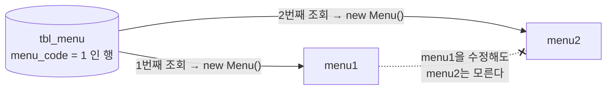
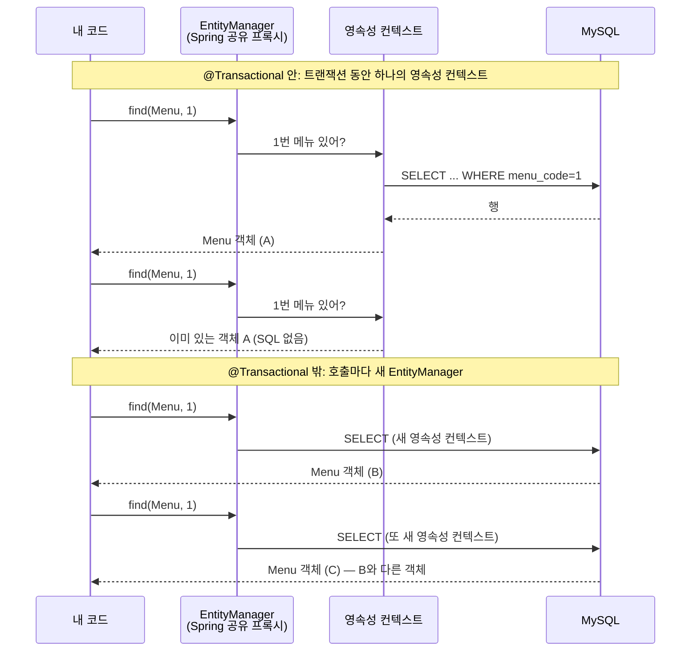

## 들어가며

JPA 단원의 첫 섹션은 JPA 코드가 한 줄도 없었다. 대신 **JPA가 없을 때 무엇이 불편한지**를 JDBC로 직접 짜 보는 것부터 시작했다.

예제는 지난번 JDBC 수업과 같은 메뉴(`tbl_menu`)와 카테고리(`tbl_category`)다. 바뀐 건 실행 환경이다. 이번에는 Spring Boot가 `application.yaml`의 접속 정보를 읽어서 `DataSource`(커넥션 풀)를 Bean으로 만들어 주고, 나는 거기서 `Connection`을 꺼내 쓰기만 한다.

```java
@Component
public class JdbcProblem {

    private final DataSource dataSource;

    public JdbcProblem(DataSource dataSource) {
        this.dataSource = dataSource;
    }
    // ...
}
```

커넥션을 직접 열고 닫는 `DriverManager` 코드가 사라져서 처음엔 "이 정도면 JDBC도 꽤 편한데?" 싶었다. 그런데 메서드를 네 개 짜고 나니 생각이 바뀌었다. **커넥션 관리만 Spring이 맡았을 뿐, 그 뒤의 일은 전부 여전히 내 몫**이었다.

## 1. 조회할 때마다 같은 코드를 다시 쓴다

첫 번째는 메뉴 전체 조회다.

```java
public void findAllMenu() {

    String query = "SELECT menu_code, menu_name, menu_price, category_code, orderable_status FROM tbl_menu";

    List<Menu> menuList = new ArrayList<>();

    try (Connection con = dataSource.getConnection();
         Statement stmt = con.createStatement();
         ResultSet rset = stmt.executeQuery(query)) {

        while (rset.next()) {
            Menu menu = new Menu();
            menu.setMenuCode(rset.getInt("menu_code"));
            menu.setMenuName(rset.getString("menu_name"));
            menu.setMenuPrice(rset.getInt("menu_price"));
            menu.setCategoryCode(rset.getInt("category_code"));
            menu.setOrderableStatus(rset.getString("orderable_status"));

            menuList.add(menu);
        }

    } catch (SQLException e) {
        throw new RuntimeException(e);
    }
}
```

`try-with-resources` 덕분에 `close()`를 직접 부르지 않아도 되지만, 구조 자체는 매번 똑같다.

| 단계 | 매 조회마다 반복되는 코드 |
|------|--------------------------|
| 자원 획득 | `getConnection()` → `createStatement()` / `prepareStatement()` |
| 실행 | `executeQuery()` |
| 매핑 | `rset.getXxx("컬럼명")` → `setXxx()`를 컬럼 수만큼 |
| 예외 처리 | `SQLException`을 잡아서 다시 던지기 |

이 클래스 안에서만 조회 메서드가 네 개인데, 실제로 서로 다른 건 SQL 문자열과 매핑 대상 클래스뿐이다.

매핑도 생각보다 손이 많이 간다. 카테고리를 조회할 때 이런 줄이 있었다.

```java
// ref_category_code 는 null 이 허용되기 때문에 getObject 로 꺼내야 한다.
category.setRefCategoryCode(rset.getObject("ref_category_code", Integer.class));
```

`ResultSet.getInt()`는 컬럼 값이 SQL `NULL`이면 `0`을 돌려준다. 그래서 "상위 카테고리 없음"과 "상위 카테고리 번호가 0"을 구분하려면 필드를 `Integer`로 두고 `getObject(..., Integer.class)`로 꺼내야 한다. 컬럼 하나하나의 NULL 허용 여부까지 개발자가 기억하고 코드에 옮겨야 한다는 뜻이다.

## 2. 요구사항이 바뀌면 SQL부터 객체까지 줄줄이 바뀐다

두 번째 예제는 요구사항 변경이다.

> 메뉴 목록을 조회할 때 카테고리 **이름**도 같이 보여주세요.

화면에 글자 하나 늘어나는 요청인데, 코드에서는 이렇게 번졌다.


새로 만든 `MenuCategoryDTO`는 `Menu`와 거의 같고, `categoryCode` 자리에 `categoryName`이 들어간 것만 다르다.

```java
public class MenuCategoryDTO {
    private int menuCode;
    private String menuName;
    private int menuPrice;
    private String categoryName;   // Menu 에서는 int categoryCode 였던 자리
    private String orderableStatus;
}
```

여기서 순서를 보면 **SQL이 먼저 정해지고, 객체는 SQL 결과 모양에 맞춰 뒤따라 만들어진다.** 조회 결과의 모양이 바뀔 때마다 이런 클래스가 하나씩 늘어날 것이다. 수업에서는 이걸 "객체 중심이 아니라 SQL(테이블) 중심으로 개발하게 된다"고 표현했다.

## 3. 테이블은 값으로, 객체는 참조로 관계를 맺는다

세 번째 예제에서 지난번에 쓴 글이 떠올랐다.

[지난 글]({{ site.baseurl }}/posts/java-dto-foreign-key-as-object/)에서는 DTO의 FK를 `int` 대신 `CategoryDTO` 객체로 들고 있으면 어떻게 되는지 고민했다. 결론은 "쓰는 쪽은 편해지지만, 그 객체를 채우는 DAO의 책임이 늘어난다"였다. 이번 수업에서는 그 고민에 **패러다임 불일치**라는 이름이 붙었다.

| 관점 | 1:N 관계를 표현하는 방법 | 메뉴의 카테고리를 얻는 방법 |
|------|--------------------------|----------------------------|
| 테이블 | `tbl_menu.category_code`라는 **값**(FK) | `JOIN` 또는 한 번 더 `SELECT` |
| 객체 | `Menu`가 `Category`를 **필드로 참조** | `menu.getCategory()` |

이번 예제의 `Menu`는 테이블에 맞춰 만들었기 때문에 `int categoryCode`만 가지고 있다. 그래서 카테고리가 필요하면 이렇게 해야 했다.

```java
public void findMenuAndCategory(int menuCode) {

    Menu menu = findMenuByMenuCode(menuCode);

    // menu.getCategory() 처럼 객체를 탐색할 수 없다.
    // categoryCode 값으로 카테고리를 다시 조회해야 한다.
    Category category = findCategoryByCategoryCode(menu.getCategoryCode());
}
```

지난 글과 이번 예제를 나란히 놓으면 선택지는 결국 둘 중 하나다.

- **FK를 `int`로 둔다** → 객체 그래프를 따라갈 수 없고, 필요할 때마다 조회를 한 번 더 한다. (이번 예제)
- **FK를 객체로 둔다** → `getCategory()`는 되지만, 그 객체를 언제 어떻게 채울지는 DAO가 직접 정해야 한다. (지난 글)

어느 쪽이든 **테이블의 관계를 객체의 관계로 번역하는 일**을 누군가 해야 하고, JDBC에서는 그게 개발자다.

## 4. 같은 행을 두 번 꺼내면 다른 객체가 된다

수업에서 "중요!!"라고 표시된 부분이다.

```java
Menu menu1 = findMenuByMenuCode(menuCode);
Menu menu2 = findMenuByMenuCode(menuCode);

System.out.println("menu1 == menu2 : " + (menu1 == menu2));   // false

menu1.setMenuName("이름 변경 테스트");

System.out.println("menu1.getMenuName() = " + menu1.getMenuName());   // 이름 변경 테스트
System.out.println("menu2.getMenuName() = " + menu2.getMenuName());   // 원래 이름 그대로
```

DB에서는 분명히 **같은 행**인데 Java에서는 **서로 다른 두 객체**다. `findMenuByMenuCode()` 안에서 조회할 때마다 `new Menu()`를 하니 당연한 결과다.



`menu1`을 고쳐도 `menu2`는 알 수 없다. 한 요청 안에서 여러 메서드가 같은 메뉴를 각자 조회해서 들고 있으면, 어느 객체가 최신 상태인지 코드만 보고는 판단하기 어려워진다.

참고로 `Menu`에는 Lombok `@ToString`, `@Getter`, `@Setter`만 붙어 있고 `@EqualsAndHashCode`는 없다. 그래서 `equals()`와 `hashCode()`도 `Object`의 기본 구현을 쓰고, 예제에서 찍은 두 `hashCode()` 값도 서로 다르게 나온다.

## 네 문제를 한 줄로 묶어 보면

정리하다 보니 네 문제가 따로 노는 게 아니었다.

| 문제 | 겉으로 보이는 증상 | 결국 개발자가 직접 하고 있던 일 |
|------|-------------------|--------------------------------|
| 1. 코드 반복 | 같은 JDBC 코드가 계속 나온다 | SQL 실행과 `ResultSet` → 객체 변환 |
| 2. SQL 의존 | 요구사항 하나에 SQL·DTO·매핑이 같이 바뀐다 | 조회 결과 모양마다 객체 설계 |
| 3. 패러다임 불일치 | `menu.getCategory()`가 안 된다 | 값(FK)을 참조(객체)로 번역 |
| 4. 동일성 | 같은 행인데 `==`가 `false` | 행 하나당 객체를 몇 개 만들지 관리 |

오른쪽 열을 보면 전부 **"DB 행을 Java 객체로 만드는 일을 개발자가 직접, 매번 하고 있다"**는 데서 나온다. 특히 4번은 `new`를 누가 언제 하느냐의 문제 그 자체다.

그래서 다음 섹션에서 배울 JPA에게 기대하게 되는 것도 이 표를 뒤집은 모양이 된다.

- 매핑 정보를 한 번 선언해 두면 `ResultSet` 변환은 알아서 해 줄 것
- 객체를 기준으로 코드를 짜면 필요한 SQL은 만들어 줄 것
- 연관된 객체를 필드로 두면 FK와 객체 참조 사이의 번역을 맡아 줄 것
- 같은 행은 같은 객체로 돌려줄 것

## JPA로 바꿔서 직접 확인해 보기

바로 다음 섹션이 같은 예제를 JPA로 다시 짜는 내용이라, 위 기대가 실제로 맞는지 돌려 봤다.

### 엔티티 하나로 매핑 선언하기

JDBC 버전의 `Menu`는 테이블 컬럼을 그대로 옮긴 클래스였다. JPA 버전은 컬럼 매핑을 어노테이션으로 선언하고, FK 자리에 `int` 대신 **`Category` 객체**를 둔다.

```java
@Entity
@Table(name = "tbl_menu")
@NoArgsConstructor
@AllArgsConstructor
@Getter
@ToString
public class Menu {

    @Id
    @Column(name = "menu_code")
    private int menuCode;

    @Column(name = "menu_name")
    private String menuName;

    @Column(name = "menu_price")
    private int menuPrice;

    @ManyToOne
    @JoinColumn(name = "category_code")   // tbl_menu.category_code (FK)
    private Category category;            // JDBC 버전에서는 int categoryCode 였던 자리

    @Column(name = "orderable_status")
    private String orderableStatus;
}
```

`Category`도 같은 방식으로 `@Entity`를 붙이고, NULL이 허용되는 `ref_category_code`는 JDBC 때처럼 `Integer`로 뒀다.

| | JDBC 버전 `Menu` | JPA 버전 `Menu` |
|---|---|---|
| 컬럼 ↔ 필드 연결 | `rset.getXxx()` → `setXxx()`를 조회 메서드마다 작성 | `@Column`으로 한 번 선언 |
| FK 표현 | `int categoryCode` (값) | `Category category` (참조) |
| Setter | `@Setter`로 모든 필드 공개 | 없음. 이름 변경은 `changeMenuName()` 메서드로만 |

### 1~3번: `find()` 한 줄이 SQL과 매핑을 대신한다

조회 코드는 이게 전부다.

```java
@PersistenceContext
private EntityManager manager;

public void findMenuAndCategory(int menuCode) {
    Menu foundMenu = manager.find(Menu.class, menuCode);
    System.out.println("foundMenu = " + foundMenu);
}
```

`show-sql`, `format_sql`을 켜 두고 1번 메뉴를 조회하니 Hibernate가 이런 SQL을 만들었다.

```sql
select
    m1_0.menu_code,
    c1_0.category_code,
    c1_0.category_name,
    c1_0.ref_category_code,
    m1_0.menu_name,
    m1_0.menu_price,
    m1_0.orderable_status
from
    tbl_menu m1_0
left join
    tbl_category c1_0
        on c1_0.category_code=m1_0.category_code
where
    m1_0.menu_code=?
```

```text
foundMenu = Menu(menuCode=1, menuName=열무김치라떼, menuPrice=4500, category=Category(categoryCode=8, categoryName=커피, refCategoryCode=2), orderableStatus=Y)
```

세 가지가 한꺼번에 보였다.

- **1번(반복 코드)**: `Connection`, `PreparedStatement`, `ResultSet`, `getXxx()`/`setXxx()`가 내 코드에서 전부 사라졌다.
- **2번(SQL 의존)**: JOIN SQL을 내가 쓰지 않았다. `Menu`가 `Category`를 필드로 가지고 있다는 사실만 보고 Hibernate가 `tbl_category`를 JOIN 했다. `MenuCategoryDTO` 같은 결과 전용 클래스도 필요 없었다.
- **3번(패러다임 불일치)**: 결과의 `category=Category(...)` 부분처럼 메뉴 안에 카테고리 객체가 채워져 있다. `foundMenu.getCategory().getCategoryName()`으로 바로 따라갈 수 있다.

한 가지 짚고 갈 점이 있다. 카테고리가 필요 없는 1번 메뉴 조회(`findMenu`)에서도 **똑같이 JOIN SQL이 나갔다.** JPA 명세에서 `@ManyToOne`의 기본 fetch 전략이 `EAGER`(즉시 로딩)이기 때문이다. 지난 글에서 고민한 "그 객체를 언제 채울 것인가"를 JPA는 기본값으로 "**항상 같이**"라고 답하고 있는 셈이다. 그리고 JOIN 종류가 `inner join`이 아니라 `left join`인 건 `@ManyToOne`의 `optional` 기본값이 `true`라서, 카테고리가 없는 메뉴도 결과에서 빠지지 않게 하려는 것으로 보인다.

### 4번: 같은 행은 정말 같은 객체가 될까

동일성 예제는 메서드에 `@Transactional(readOnly = true)`가 붙어 있다.

```java
@Transactional(readOnly = true)
public void compareSameMenu(int menuCode) {

    System.out.println("======= 1번째 조회 =======");
    Menu menu1 = manager.find(Menu.class, menuCode);
    System.out.println("======= 2번째 조회 =======");
    Menu menu2 = manager.find(Menu.class, menuCode);

    System.out.println("menu1 == menu2 : " + (menu1 == menu2));

    menu1.changeMenuName("테스트!");

    System.out.println("menu1 = " + menu1.getMenuName());
    System.out.println("menu2 = " + menu2.getMenuName());
}
```

실행 결과 (SQL 본문은 위와 같아서 줄였다):

```text
======= 1번째 조회 =======
Hibernate:
    select ... from tbl_menu m1_0 left join tbl_category c1_0 ... where m1_0.menu_code=?
======= 2번째 조회 =======
menu1.hashCode() = 1266421561
menu2.hashCode() = 1266421561
menu1 == menu2 : true
menu1의 이름 변경 후!
menu1 = 테스트!
menu2 = 테스트!
```

기대대로 `true`다. 그런데 결과보다 더 눈에 띈 건 **"2번째 조회" 아래에 SQL이 없다**는 점이었다. 두 번째 `find()`는 DB에 가지도 않고, 첫 번째 조회 때 영속성 컨텍스트에 올려 둔 그 객체를 그대로 돌려줬다. 같은 객체이니 `menu1`의 이름을 바꾸면 `menu2`에서도 바뀐 이름이 보인다. JDBC 때 "menu1을 수정해도 menu2는 모른다"던 문제가 애초에 생길 수 없는 구조가 된 것이다.

### 트랜잭션을 빼면 다시 `false`가 된다

여기서 궁금해졌다. 1번 메뉴(`findMenu`)를 연달아 두 번 실행했을 때는 **매번 SQL이 새로 나갔다.** 그 메서드엔 `@Transactional`이 없다.

그래서 원본 코드는 건드리지 않고, 따로 작은 확인용 클래스를 만들어 **트랜잭션 없이** `find()`를 두 번 불러 봤다. (아래는 확인용으로 따로 작성한 코드다.)

```java
// 확인용 코드 — @Transactional 없음
Menu a = em.find(Menu.class, 1);
Menu b = em.find(Menu.class, 1);
System.out.println("a == b : " + (a == b));
```

```text
Hibernate: select m1_0.menu_code, ... where m1_0.menu_code=?
Hibernate: select m1_0.menu_code, ... where m1_0.menu_code=?
a == b : false
```

SQL이 두 번 나가고 결과도 `false`. JDBC 때와 똑같다.

이유는 `@PersistenceContext`로 주입받은 `EntityManager`가 진짜 `EntityManager`가 아니라 Spring이 만든 **공유 프록시**라는 데 있다. Spring 문서(`SharedEntityManagerCreator`)에 따르면 이 프록시는 현재 트랜잭션에 묶인 `EntityManager`가 있으면 거기로 호출을 넘기고, **없으면 호출할 때마다 새 `EntityManager`를 만든다.** 영속성 컨텍스트도 매번 새로 생기니, 같은 객체를 돌려줄 근거가 없어지는 것이다.



정리하면 JPA가 보장하는 건 "같은 행이면 항상 같은 객체"가 아니라 **"같은 영속성 컨텍스트 안에서는 같은 객체"**다. Spring에서는 그 범위가 보통 트랜잭션과 같아서, `@Transactional`이 그 경계선 역할을 한다.

### `readOnly = true`라서 DB는 그대로였다

`menu1.changeMenuName("테스트!")`로 이름을 바꿨는데, 이 조회 뒤에 확인용 코드로 1번 메뉴를 다시 읽어 보니 DB의 이름은 여전히 `열무김치라떼`였다. `update` SQL도 로그에 없었다.

Spring은 Hibernate를 쓸 때 `readOnly = true` 트랜잭션에서 flush를 하지 않도록 설정한다. 그래서 객체만 바뀌고 DB에는 반영되지 않았다. 거꾸로 말하면, `readOnly`가 아니었다면 `UPDATE` 문을 따로 쓰지 않았는데도 이 변경이 커밋 시점에 DB로 나갔을 수 있다는 뜻이다. 이건 다음 단원(영속성 컨텍스트)에서 직접 확인해 볼 생각이다.

### JDBC와 JPA 결과를 나란히 놓으면

| 문제 | JDBC 결과 | JPA 결과 |
|------|-----------|----------|
| 1. 코드 반복 | 조회마다 자원 획득·매핑 코드 작성 | `manager.find()` 한 줄 |
| 2. SQL 의존 | JOIN SQL + `MenuCategoryDTO` + 매핑 코드 추가 | 엔티티 연관관계만 보고 JOIN SQL 생성 |
| 3. 패러다임 불일치 | 카테고리 조회 SQL을 한 번 더 실행 | `menu.getCategory()`로 탐색 (기본은 즉시 로딩) |
| 4. 동일성 | `menu1 == menu2` → `false`, SQL 2번 | 트랜잭션 안: `true`, SQL 1번 / 트랜잭션 밖: `false`, SQL 2번 |

4번 행의 "트랜잭션 밖" 칸이 이번 보충에서 가장 크게 배운 부분이다. JPA를 쓴다고 자동으로 해결되는 게 아니라, **영속성 컨텍스트의 범위 안에서만** 해결된다.

## 더 알아보고 싶은 것

- **영속성 컨텍스트(Persistence Context)와 1차 캐시** — 두 번째 `find()`에서 SQL이 안 나간 이유다. 트랜잭션 범위와 영속성 컨텍스트 범위가 어떻게 묶이는지(트랜잭션 범위 vs 확장 영속성 컨텍스트)까지 이어서 보고 싶다.
- **변경 감지(Dirty Checking)와 flush** — `readOnly`를 빼면 `changeMenuName()`만으로 `UPDATE`가 나가는지. `UPDATE` SQL을 직접 안 쓰는 대신 "언제 DB에 반영되는지"를 알아야 한다.
- **즉시 로딩(EAGER) vs 지연 로딩(LAZY)과 프록시** — 카테고리가 필요 없는 조회에서도 JOIN이 나간 이유다. `@ManyToOne(fetch = FetchType.LAZY)`로 바꾸면 SQL과 `getCategory()`의 동작이 어떻게 달라지는지 확인해 보고 싶다.
- **N+1 문제** — 메뉴 목록을 JPQL로 조회할 때 연관된 카테고리 조회가 메뉴 개수만큼 반복될 수 있다. JPA가 번역을 맡아 준다고 SQL 비용까지 사라지는 건 아니다.
- **Spring의 `JdbcTemplate`과 `RowMapper`** — 1번 반복 문제만 놓고 보면 JPA 말고도 해결책이 있다. JPA와 무엇이 다른지 비교해 보면 JPA가 해결하는 범위가 더 선명해질 것 같다.

## 참고 자료

- [Oracle Java Tutorials - Processing SQL Statements with JDBC](https://docs.oracle.com/javase/tutorial/jdbc/basics/processingsqlstatements.html)
- [Oracle Java Tutorials - The try-with-resources Statement](https://docs.oracle.com/javase/tutorial/essential/exceptions/tryResourceClose.html)
- [Java SE 21 API - ResultSet](https://docs.oracle.com/en/java/javase/21/docs/api/java.sql/java/sql/ResultSet.html)
- [Spring Boot Reference - SQL Databases](https://docs.spring.io/spring-boot/reference/data/sql.html)
- [Jakarta Persistence Specification](https://jakarta.ee/specifications/persistence/)
- [Spring Framework Reference - JPA](https://docs.spring.io/spring-framework/reference/data-access/orm/jpa.html)
- [Spring Framework API - SharedEntityManagerCreator](https://docs.spring.io/spring-framework/docs/current/javadoc-api/org/springframework/orm/jpa/SharedEntityManagerCreator.html)
- [Spring Framework Reference - Using @Transactional](https://docs.spring.io/spring-framework/reference/data-access/transaction/declarative/annotations.html)
- [Hibernate ORM User Guide - Fetching](https://docs.jboss.org/hibernate/orm/current/userguide/html_single/Hibernate_User_Guide.html#fetching)
