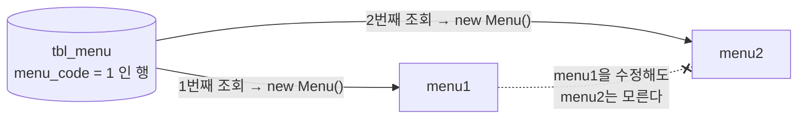

## 들어가며

JPA 단원의 첫 섹션은 JPA 코드가 한 줄도 없었다. 대신 **JPA가 없을 때 무엇이 불편한지**를 JDBC로 직접 짜 보는 것부터 시작했다.

예제는 지난번 JDBC 수업과 같은 메뉴(`tbl_menu`)와 카테고리(`tbl_category`)다. 바뀐 건 실행 환경이다. 이번에는 Spring Boot가 `application.yaml`의 접속 정보를 읽어서 `DataSource`(커넥션 풀)를 Bean으로 만들어 주고, 나는 거기서 `Connection`을 꺼내 쓰기만 한다.

```java
@Component
public class JdbcProblem {

    private final DataSource dataSource;

    public JdbcProblem(DataSource dataSource) {
        this.dataSource = dataSource;
    }
    // ...
}
```

커넥션을 직접 열고 닫는 `DriverManager` 코드가 사라져서 처음엔 "이 정도면 JDBC도 꽤 편한데?" 싶었다. 그런데 메서드를 네 개 짜고 나니 생각이 바뀌었다. **커넥션 관리만 Spring이 맡았을 뿐, 그 뒤의 일은 전부 여전히 내 몫**이었다.

## 1. 조회할 때마다 같은 코드를 다시 쓴다

첫 번째는 메뉴 전체 조회다.

```java
public void findAllMenu() {

    String query = "SELECT menu_code, menu_name, menu_price, category_code, orderable_status FROM tbl_menu";

    List<Menu> menuList = new ArrayList<>();

    try (Connection con = dataSource.getConnection();
         Statement stmt = con.createStatement();
         ResultSet rset = stmt.executeQuery(query)) {

        while (rset.next()) {
            Menu menu = new Menu();
            menu.setMenuCode(rset.getInt("menu_code"));
            menu.setMenuName(rset.getString("menu_name"));
            menu.setMenuPrice(rset.getInt("menu_price"));
            menu.setCategoryCode(rset.getInt("category_code"));
            menu.setOrderableStatus(rset.getString("orderable_status"));

            menuList.add(menu);
        }

    } catch (SQLException e) {
        throw new RuntimeException(e);
    }
}
```

`try-with-resources` 덕분에 `close()`를 직접 부르지 않아도 되지만, 구조 자체는 매번 똑같다.

| 단계 | 매 조회마다 반복되는 코드 |
|------|--------------------------|
| 자원 획득 | `getConnection()` → `createStatement()` / `prepareStatement()` |
| 실행 | `executeQuery()` |
| 매핑 | `rset.getXxx("컬럼명")` → `setXxx()`를 컬럼 수만큼 |
| 예외 처리 | `SQLException`을 잡아서 다시 던지기 |

이 클래스 안에서만 조회 메서드가 네 개인데, 실제로 서로 다른 건 SQL 문자열과 매핑 대상 클래스뿐이다.

매핑도 생각보다 손이 많이 간다. 카테고리를 조회할 때 이런 줄이 있었다.

```java
// ref_category_code 는 null 이 허용되기 때문에 getObject 로 꺼내야 한다.
category.setRefCategoryCode(rset.getObject("ref_category_code", Integer.class));
```

`ResultSet.getInt()`는 컬럼 값이 SQL `NULL`이면 `0`을 돌려준다. 그래서 "상위 카테고리 없음"과 "상위 카테고리 번호가 0"을 구분하려면 필드를 `Integer`로 두고 `getObject(..., Integer.class)`로 꺼내야 한다. 컬럼 하나하나의 NULL 허용 여부까지 개발자가 기억하고 코드에 옮겨야 한다는 뜻이다.

## 2. 요구사항이 바뀌면 SQL부터 객체까지 줄줄이 바뀐다

두 번째 예제는 요구사항 변경이다.

> 메뉴 목록을 조회할 때 카테고리 **이름**도 같이 보여주세요.

화면에 글자 하나 늘어나는 요청인데, 코드에서는 이렇게 번졌다.


새로 만든 `MenuCategoryDTO`는 `Menu`와 거의 같고, `categoryCode` 자리에 `categoryName`이 들어간 것만 다르다.

```java
public class MenuCategoryDTO {
    private int menuCode;
    private String menuName;
    private int menuPrice;
    private String categoryName;   // Menu 에서는 int categoryCode 였던 자리
    private String orderableStatus;
}
```

여기서 순서를 보면 **SQL이 먼저 정해지고, 객체는 SQL 결과 모양에 맞춰 뒤따라 만들어진다.** 조회 결과의 모양이 바뀔 때마다 이런 클래스가 하나씩 늘어날 것이다. 수업에서는 이걸 "객체 중심이 아니라 SQL(테이블) 중심으로 개발하게 된다"고 표현했다.

## 3. 테이블은 값으로, 객체는 참조로 관계를 맺는다

세 번째 예제에서 지난번에 쓴 글이 떠올랐다.

[지난 글]({{ site.baseurl }}/posts/java-dto-foreign-key-as-object/)에서는 DTO의 FK를 `int` 대신 `CategoryDTO` 객체로 들고 있으면 어떻게 되는지 고민했다. 결론은 "쓰는 쪽은 편해지지만, 그 객체를 채우는 DAO의 책임이 늘어난다"였다. 이번 수업에서는 그 고민에 **패러다임 불일치**라는 이름이 붙었다.

| 관점 | 1:N 관계를 표현하는 방법 | 메뉴의 카테고리를 얻는 방법 |
|------|--------------------------|----------------------------|
| 테이블 | `tbl_menu.category_code`라는 **값**(FK) | `JOIN` 또는 한 번 더 `SELECT` |
| 객체 | `Menu`가 `Category`를 **필드로 참조** | `menu.getCategory()` |

이번 예제의 `Menu`는 테이블에 맞춰 만들었기 때문에 `int categoryCode`만 가지고 있다. 그래서 카테고리가 필요하면 이렇게 해야 했다.

```java
public void findMenuAndCategory(int menuCode) {

    Menu menu = findMenuByMenuCode(menuCode);

    // menu.getCategory() 처럼 객체를 탐색할 수 없다.
    // categoryCode 값으로 카테고리를 다시 조회해야 한다.
    Category category = findCategoryByCategoryCode(menu.getCategoryCode());
}
```

지난 글과 이번 예제를 나란히 놓으면 선택지는 결국 둘 중 하나다.

- **FK를 `int`로 둔다** → 객체 그래프를 따라갈 수 없고, 필요할 때마다 조회를 한 번 더 한다. (이번 예제)
- **FK를 객체로 둔다** → `getCategory()`는 되지만, 그 객체를 언제 어떻게 채울지는 DAO가 직접 정해야 한다. (지난 글)

어느 쪽이든 **테이블의 관계를 객체의 관계로 번역하는 일**을 누군가 해야 하고, JDBC에서는 그게 개발자다.

## 4. 같은 행을 두 번 꺼내면 다른 객체가 된다

수업에서 "중요!!"라고 표시된 부분이다.

```java
Menu menu1 = findMenuByMenuCode(menuCode);
Menu menu2 = findMenuByMenuCode(menuCode);

System.out.println("menu1 == menu2 : " + (menu1 == menu2));   // false

menu1.setMenuName("이름 변경 테스트");

System.out.println("menu1.getMenuName() = " + menu1.getMenuName());   // 이름 변경 테스트
System.out.println("menu2.getMenuName() = " + menu2.getMenuName());   // 원래 이름 그대로
```

DB에서는 분명히 **같은 행**인데 Java에서는 **서로 다른 두 객체**다. `findMenuByMenuCode()` 안에서 조회할 때마다 `new Menu()`를 하니 당연한 결과다.



`menu1`을 고쳐도 `menu2`는 알 수 없다. 한 요청 안에서 여러 메서드가 같은 메뉴를 각자 조회해서 들고 있으면, 어느 객체가 최신 상태인지 코드만 보고는 판단하기 어려워진다.

참고로 `Menu`에는 Lombok `@ToString`, `@Getter`, `@Setter`만 붙어 있고 `@EqualsAndHashCode`는 없다. 그래서 `equals()`와 `hashCode()`도 `Object`의 기본 구현을 쓰고, 예제에서 찍은 두 `hashCode()` 값도 서로 다르게 나온다.

## 네 문제를 한 줄로 묶어 보면

정리하다 보니 네 문제가 따로 노는 게 아니었다.

| 문제 | 겉으로 보이는 증상 | 결국 개발자가 직접 하고 있던 일 |
|------|-------------------|--------------------------------|
| 1. 코드 반복 | 같은 JDBC 코드가 계속 나온다 | SQL 실행과 `ResultSet` → 객체 변환 |
| 2. SQL 의존 | 요구사항 하나에 SQL·DTO·매핑이 같이 바뀐다 | 조회 결과 모양마다 객체 설계 |
| 3. 패러다임 불일치 | `menu.getCategory()`가 안 된다 | 값(FK)을 참조(객체)로 번역 |
| 4. 동일성 | 같은 행인데 `==`가 `false` | 행 하나당 객체를 몇 개 만들지 관리 |

오른쪽 열을 보면 전부 **"DB 행을 Java 객체로 만드는 일을 개발자가 직접, 매번 하고 있다"**는 데서 나온다. 특히 4번은 `new`를 누가 언제 하느냐의 문제 그 자체다.

그래서 다음 섹션에서 배울 JPA에게 기대하게 되는 것도 이 표를 뒤집은 모양이 된다.

- 매핑 정보를 한 번 선언해 두면 `ResultSet` 변환은 알아서 해 줄 것
- 객체를 기준으로 코드를 짜면 필요한 SQL은 만들어 줄 것
- 연관된 객체를 필드로 두면 FK와 객체 참조 사이의 번역을 맡아 줄 것
- 같은 행은 같은 객체로 돌려줄 것

마지막 항목이 특히 궁금하다. Jakarta Persistence 명세는 **하나의 영속성 컨텍스트 안에서는 같은 식별자의 엔티티 인스턴스가 하나만 존재한다**고 설명한다. 그렇다면 아래 코드는 `true`가 나와야 한다. (아직 실행해 보지 않은 예시 코드다.)

```java
// 예시 코드 — 다음 섹션에서 직접 확인해 볼 것
Menu menu1 = entityManager.find(Menu.class, 1);
Menu menu2 = entityManager.find(Menu.class, 1);

System.out.println(menu1 == menu2);   // true 로 기대
```

이번에 JDBC로 `false`를 직접 본 덕분에, 다음 섹션에서 이 코드가 `true`가 나오면 그게 왜 대단한 건지 실감할 수 있을 것 같다.

## 더 알아보고 싶은 것

- **영속성 컨텍스트(Persistence Context)와 1차 캐시** — 4번 동일성 문제를 JPA가 어떻게 해결하는지의 핵심이다. "같은 `EntityManager` 안에서만"이라는 범위 조건도 같이 확인해 보고 싶다.
- **지연 로딩(Lazy Loading)과 프록시** — `menu.getCategory()`를 부를 때 카테고리를 언제 조회하는지에 대한 답이다. 지난 글에서 고민한 "그 객체를 누가, 언제 채우는가"와 바로 이어진다.
- **N+1 문제** — 3번 예제처럼 "메뉴 조회 후 카테고리 조회"가 메뉴 개수만큼 반복되면 어떻게 되는지. JPA가 번역을 맡아 준다고 SQL 비용까지 사라지는 건 아닐 것이다.
- **Spring의 `JdbcTemplate`과 `RowMapper`** — 1번 반복 문제만 놓고 보면 JPA 말고도 해결책이 있다. JPA와 무엇이 다른지 비교해 보면 JPA가 해결하는 범위가 더 선명해질 것 같다.

## 참고 자료

- [Oracle Java Tutorials - Processing SQL Statements with JDBC](https://docs.oracle.com/javase/tutorial/jdbc/basics/processingsqlstatements.html)
- [Oracle Java Tutorials - The try-with-resources Statement](https://docs.oracle.com/javase/tutorial/essential/exceptions/tryResourceClose.html)
- [Java SE 21 API - ResultSet](https://docs.oracle.com/en/java/javase/21/docs/api/java.sql/java/sql/ResultSet.html)
- [Spring Boot Reference - SQL Databases](https://docs.spring.io/spring-boot/reference/data/sql.html)
- [Jakarta Persistence Specification](https://jakarta.ee/specifications/persistence/)
