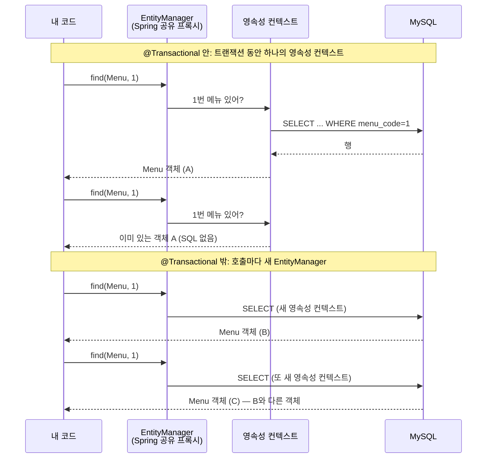
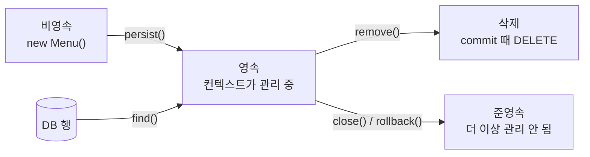
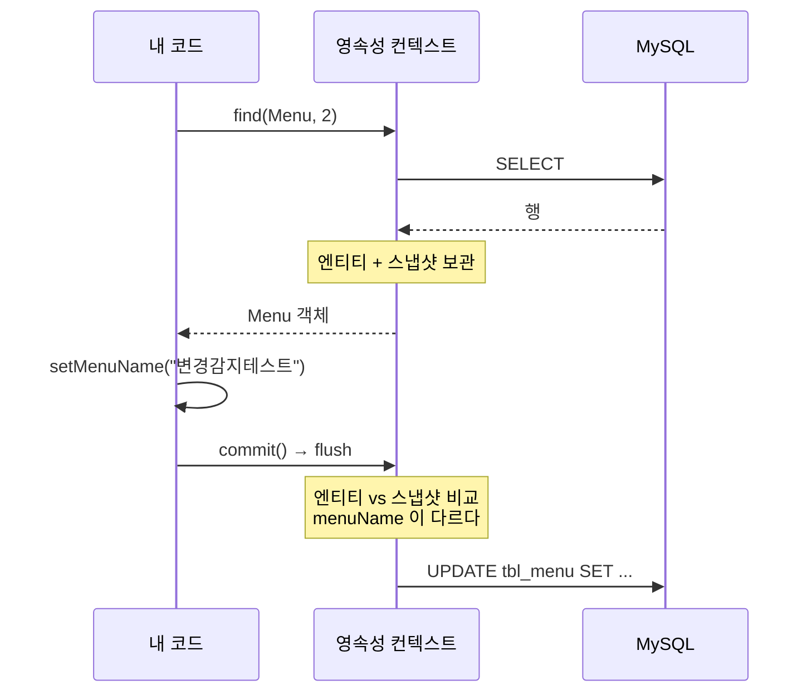

## 들어가며

[지난 글]({{ site.baseurl }}/posts/jdbc-problems-before-jpa/)에서 JDBC로 메뉴 조회 코드를 짜 보며 네 가지 불편함을 모았고, 그중 1~3번(반복 코드, SQL 의존, 패러다임 불일치)이 JPA의 엔티티 매핑으로 어떻게 풀리는지까지 확인했다.

남은 건 4번이었다.

```java
Menu menu1 = findMenuByMenuCode(menuCode);   // JDBC: 조회할 때마다 new Menu()
Menu menu2 = findMenuByMenuCode(menuCode);

System.out.println(menu1 == menu2);   // false
```

DB에서는 같은 행인데 Java에서는 다른 객체가 되는 문제다. 이번 글은 이걸 JPA로 바꿔 보는 데서 시작해서, 왜 그렇게 되는지를 따라가다 만난 **영속성 컨텍스트(Persistence Context)**와 **변경 감지(Dirty Checking)**를 정리한 기록이다.

## 1. JPA로 바꾸니 `true`가 나왔다

JPA 버전의 동일성 예제는 메서드에 `@Transactional(readOnly = true)`가 붙어 있다.

```java
@PersistenceContext
private EntityManager manager;

@Transactional(readOnly = true)
public void compareSameMenu(int menuCode) {

    System.out.println("======= 1번째 조회 =======");
    Menu menu1 = manager.find(Menu.class, menuCode);
    System.out.println("======= 2번째 조회 =======");
    Menu menu2 = manager.find(Menu.class, menuCode);

    System.out.println("menu1 == menu2 : " + (menu1 == menu2));

    menu1.changeMenuName("테스트!");

    System.out.println("menu1 = " + menu1.getMenuName());
    System.out.println("menu2 = " + menu2.getMenuName());
}
```

1번 메뉴로 실행한 결과다. (SQL 본문은 줄였다.)

```text
======= 1번째 조회 =======
Hibernate:
    select ... from tbl_menu m1_0 left join tbl_category c1_0 ... where m1_0.menu_code=?
======= 2번째 조회 =======
menu1.hashCode() = 1266421561
menu2.hashCode() = 1266421561
menu1 == menu2 : true
menu1의 이름 변경 후!
menu1 = 테스트!
menu2 = 테스트!
```

기대대로 `true`다. 그런데 결과보다 더 눈에 띈 건 **"2번째 조회" 아래에 SQL이 없다**는 점이었다. 두 번째 `find()`는 DB에 가지도 않고, 첫 번째 조회 때 올려 둔 그 객체를 그대로 돌려줬다. 같은 객체이니 `menu1`의 이름을 바꾸면 `menu2`에서도 바뀐 이름이 보인다. JDBC 때 "menu1을 수정해도 menu2는 모른다"던 문제가 애초에 생길 수 없는 구조가 된 것이다.

## 2. 트랜잭션을 빼면 다시 `false`가 된다

같은 예제의 다른 메서드 `findMenu()`에는 `@Transactional`이 없는데, 이걸 연달아 실행하면 **매번 SQL이 새로 나갔다.** 그래서 원본 코드는 건드리지 않고, 확인용 클래스를 따로 만들어 트랜잭션 없이 `find()`를 두 번 불러 봤다.

```java
// 확인용 코드 — @Transactional 없음
Menu a = em.find(Menu.class, 1);
Menu b = em.find(Menu.class, 1);
System.out.println("a == b : " + (a == b));
```

```text
Hibernate: select m1_0.menu_code, ... where m1_0.menu_code=?
Hibernate: select m1_0.menu_code, ... where m1_0.menu_code=?
a == b : false
```

SQL이 두 번 나가고 결과도 `false`. JDBC 때와 똑같다.

이유는 `@PersistenceContext`로 주입받은 `EntityManager`가 진짜 `EntityManager`가 아니라 Spring이 만든 **공유 프록시**라는 데 있다. Spring 문서(`SharedEntityManagerCreator`)에 따르면 이 프록시는 현재 트랜잭션에 묶인 `EntityManager`가 있으면 그쪽으로 호출을 넘기고, **없으면 호출할 때마다 새 `EntityManager`를 만든다.** 영속성 컨텍스트도 매번 새로 생기니, 같은 객체를 돌려줄 근거가 없어지는 것이다.



정리하면 JPA가 보장하는 건 "같은 행이면 항상 같은 객체"가 아니라 **"같은 영속성 컨텍스트 안에서는 같은 객체"**다. Spring에서는 그 범위가 보통 트랜잭션과 같아서, `@Transactional`이 경계선 역할을 한다.

그렇다면 영속성 컨텍스트는 정확히 무엇을 들고 있고, 언제 DB와 대화하는 걸까. 다음 단원이 마침 이걸 다뤘다.

## 3. EntityManager를 직접 만들어 보기

다음 단원 예제(`EntityManagerCRUD`)는 `@PersistenceContext` 주입을 주석 처리하고, `EntityManagerFactory`에서 매니저를 **직접** 만든다.

```java
@Component
public class EntityManagerCRUD {

//    @PersistenceContext
//    private EntityManager manager;
    private final EntityManagerFactory factory;

    public EntityManagerCRUD(EntityManagerFactory factory) {
        this.factory = factory;
    }

    public void findMenuByMenuCode(int menuCode) {
        EntityManager manager = factory.createEntityManager();   // 요청마다 생성

        Menu foundMenu = manager.find(Menu.class, menuCode);
        System.out.println("foundMenu = " + foundMenu);

        manager.close();                                          // 요청이 끝나면 닫기
    }
    // ...
}
```

2번에서 Spring 프록시가 뒤에서 하던 일을 손으로 하는 셈이라, **`createEntityManager()`부터 `close()`까지가 영속성 컨텍스트 하나의 수명**이라는 게 코드에 그대로 드러난다. 수업 주석에는 "매니저를 필드로 공유하지 말고 요청 하나에 매니저 하나"라고 되어 있는데, Jakarta Persistence의 `EntityManager` 자체는 스레드 안전하지 않기 때문이다. (참고로 2번의 `@PersistenceContext` 프록시는 Spring이 스레드 안전하게 만들어 준 것이라 필드 주입이 가능하다.)

이 예제의 엔티티는 지난 글과 달리 `@Setter`가 있고, 연관관계 없이 `int categoryCode`를 그대로 쓴다.

```java
@Entity
@Table(name = "tbl_menu")
@NoArgsConstructor @AllArgsConstructor
@Getter @Setter @ToString
public class Menu {

    @Id
    @Column(name = "menu_code")
    private int menuCode;

    @Column(name = "menu_name")
    private String menuName;
    // menuPrice, categoryCode, orderableStatus ...
}
```

이후 확인은 이 엔티티와 매니저로, 원본 코드와 같은 흐름의 **확인용 코드를 따로 만들어** 진행했다. DB 데이터를 바꾸지 않으려고 쓰기 작업은 전부 `commit()` 대신 `flush()` 후 `rollback()`으로 끝냈다. `flush()`는 모아 둔 SQL을 DB로 보내기만 하고 커밋은 하지 않으니, SQL이 나가는 시점은 그대로 볼 수 있다.

엔티티가 영속성 컨텍스트와 어떤 관계인지에 따라 상태 이름이 붙는다.



`em.contains(엔티티)`로 지금 "영속" 상태인지 직접 찍어 볼 수 있어서, 아래 확인에서 같이 출력했다.

## 4. 1차 캐시: 한 번 읽은 행은 다시 읽지 않는다

```java
// 확인용 코드
EntityManager em = factory.createEntityManager();
Menu a1 = em.find(Menu.class, 2);
Menu a2 = em.find(Menu.class, 2);          // 같은 매니저
em.close();

EntityManager em2 = factory.createEntityManager();
Menu a3 = em2.find(Menu.class, 2);         // 새 매니저
```

```text
Hibernate: select ... from tbl_menu m1_0 where m1_0.menu_code=?
>> find again same EM
>> same EM a1==a2 : true, contains=true
>> find in NEW EM
Hibernate: select ... from tbl_menu m1_0 where m1_0.menu_code=?
>> a1==a3 : false
```

같은 매니저에서는 두 번째 `find()`에 SQL이 없고 같은 객체가 온다. 영속성 컨텍스트 안에 **식별자(PK) → 엔티티 객체**를 보관하는 저장소가 있어서, 같은 PK로 다시 찾으면 거기서 꺼내 주기 때문이다. 이걸 1차 캐시라고 부른다. 새 매니저에서는 그 저장소도 새것이라 SQL이 다시 나가고 다른 객체가 된다. 2번에서 본 "트랜잭션 밖이면 `false`"가 바로 이 상황이다.

처음에 이 확인을 1번 메뉴로 했다가 재미있는 걸 봤다. 1번 메뉴는 이미 DB에 없는 행이었는데, 같은 매니저에서 두 번 `find()`해도 **SQL이 두 번 다 나가고** `contains=false`였다. 결과가 `null`인 조회는 1차 캐시에 남지 않는다는 뜻이다. 캐시에 넣을 엔티티 객체가 없으니 당연하긴 하다.

## 5. 쓰기 지연: `persist()`는 SQL을 바로 보내지 않는다

등록 코드는 `persist()`를 부르고 `commit()`한다.

```java
public void registMenu(Menu menu) {
    EntityManager manager = factory.createEntityManager();
    EntityTransaction transaction = manager.getTransaction();
    transaction.begin();
    try {
        manager.persist(menu);
        transaction.commit();   // 이때 flush 가 자동으로 일어난다
        System.out.println("등록 된 메뉴 : " + menu);
    } catch (Exception e) {
        transaction.rollback();
    } finally {
        manager.close();
    }
}
```

`persist()`와 `flush()` 사이를 쪼개서 찍어 봤다.

```text
>> contains before persist : false
>> after persist, contains=true, menuCode=0
>> find(Menu, 0) after persist (before flush)
>> same==m : true
>> flush
Hibernate: insert into tbl_menu (category_code,menu_name,menu_price,orderable_status,menu_code) values (?,?,?,?,?)
>> after flush, menuCode=0
```

- `persist()` 직후 `contains=true`가 됐지만 **INSERT는 아직 안 나갔다.** 영속성 컨텍스트는 SQL을 모아 뒀다가 flush 때 한꺼번에 보낸다. 수업에서는 이걸 "쓰기 지연 SQL 저장소"라고 불렀다.
- 아직 DB에 없는 상태인데도 `find(Menu.class, 0)`이 SQL 없이 같은 객체를 돌려줬다. `persist()`한 순간 1차 캐시에 들어가기 때문이다.
- INSERT는 `flush()`를 부른 뒤에야 나갔다. 원본 코드에서는 `commit()`이 이 flush를 대신한다.

### 덤으로 발견한 것: `menuCode`가 계속 0이다

로그를 보면 INSERT 문에 `menu_code` 컬럼이 들어가 있고, flush 후에도 `menuCode=0`이다. 이 엔티티의 `@Id`에는 **`@GeneratedValue`가 없어서** JPA는 PK를 내가 직접 넣는 값으로 본다. `new Menu()`의 `int` 기본값 0이 그대로 INSERT에 실린 것이다.

그런데도 등록이 실패하지 않는 건 MySQL 쪽 사정이다. `tbl_menu.menu_code`는 `AUTO_INCREMENT`이고, MySQL은 `AUTO_INCREMENT` 컬럼에 0이 들어오면 (`NO_AUTO_VALUE_ON_ZERO` 모드가 아닌 한) 다음 번호를 대신 채운다. 그래서 **DB에는 새 번호로 저장되지만, Java 객체는 끝까지 `menuCode=0`**이다. 원본 코드의 "등록 된 메뉴" 출력도 `menuCode=0`으로 찍히게 된다.

| | DB 행 | 영속성 컨텍스트의 객체 |
|---|---|---|
| PK | MySQL이 채운 다음 번호 | 0 |

같은 매니저로 이 메뉴를 이어서 다루면 영속성 컨텍스트와 DB가 서로 다른 PK를 보게 된다. DB가 번호를 만들게 하려면 `@GeneratedValue(strategy = GenerationType.IDENTITY)`를 붙이는 게 맞다. 다만 Hibernate 문서에 따르면 IDENTITY 방식은 INSERT를 실행해야 PK를 알 수 있어서, 이 경우엔 `persist()` 시점에 INSERT가 바로 나간다. 즉 쓰기 지연이 INSERT에는 적용되지 않는다. 이 부분은 아직 직접 돌려 보진 않았다.

## 6. 변경 감지: `update()` 메서드가 없다

수정 예제에는 UPDATE를 하는 메서드 호출이 없다. 값을 바꾸고 커밋할 뿐이다.

```java
public void modifyMenuName(int menuCode, String menuName) {
    EntityManager manager = factory.createEntityManager();

    Menu foundMenu = manager.find(Menu.class, menuCode);
    System.out.println("수정 전 메뉴 : " + foundMenu);

    EntityTransaction transaction = manager.getTransaction();
    transaction.begin();
    try {
        foundMenu.setMenuName(menuName);   // setter 만 불렀다
        transaction.commit();
    } catch (Exception e) {
        transaction.rollback();
    }
    System.out.println("수정 후 메뉴 : " + manager.find(Menu.class, menuCode));
    manager.close();
}
```

영속성 컨텍스트는 엔티티를 처음 관리하기 시작할 때 그 상태를 **스냅샷**으로 따로 보관해 둔다. flush 때 현재 객체와 스냅샷을 비교해서, 달라진 엔티티가 있으면 UPDATE를 만들어 보낸다.



정말 "비교"를 하는지 보려고, **같은 값**으로 바꿨을 때와 **다른 값**으로 바꿨을 때를 나눠서 flush해 봤다.

```text
Hibernate: select ... from tbl_menu m1_0 where m1_0.menu_code=?
>> set SAME name -> flush
>> set NEW name -> flush
Hibernate: update tbl_menu set category_code=?,menu_name=?,menu_price=?,orderable_status=? where menu_code=?
>> find after flush
>> c2 name : 변경감지테스트
```

- setter를 불렀어도 값이 같으면 **UPDATE가 나가지 않았다.** "setter가 호출됐는지"가 아니라 "스냅샷과 값이 다른지"를 본다는 뜻이다.
- 바뀐 건 `menu_name` 하나인데 UPDATE 문은 **모든 컬럼**을 SET 한다. Hibernate 기본 설정에서는 엔티티마다 미리 만들어 둔 UPDATE 문을 쓰기 때문이다.
- flush 뒤 `find()`도 SQL 없이 캐시에서 나왔다.

마지막 항목이 원본 코드를 읽을 때 중요했다. `modifyMenuName()`의 "수정 후 메뉴"는 commit 뒤 같은 매니저로 `find()`한 결과인데, 같은 값으로 바꾸고 commit하는 방식으로 따로 확인해 보니 **commit 뒤의 `find()`도 SQL 없이 같은 객체를 돌려줬다.** 즉 그 출력은 DB를 다시 읽은 게 아니라 내 메모리 속 객체를 다시 보여 준 것이다. 수정이 DB에 반영됐는지 확인하려면 새 매니저로 조회해야 한다.

### 바뀐 객체는 롤백해도 그대로다

위 확인을 `rollback()`으로 끝낸 뒤 객체와 DB를 각각 봤다.

```text
>> after rollback, java obj name : 변경감지테스트, contains=false
Hibernate: select ... from tbl_menu m1_0 where m1_0.menu_code=?
>> new EM DB name : 우럭스무디
```

DB는 원래 이름으로 돌아갔지만 Java 객체는 `변경감지테스트`를 그대로 들고 있고, `contains=false`로 준영속 상태가 됐다. 롤백은 DB를 되돌릴 뿐 **메모리 속 객체를 되돌려 주지는 않는다.** 롤백 후에 이 객체를 계속 쓰면 DB와 다른 값을 보게 된다.

### 트랜잭션이 없으면, 또는 `readOnly`면 반영되지 않는다

트랜잭션 없이 setter만 부르고 매니저를 닫아 봤다.

```text
>> [E] no tx, setter only
Hibernate: select ... where m1_0.menu_code=?
Hibernate: select ... where m1_0.menu_code=?   ← 새 매니저로 다시 확인
>> DB name : 우럭스무디
```

flush가 일어날 계기(commit)가 없으니 UPDATE도 없다. 변경 감지는 "값을 바꾸면 알아서 저장"이 아니라 **"flush 시점에 바뀐 걸 찾아서 저장"**이다.

이걸 알고 나니 1번 예제의 마지막 줄도 설명이 됐다. `@Transactional(readOnly = true)` 안에서 `changeMenuName("테스트!")`를 했는데, 그 뒤 DB를 다시 읽어 보니 원래 이름 그대로였고 UPDATE 로그도 없었다. Spring은 Hibernate를 쓸 때 `readOnly` 트랜잭션에서는 flush를 하지 않도록 설정한다. flush가 없으니 변경 감지도 일어나지 않은 것이다.

## 7. 삭제도 flush 때 나간다

```java
// 확인용 코드
Menu d = em.find(Menu.class, 37);
tx.begin();
em.remove(d);
// contains, find 확인 후
em.flush();
```

```text
>> after remove (no flush), contains=false
>> find after remove
>> found : null
>> flush
Hibernate: delete from tbl_menu where menu_code=?
```

`remove()` 직후 엔티티는 바로 관리 대상에서 빠지고(`contains=false`), 같은 매니저로 `find()`하면 **SQL 없이** `null`이 온다. 그런데 실제 DELETE는 flush 때 나간다. 수업 주석의 "삭제할 엔티티는 먼저 조회해서 영속성 컨텍스트가 관리하는 상태여야 한다"는 말도 여기서 이해됐다. `remove()`는 SQL을 바로 날리는 게 아니라 **영속성 컨텍스트가 관리 중인 엔티티에 "삭제 예정" 표시를 하는 일**이라서, 관리 중이 아닌 객체에는 할 수 없다.

## 정리: SQL은 언제 나가는가

| 작업 | 영속성 컨텍스트에서 일어나는 일 | SQL이 나가는 시점 |
|------|-------------------------------|-------------------|
| `find()` | 1차 캐시에 있으면 꺼내 주고, 없으면 조회 후 캐시와 스냅샷에 보관 | 캐시에 없을 때만 즉시 SELECT |
| `persist()` | 1차 캐시에 넣고 INSERT를 쓰기 지연 저장소에 등록 | flush (commit) 때 INSERT* |
| setter로 값 변경 | 아무 일도 안 함 | flush 때 스냅샷과 비교해서 다르면 UPDATE |
| `remove()` | 관리 대상에서 빼고 DELETE 등록 | flush (commit) 때 DELETE |
| `rollback()` / `close()` | 컨텍스트를 비움. 객체는 준영속이 됨 | 없음 |

\* PK를 DB가 만드는 IDENTITY 전략이면 `persist()` 때 바로 INSERT (Hibernate 문서 기준, 직접 확인 전)

지난 글에서 JDBC 문제 네 개를 묶으면서 "결국 **`new`를 누가 언제 하느냐**의 문제"라고 적었다. 이번에 보니 JPA의 답은 영속성 컨텍스트였다. 행 하나당 객체 하나를 컨텍스트가 보관하니 동일성이 생기고(1차 캐시), 그 객체의 처음 모습을 기억하니 UPDATE를 대신 만들 수 있고(변경 감지), SQL을 모아 두니 언제 보낼지도 컨텍스트가 정한다(쓰기 지연).

대신 그 모든 게 **컨텍스트의 수명 안에서만** 성립한다. 매니저가 바뀌면 같은 행도 다른 객체가 되고, flush가 없으면 바꾼 값도 DB에 가지 않으며, 롤백해도 객체는 되돌아오지 않는다. JPA가 SQL을 대신 써 준다고 해서 생각할 게 줄어든 게 아니라, **생각할 단위가 "SQL 한 줄"에서 "영속성 컨텍스트의 수명"으로 바뀐** 느낌이다.

## 더 알아보고 싶은 것

- **flush 모드와 JPQL** — `FlushModeType.AUTO`에서는 JPQL을 실행하기 직전에도 flush가 일어난다고 한다. 쓰기 지연 중인 INSERT가 JPQL 조회 결과에 보이는지 확인해 보고 싶다.
- **IDENTITY 전략과 쓰기 지연** — 5번에서 문서로만 확인한 "IDENTITY면 `persist()` 때 바로 INSERT"를 `@GeneratedValue`를 붙여 직접 로그로 보고 싶다. 배치 INSERT가 안 되는 이유와도 이어진다.
- **`@DynamicUpdate`** — 6번에서 UPDATE가 모든 컬럼을 SET 했다. 바뀐 컬럼만 SET 하게 하는 Hibernate 전용 설정인데, 언제 득이고 언제 실인지 비교해 볼 만하다.
- **준영속 엔티티와 `merge()`** — 롤백이나 `close()` 뒤 준영속이 된 객체를 다시 저장하려면 `merge()`가 필요하다. 웹 요청에서 받은 DTO를 엔티티로 바꿔 저장할 때 바로 부딪힐 문제다.
- **Spring 트랜잭션과 영속성 컨텍스트 범위** — 이번엔 `EntityTransaction`으로 직접 경계를 잡았다. `@Transactional`과 `JpaTransactionManager`가 이걸 어떻게 대신하는지, 서비스 메서드가 다른 서비스 메서드를 부를 때(전파) 컨텍스트가 공유되는지 이어서 보고 싶다.

## 참고 자료

- [Jakarta Persistence Specification](https://jakarta.ee/specifications/persistence/)
- [Hibernate ORM User Guide - Persistence Context](https://docs.jboss.org/hibernate/orm/current/userguide/html_single/Hibernate_User_Guide.html#pc)
- [Hibernate ORM User Guide - Flushing](https://docs.jboss.org/hibernate/orm/current/userguide/html_single/Hibernate_User_Guide.html#flushing)
- [Hibernate ORM User Guide - Identifier generators (IDENTITY)](https://docs.jboss.org/hibernate/orm/current/userguide/html_single/Hibernate_User_Guide.html#identifiers-generators-identity)
- [Spring Framework Reference - JPA](https://docs.spring.io/spring-framework/reference/data-access/orm/jpa.html)
- [Spring Framework API - SharedEntityManagerCreator](https://docs.spring.io/spring-framework/docs/current/javadoc-api/org/springframework/orm/jpa/SharedEntityManagerCreator.html)
- [Spring Framework Reference - Using @Transactional](https://docs.spring.io/spring-framework/reference/data-access/transaction/declarative/annotations.html)
- [MySQL 8.0 Reference Manual - Using AUTO_INCREMENT](https://dev.mysql.com/doc/refman/8.0/en/example-auto-increment.html)
