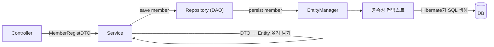
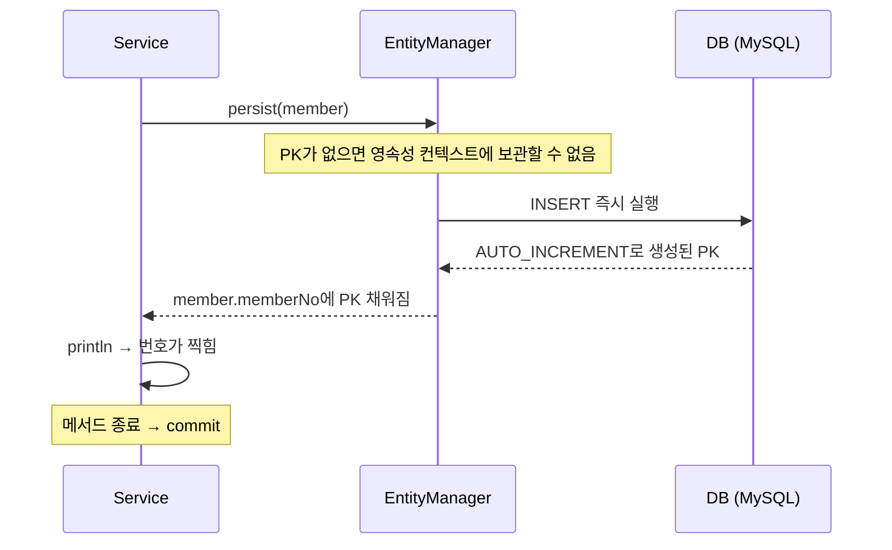

## 들어가며

JPA 엔티티 매핑 수업에서 회원 등록 예제를 따라 쳤다. 코드는 짧은데 흐름이 머릿속에 안 그려졌다.

- Service에서 DTO를 Entity로 왜 굳이 바꾸는지
- Repository(DAO)가 `save()`를 받으면 그다음에 DB까지 어떻게 가는지

둘 다 헷갈려서, `member` 객체 **하나만** 처음부터 끝까지 따라가 보기로 했다.

## 전체 흐름

먼저 결론부터 그림으로 정리하면 이렇다.



Service 코드는 딱 두 단계다.

```java
@Transactional
public int registMember(MemberRegistDTO dto) {

    // 1. DTO -> Entity
    Member member = new Member(
            dto.getMemberId(),
            dto.getMemberPwd(),
            dto.getMemberName(),
            dto.getPhone(),
            dto.getAddress(),
            dto.getEnrollDate(),
            dto.getMemberRole(),
            dto.getStatus()
    );

    // 2. 변환 된 Entity를 JPA를 사용하는 DAO 계층에 전달한다.
    memberRepository.save(member);

    return member.getMemberNo();
}
```

Repository는 받은 엔티티를 `EntityManager`에 넘기기만 한다.

```java
@Repository
public class MemberRepository {

    @PersistenceContext
    private EntityManager manager;

    public void save(Member member) {
        manager.persist(member);
    }
}
```

## 1. DTO를 Entity로 바꾸는 이유

두 클래스의 맨 위를 나란히 놓고 보니 차이가 바로 보였다.

```java
@Entity
@Table(name="tbl_member")
public class Member { ... }

public class MemberRegistDTO { ... }   // 아무 표시 없음
```

JPA는 `@Entity`가 붙은 객체만 관리한다. DTO에는 "어느 테이블, 어느 컬럼에 들어가는지" 정보가 없다.

| | DTO | Entity |
|---|---|---|
| 역할 | 화면 → Controller → Service로 값을 **나르는** 상자 | DB 테이블과 **짝지어진** 객체 |
| JPA 관리 대상 | X | O (`@Entity`) |
| 매핑 정보 | 없음 | `@Table`, `@Column`, `@Id` 등 |

그래서 Service가 중간에서 DTO를 Entity로 옮겨 담아 Repository에 넘긴다.

### 옮겨 담다가 생긴 버그

`member` 객체가 만들어지는 곳을 보다가 이상한 점을 발견했다. 처음 코드는 이랬다.

```java
// 수정 전 (Service)
Member member = new Member(
        dto.getMemberId(),
        dto.getMemberName(),   // ← 2번째
        dto.getMemberPwd(),    // ← 3번째
        ...
);
```

그런데 `Member` 생성자의 파라미터 순서는 이렇다.

```java
public Member(String memberId, String memberPwd,
              String memberName, ...)
```

**이름이 비밀번호 칸에, 비밀번호가 이름 칸에** 들어가고 있었다. 이대로 실행했다면 에러 없이 DB에 뒤바뀐 값이 저장됐을 것이다.

**어디를 고칠까?** 생성자 순서를 바꾸는 방법도 있었지만 Service 쪽을 고쳤다.

- 생성자는 "Member는 이 순서로 만든다"는 약속이다. 약속을 바꾸면 그걸 믿고 호출하던 곳이 전부 영향을 받는다.
- 틀린 건 약속을 잘못 지킨 호출부(Service) 한 곳이다.

지금은 `new Member(...)`를 부르는 곳이 Service 한 군데뿐이지만, 호출하는 곳이 늘어날 걸 생각하면 틀린 쪽을 고치는 게 맞다고 판단했다.

### 왜 컴파일러가 못 잡았을까

`memberPwd`와 `memberName`은 **둘 다 `String`** 이다. 컴파일러는 "이 자리에 맞는 타입이 들어왔나"만 확인하고, 변수 이름이나 의미는 보지 않는다.

확인하려고 일부러 `dto.getPhone()`(String)과 `dto.getEnrollDate()`(LocalDateTime) 자리를 바꿔서 빌드해 봤다. 이번에는 **컴파일 에러**가 났다. (확인 후 원래대로 되돌렸다.)

| 바꾼 것 | 타입 | 결과 |
|---|---|---|
| 이름 ↔ 비밀번호 | String ↔ String | 에러 없음 → 잘못된 값이 조용히 저장됨 |
| 전화번호 ↔ 가입일 | String ↔ LocalDateTime | 컴파일 에러 → 실행 전에 잡힘 |

에러가 나는 쪽이 오히려 안전하다. 같은 타입이 연달아 있는 생성자가 진짜 위험한 쪽이었다.

## 2. `save()` 다음에 일어나는 일

### SQL은 누가 만들까

`application.yaml`에 `show-sql: true`가 켜져 있어서, 회원 등록을 실행하면 콘솔에 `insert into tbl_member ...` 로그가 찍혔다. 내 코드에는 SQL이 한 줄도 없는데 말이다.

이 SQL은 JPA 구현체인 **Hibernate**가 엔티티의 매핑 정보를 보고 만든 것이다.

```text
@Table(name="tbl_member")              →  insert into tbl_member
@Column(name="member_id"), ...         →  (member_id, member_pwd, ...)
member 객체에 담긴 값                    →  values (?, ?, ...)
```

1번에서 DTO를 Entity로 꼭 바꿔야 했던 이유가 여기서 이어진다. 이 매핑 정보가 DTO에는 없기 때문에 Hibernate가 SQL을 만들 수 없다.

그래서 "DAO가 JPA 역할을 한다"기보다는 **DAO는 JPA(EntityManager)에게 일을 맡기는 창구**라고 이해하는 게 더 정확했다.

### INSERT는 언제 나갈까

`@Transactional`이 붙은 메서드는 끝날 때 commit된다. 그리고 JPA는 원래 SQL을 모아뒀다가 commit 시점에 보내는 **쓰기 지연**이 기본이다. 그렇다면 INSERT도 메서드가 끝날 때 나가야 한다.

확인하려고 `save()` 바로 다음 줄에 출력을 넣었다.

```java
memberRepository.save(member);
System.out.println("===== save 끝, memberNo = " + member.getMemberNo());
```

결과는 예상과 달랐다.

- `insert` 로그가 `=====` 줄보다 **먼저** 찍혔다.
- `memberNo`에는 **DB가 매긴 번호**가 이미 들어 있었다. (`int`라서 아직 값을 못 받았다면 기본값 `0`이었을 것이다.)

이유는 PK 생성 전략에 있었다.

```java
@Id
@Column(name = "member_no")
@GeneratedValue(strategy = GenerationType.IDENTITY)
private int memberNo;
```



1. `IDENTITY`는 PK 생성을 DB(MySQL의 AUTO_INCREMENT)에 맡긴다.
2. 영속성 컨텍스트는 엔티티를 **PK를 키로** 보관한다.
3. PK를 알려면 INSERT를 해봐야 하니까, `persist()` 시점에 바로 INSERT를 보낸다.

그래서 `IDENTITY`에서는 쓰기 지연이 적용되지 않는다. Service가 `return member.getMemberNo()`로 번호를 바로 돌려줄 수 있는 것도 이 덕분이다.

## 배운 점

- DTO는 나르는 상자, Entity는 테이블과 짝지어진 객체다. JPA는 Entity만 다룰 수 있어서 Service에서 옮겨 담는다.
- 같은 타입 파라미터가 연달아 있는 생성자는 순서가 바뀌어도 컴파일러가 못 잡는다. 에러가 안 난다고 맞는 게 아니다.
- 고칠 때는 **영향 범위**를 먼저 본다. 약속(생성자)보다 약속을 어긴 쪽(호출부)을 고친다.
- Repository는 SQL을 직접 쓰지 않는다. `persist()`로 넘기면 Hibernate가 매핑 정보를 보고 SQL을 만든다.
- `IDENTITY` 전략에서는 PK를 받아오려고 `persist()` 시점에 INSERT가 바로 나간다.

## 더 학습하면 좋은 개념

- **Builder 패턴 (Lombok `@Builder`)**: `.memberName("...")`처럼 값마다 이름을 붙여 넣으니, 오늘 같은 순서 실수를 구조적으로 막을 수 있다.
- **`SEQUENCE` 전략과 쓰기 지연**: 시퀀스에서 PK만 먼저 받아오기 때문에 INSERT를 commit까지 미룰 수 있다. Oracle, PostgreSQL에서 IDENTITY와 순서를 비교해 보면 차이가 잘 보일 것 같다.
- **Checked / Unchecked 예외와 `@Transactional` rollback**: 기본 설정에서는 어떤 예외일 때만 rollback되는지 알아야 저장 실패를 제대로 다룰 수 있다.
- **`@Transactional` 전파(propagation)**: Service 메서드가 다른 트랜잭션 메서드를 호출할 때 트랜잭션이 어떻게 이어지는지.

## 참고 자료

- [Jakarta Persistence 3.1 Specification](https://jakarta.ee/specifications/persistence/3.1/jakarta-persistence-spec-3.1.html)
- [Hibernate ORM Documentation](https://hibernate.org/orm/documentation/)
- [Spring Framework 공식 문서 - Using @Transactional](https://docs.spring.io/spring-framework/reference/data-access/transaction/declarative/annotations.html)
