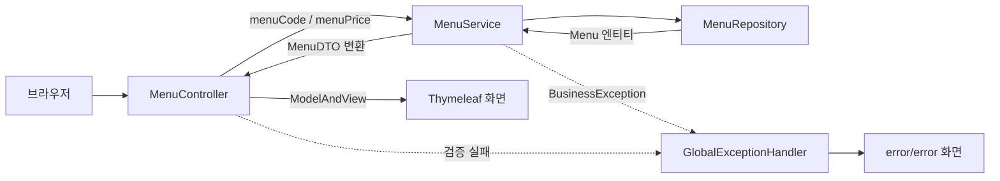
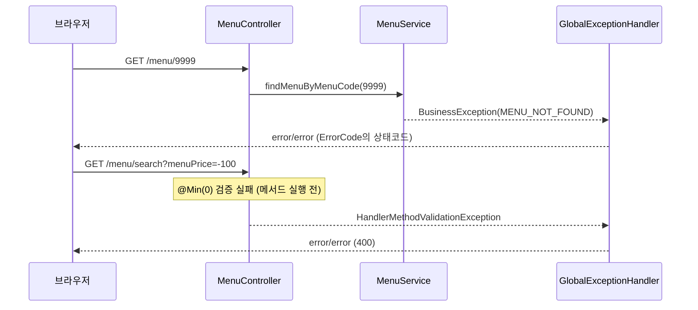

## 들어가며

JPA 수업의 미니 프로젝트는 메뉴 관리 웹 애플리케이션이다. 계층별 뼈대(Controller, Service, Repository, DTO, Entity, Policy, 예외 처리기)는 다 만들어져 있고, 실제 동작 코드는 `// TODO` 주석으로 비어 있다.

TODO 전체 중 지금까지 채운 건 아래 두 기능이다. 이 글은 이 두 기능만 다룬다.

| 기능 | URL | 채운 TODO |
|---|---|---|
| 메뉴 1건 조회 | `GET /menu/{menuCode}` | Controller 1, Service 0·1, `MenuDTO.from()`, `Menu` 엔티티 매핑, 예외 처리기 0·1 |
| 가격으로 메뉴 검색 | `GET /menu/search?menuPrice=...` | Controller 3, Service 3, Repository 1·2, 예외 처리기 3 |

목록 조회, 등록, 수정, 삭제, 판매중지/재개, Policy 클래스들은 아직 비어 있다.

## 전체 흐름

두 기능 모두 요청이 지나가는 길은 같다.



아래에서 DB에 가까운 쪽부터 위로 올라가면서 정리했다.

## 1. Entity: 테이블과 짝짓기

`Menu`는 `tbl_menu` 한 행과 매핑된다.

```java
@NoArgsConstructor
@AllArgsConstructor(access = AccessLevel.PRIVATE)
@Getter
@ToString
@Entity
@Table(name="tbl_menu")
public class Menu {

    @Id
    @Column(name = "menu_code")
    @GeneratedValue(strategy = GenerationType.IDENTITY)
    private int menuCode;

    @Column(name = "menu_name")
    private String menuName;

    @Column(name = "menu_price")
    private int menuPrice;

    @Column(name = "category_code")
    private int categoryCode;

    @Column(name = "orderable_status")
    private String orderableStatus;
}
```

- `menu_code`는 DB가 자동 증가시키는 PK라서 `IDENTITY` 전략을 썼다.
- 클래스에 setter가 없고, 전체 필드 생성자는 `private`이다. 이 프로젝트는 "Entity 값은 `create()`, `changeMenuName()`처럼 이름 있는 메서드로만 바꾼다"는 규칙으로 설계돼 있다. 그 메서드들은 아직 TODO로 남아 있다.

## 2. Repository: 인터페이스만 만들면 구현은 Spring Data JPA가

```java
@Repository
public interface MenuRepository extends JpaRepository<Menu, Integer> {

    List<Menu> findByMenuPriceGreaterThanOrderByMenuPrice(int menuPriceIsGreaterThan);
}
```

`JpaRepository<관리할 엔티티, @Id 필드 타입>`을 상속하는 것만으로 `findById()`, `findAll()`, `save()`, `deleteById()` 같은 메서드를 바로 쓸 수 있다. 구현 클래스는 내가 만들지 않는다. 실행할 때 Spring Data JPA가 프록시 구현체를 만들어 Bean으로 등록한다.

지난번 회원 예제에서는 Repository를 클래스로 만들고 `EntityManager`를 직접 주입받아 `persist()`를 불렀다. 이번에는 그 코드가 통째로 사라졌다.

| | 지난 예제 (`MemberRepository`) | 이번 (`MenuRepository`) |
|---|---|---|
| 형태 | 클래스 | 인터페이스 |
| EntityManager | `@PersistenceContext`로 직접 주입 | 안 보임 (구현체 안에 있음) |
| 저장 / 조회 | `manager.persist()` 직접 호출 | 상속받은 `save()`, `findById()` |

### 쿼리 메서드: 메서드 이름이 곧 조건

가격 검색은 상속받은 기본 메서드로는 안 돼서 **쿼리 메서드**를 하나 선언했다. 이름을 규칙대로 지으면 Spring Data JPA가 이름을 쪼개서 JPQL을 만든다.

```text
findBy  MenuPrice  GreaterThan  OrderBy  MenuPrice
  │        │           │           │        │
 조회    필드명    조건( > )      정렬    정렬 기준(기본 오름차순)
```

여기서 헷갈리기 쉬운 게 하나 있다. 코드 주석에는 "menuPrice **이상**"이라고 적혀 있는데, `GreaterThan`은 **초과(`>`)** 다. 이상(`>=`)을 원하면 `GreaterThanEqual`을 써야 한다. 프로젝트 README의 요구사항은 "입력 가격 **초과**"라서 지금 메서드 이름이 맞고, 주석 쪽이 부정확하다.

| 키워드 | 조건 |
|---|---|
| `GreaterThan` | `price > ?` (초과) |
| `GreaterThanEqual` | `price >= ?` (이상) |

조건이 한두 개일 때는 메서드 이름만으로 끝나서 편하다. 대신 조건이 늘거나 조인이 필요해지면 이름이 너무 길어져서 읽기 어려워진다. 그때는 `@Query`로 직접 쿼리를 쓰는 편이 낫다. (`CategoryRepository`의 남은 TODO가 바로 `@Query` native query를 쓰는 과제다.)

## 3. Service: 조회 → 없으면 예외 → DTO 변환

```java
@Service
@RequiredArgsConstructor
public class MenuService {

    private final MenuRepository menuRepository;

    public MenuDTO findMenuByMenuCode(int menuCode) {
        Menu foundMenu = menuRepository.findById(menuCode)
                .orElseThrow(() -> new BusinessException(ErrorCode.MENU_NOT_FOUND));

        return MenuDTO.from(foundMenu);
    }

    public List<MenuDTO> findMenuByPrice(int menuPrice) {
        List<Menu> menuList = menuRepository.findByMenuPriceGreaterThanOrderByMenuPrice(menuPrice);

        return menuList.stream()
                .map(menu -> MenuDTO.from(menu))
                .toList();
    }
}
```

### 의존성 주입: `@RequiredArgsConstructor`

`menuRepository`는 `final`인데 생성자가 코드에 안 보인다. Lombok의 `@RequiredArgsConstructor`가 `final` 필드를 받는 생성자를 만들어 주고, 생성자가 하나뿐이면 Spring이 그 생성자로 Bean을 주입한다. 필드에 `@Autowired`를 붙이지 않아도 된다.

### `findById()`는 왜 `Optional`을 돌려줄까

`findById()`의 반환 타입은 `Menu`가 아니라 `Optional<Menu>`다. 해당 menuCode가 DB에 없을 수도 있다는 걸 타입으로 드러낸 것이다. 만약 `Menu`를 그냥 돌려줬다면 없을 때 `null`이 오고, 그걸 모르고 쓰다가 엉뚱한 곳에서 `NullPointerException`이 났을 것이다.

`orElseThrow()`로 "없으면 이 예외를 던져라"를 조회하는 자리에서 바로 정했다. 예외는 `ErrorCode.MENU_NOT_FOUND`를 담은 `BusinessException`이다. 이 예외를 받아서 화면을 보여주는 건 Service가 아니라 아래에서 볼 `GlobalExceptionHandler`다.

### Entity는 Service 밖으로 나가지 않는다

Service는 Controller에게 `Menu`가 아니라 `MenuDTO`를 돌려준다. 변환 메서드는 DTO 쪽에 있다.

```java
public static MenuDTO from(Menu menu) {
    return new MenuDTO(
            menu.getMenuCode(),
            menu.getMenuName(),
            menu.getMenuPrice(),
            menu.getCategoryCode(),
            menu.getOrderableStatus()
    );
}
```

변환 메서드를 Entity가 아니라 DTO에 둔 이유는 의존 방향 때문이다. DTO는 Entity를 알아도 되지만, Entity는 화면용 객체인 DTO를 몰라야 한다. 그래야 화면이 바뀌어도 Entity는 건드리지 않는다.

여러 건을 변환할 때는 `for`문 대신 `stream().map().toList()`를 썼다. "리스트의 각 원소를 이렇게 바꿔라"를 한 줄로 쓸 수 있다. `menu -> MenuDTO.from(menu)`는 메서드 참조 `MenuDTO::from`으로 줄일 수도 있다. (주석에 남겨 둔 `MenuDTO::from(menu)`는 괄호가 붙어서 문법 오류다. 메서드 참조에는 인자를 쓰지 않는다.)

## 4. Controller: 값 꺼내기, 검증 선언, 화면 고르기

```java
@GetMapping("/{menuCode}")
public ModelAndView findByMenuByPathVariable(@PathVariable int menuCode, ModelAndView mv) {
    MenuDTO findMenu = menuService.findMenuByMenuCode(menuCode);
    mv.addObject("result", findMenu);
    mv.setViewName("menu/detail");
    return mv;
}

@GetMapping("/search")
public ModelAndView findByMenuPrice(@RequestParam
                                    @Min(value = 0, message = "가격은 0 이상 입력!")
                                    int menuPrice,
                                    ModelAndView mv) {
    List<MenuDTO> menuList = menuService.findMenuByPrice(menuPrice);
    mv.addObject("menuList", menuList);
    mv.addObject("price", menuPrice);
    mv.setViewName("menu/searchResult");
    return mv;
}
```

### `@PathVariable` vs `@RequestParam`

| | 요청 예 | 꺼내는 방법 | 주로 쓰는 경우 |
|---|---|---|---|
| Path Variable | `/menu/3` | `@PathVariable` | 특정 자원 하나를 가리킬 때 |
| Query String | `/menu/search?menuPrice=1000` | `@RequestParam` | 검색 조건, 필터 |

URL에 `?`가 있느냐로 구분하면 쉽다.

### 검증은 백엔드에서도 한다

가격 입력란에 JS로 음수를 막아도, 사용자가 주소창에 `?menuPrice=-100`을 직접 치면 그대로 서버에 온다. 그래서 `@RequestParam`에 `@Min(0)`을 붙였다.

Controller는 검증을 **선언만** 하고, 실패했을 때의 처리(try-catch)는 쓰지 않는다. 이 프로젝트에서 Controller는 정상 흐름만 담당한다.

## 5. GlobalExceptionHandler: 예외를 한 곳에서 화면으로

```java
@Slf4j
@ControllerAdvice
public class GlobalExceptionHandler {

    @ExceptionHandler(BusinessException.class)
    public ModelAndView handleBusinessException(BusinessException e) {
        return errorPage(e.getErrorCode().getStatus(), e.getMessage());
    }

    @ExceptionHandler(HandlerMethodValidationException.class)
    public ModelAndView handleMethodValidation(HandlerMethodValidationException e) {
        String message = e.getMessage();
        return errorPage(HttpStatus.BAD_REQUEST, message);
    }

    // errorPage(): error/error 화면에 상태코드와 메시지를 담는 제공 코드
}
```

`@ControllerAdvice`를 붙이면 모든 Controller에서 던져진 예외가 여기로 모이고, `@ExceptionHandler`에 적은 예외 타입에 맞는 메서드가 호출된다.

두 예외가 각각 어디서 출발하는지 정리하면 이렇다.



- `BusinessException`은 Service가 직접 던진다. 상태코드와 메시지는 `ErrorCode`에 같이 들어 있어서, 처리기는 꺼내 쓰기만 한다.
- `HandlerMethodValidationException`은 Controller 메서드가 **실행되기 전에** Spring이 파라미터 검증을 하다가 던진다. Spring Framework 6.1부터는 Controller 클래스에 `@Validated`가 없어도, 메서드 파라미터에 `@Min` 같은 제약 어노테이션이 붙어 있으면 이 내장 검증이 동작한다.

덕분에 Service에도 Controller에도 try-catch가 하나도 없다.

## 정리

- `Menu` 엔티티에 `@Entity`, `@Table`, `@Id`, `@GeneratedValue(IDENTITY)`, `@Column`으로 테이블을 매핑했다.
- `JpaRepository`를 상속하면 기본 CRUD 구현은 Spring Data JPA가 만들어 준다. 직접 다루던 `EntityManager`가 코드에서 사라졌다.
- 쿼리 메서드는 이름이 곧 조건이다. `GreaterThan`은 초과, `GreaterThanEqual`은 이상이다.
- `findById()`는 `Optional`을 돌려주고, `orElseThrow()`로 "없을 때"를 조회 자리에서 바로 처리했다.
- Service는 Entity를 DTO로 바꿔서 돌려주고, 변환 메서드는 DTO 쪽에 둔다.
- Controller는 검증을 선언만 하고, 예외는 `@ControllerAdvice` 한 곳에서 화면으로 바꾼다.

남은 TODO는 목록 조회(`Sort.by`), 카테고리 조회(`@Query` native query), 등록/수정/삭제(`@Transactional`, 변경 감지), 그리고 PART 3의 Policy 클래스들이다.

## 더 학습하면 좋은 개념

- **`Sort`와 `Pageable`**: 다음 TODO인 전체 목록 조회에서 `findAll(Sort.by(...))`를 쓴다. 메뉴가 많아지면 `Pageable`로 페이지 단위 조회까지 이어진다.
- **`@Query`와 JPQL / native query**: 쿼리 메서드 이름이 너무 길어질 때의 대안이다. 카테고리 조회 TODO에서 바로 쓰게 된다.
- **변경 감지(Dirty Checking)**: 메뉴 이름 수정 TODO는 `save()` 없이 엔티티 값만 바꾸고 트랜잭션이 끝날 때 UPDATE가 나가는 구조다.
- **`MethodArgumentNotValidException`과 `BindException`**: 메뉴 등록 시 `@Valid` DTO 검증이 실패하면 `@RequestParam` 검증과는 다른 예외가 온다. 둘의 차이를 알아야 예외 처리기 TODO 2를 채울 수 있다.

## 참고 자료

- [Spring Data JPA - Query Methods](https://docs.spring.io/spring-data/jpa/reference/jpa/query-methods.html)
- [Spring Data JPA - Repository query keywords](https://docs.spring.io/spring-data/jpa/reference/repositories/query-keywords-reference.html)
- [Spring Framework - Method Validation (Web MVC)](https://docs.spring.io/spring-framework/reference/web/webmvc/mvc-controller/ann-validation.html)
- [Spring Framework - Controller Advice](https://docs.spring.io/spring-framework/reference/web/webmvc/mvc-controller/ann-advice.html)
- [Java SE 17 - Optional](https://docs.oracle.com/en/java/javase/17/docs/api/java.base/java/util/Optional.html)
