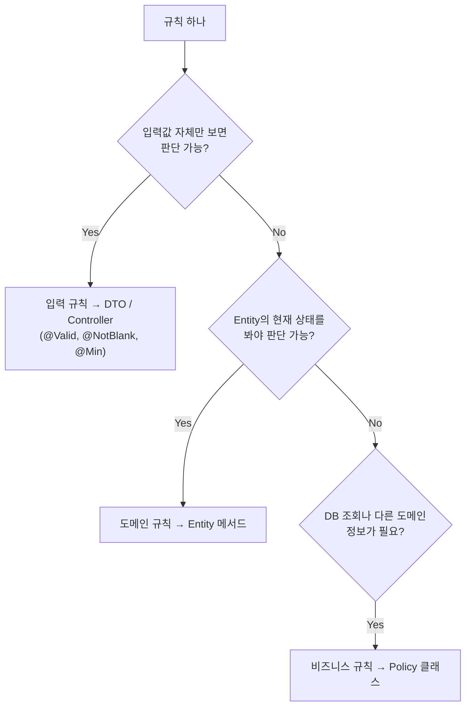
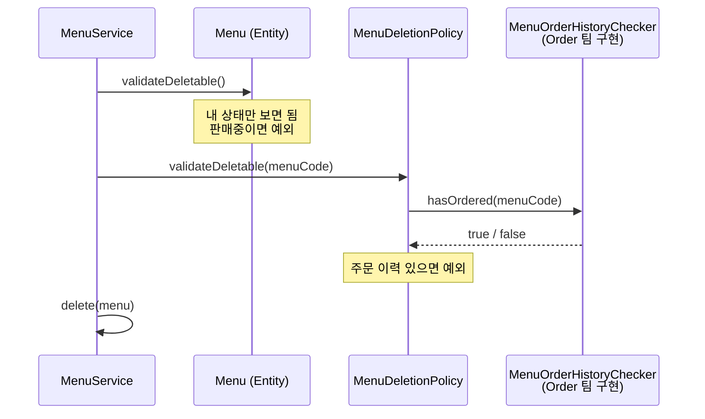
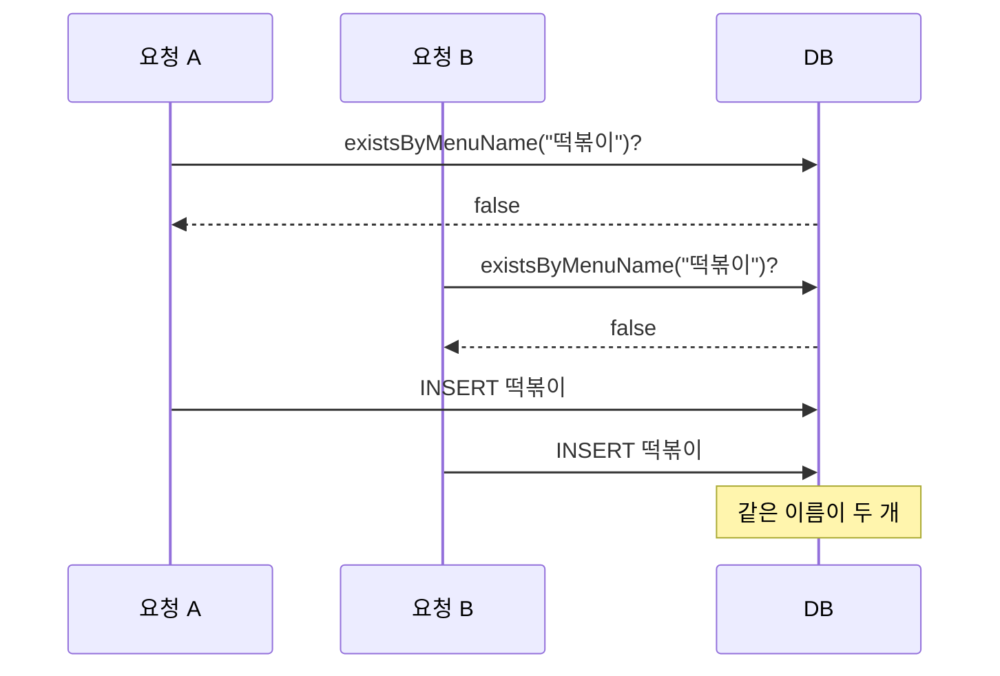

## 들어가며

JPA 수업의 메뉴 관리 미니 프로젝트를 TODO 순서대로 채우고 있다. 조회 기능까지는 Service가 깔끔했다. Repository에서 꺼내서 DTO로 바꿔 돌려주면 끝이었다.

등록부터 달라졌다. 메뉴 하나를 등록하는 데 지켜야 할 규칙이 이만큼 있다.

| 규칙 | 예 |
|---|---|
| 이름은 필수, 30자 이하 | 빈 이름 거절 |
| 가격은 0원 이상 | -100원 거절 |
| 카테고리는 반드시 선택 | 미선택(0) 거절 |
| 신규 메뉴는 항상 판매중(Y)으로 시작 | 판매 여부는 입력받지 않음 |
| 이름은 중복 불가 | 이미 있는 이름 거절 |
| 하위 카테고리에만 등록 가능 | "식사", "음료" 같은 상위 카테고리 거절 |

수정, 판매중지, 삭제까지 가면 규칙이 더 붙는다. 이걸 전부 Service에 쓰면 어떻게 될까?

## Service에 규칙을 직접 쓰면

프로젝트 코드 주석에 "Before" 버전이 남아 있었다. 등록 메서드가 규칙을 직접 판단하는 모습이다.

```java
@Transactional
public int registNewMenu(MenuDTO registMenu) {

    // ① 이름 중복 금지 (다른 메뉴를 조회해야 판단 가능)
    if (menuRepository.existsByMenuName(registMenu.getMenuName())) {
        throw new BusinessException(ErrorCode.DUPLICATE_MENU_NAME);
    }

    // ② 하위 카테고리에만 등록 (카테고리를 조회해야 판단 가능)
    Category category = categoryRepository.findById(registMenu.getCategoryCode())
            .orElseThrow(() -> new BusinessException(ErrorCode.CATEGORY_NOT_FOUND));
    if (category.getRefCategoryCode() == null) {      // Category 내부 구조를 Service가 해석
        throw new BusinessException(ErrorCode.NOT_SUB_CATEGORY);
    }

    // ③ 흐름 : 생성 -> 저장 -> 반환  (정작 이 메서드의 "할 일"은 여기 3줄뿐)
    Menu menu = Menu.create(registMenu.getMenuName(), registMenu.getMenuPrice(), registMenu.getCategoryCode());
    menuRepository.save(menu);
    return menu.getMenuCode();
}
```

돌아가긴 한다. 그런데 읽어보면 문제가 네 개 보인다.

1. **규칙이 복사된다.** ①의 이름 중복 검사는 이름 수정 메서드에도 똑같이 필요하다. 복사해 두고 한쪽만 고치면 등록과 수정의 규칙이 달라진다.
2. **남의 사정을 안다.** ②에서 Service는 "`refCategoryCode`가 `null`이면 상위 카테고리"라는 Category 내부 구조를 알고 있어야 한다. 카테고리 구조가 바뀌면 Category가 아니라 Service를 고쳐야 한다.
3. **흐름이 묻힌다.** 이 메서드가 하는 일은 ③의 세 줄인데, 규칙이 늘수록 if 문 아래로 밀려 내려간다.
4. **테스트가 무겁다.** 규칙 하나만 확인하고 싶어도 Service 전체와 Repository 두 개를 준비해야 한다.

결국 "이 규칙은 Service가 아니면 어디에 두지?"라는 질문이 남는다.

## 질문 하나로 위치 정하기

프로젝트는 규칙을 **판단하려면 무엇을 봐야 하는가**로 나눈다.



앞의 규칙들을 이 질문에 넣어 보면 이렇게 나뉜다.

| 규칙 | 판단에 필요한 것 | 종류 | 위치 |
|---|---|---|---|
| 이름 필수, 30자 이하 / 가격 0원 이상 / 카테고리 선택 | 들어온 값 | 입력 | `MenuDTO` |
| 신규 메뉴는 판매중으로 시작 | 없음 (생성 규칙) | 도메인 | `Menu.create()` |
| 이미 판매중지면 또 판매중지 불가 | 메뉴의 **현재 상태** | 도메인 | `Menu.stopSelling()` |
| 판매중인 메뉴는 삭제 불가 | 메뉴의 **현재 상태** | 도메인 | `Menu.validateDeletable()` |
| 이름 중복 불가 | **다른 메뉴들** | 비즈니스 | `MenuNamePolicy` |
| 하위 카테고리에만 등록 | **카테고리 테이블** | 비즈니스 | `MenuCategoryPolicy` |
| 주문 이력 있으면 삭제 불가 | **다른 팀(Order)의 데이터** | 비즈니스 | `MenuDeletionPolicy` |

하나씩 왜 그 자리인지 보자.

## 1. 입력 규칙 → DTO

빈 이름, 음수 가격은 DB를 볼 필요도 없다. 들어온 값만 보면 판단된다. 그래서 값을 처음 받는 DTO에 어노테이션으로 선언한다.

```java
public class MenuDTO {

    @NotBlank(message = "메뉴 이름은 필수입니다!")
    @Size(max = 30, message = "메뉴 이름은 30자 이하입니다!")
    private String menuName;

    @Min(value = 0, message = "메뉴 가격은 0원 이상 입력!")
    private int menuPrice;

    @Positive(message = "카테고리를 선택 해주세요!")   // 미선택이면 0이 들어온다
    private int categoryCode;
}
```

```java
@PostMapping("/regist")
public ModelAndView registMenu(@Valid @ModelAttribute MenuDTO registMenu, ModelAndView mv) { ... }
```

DTO는 규칙을 **선언**만 한다. 실행은 Controller의 `@Valid`가, 실패 처리는 `@ControllerAdvice`가 맡는다. 덕분에 Service에 도착한 DTO는 이미 형식 검사를 통과한 상태다.

이름 수정은 DTO 없이 파라미터 하나만 받는다. 이때는 파라미터에 직접 붙였다.

```java
@PostMapping("/modify")
public ModelAndView modifyMenuName(@RequestParam int menuCode,
                                   @RequestParam
                                   @NotBlank(message = "메뉴 이름은 필수입니다.")
                                   @Size(max = 30, message = "메뉴 이름은 30자 이하로 입력해주세요.")
                                   String menuName,
                                   ModelAndView mv) { ... }
```

## 2. 도메인 규칙 → Entity

"이미 판매중지된 메뉴는 판매중지할 수 없다"는 DTO로 검사할 수 없다. DTO에는 화면에서 넘어온 `menuCode`밖에 없다. 이 메뉴가 **지금** 판매중인지는 DB에 저장된 Menu만 안다.

그러면 그 상태를 가진 Menu가 직접 판단하면 된다.

```java
public class Menu {

    public void stopSelling() {
        if (!isOnSale()) {
            throw new BusinessException(ErrorCode.ALREADY_STOPPED_MENU);
        }
        this.orderableStatus = "N";
    }

    public void resumeSelling() {
        if (isOnSale()) {
            throw new BusinessException(ErrorCode.ALREADY_ON_SALE_MENU);
        }
        this.orderableStatus = "Y";
    }

    public void validateDeletable() {
        if (isOnSale()) {
            throw new BusinessException(ErrorCode.ON_SALE_MENU_CANNOT_DELETE);
        }
    }

    private boolean isOnSale() {
        return "Y".equals(orderableStatus);
    }
}
```

Menu에는 setter가 없다. `orderableStatus`를 바꾸는 길은 `stopSelling()`, `resumeSelling()` 두 개뿐이다. 그래서 "이미 판매중지인데 또 N으로 바꾸는" 코드는 어디서도 쓸 수 없다. 규칙을 지키는 메서드로만 상태를 바꿀 수 있기 때문이다.

생성 규칙도 같다. "신규 메뉴는 항상 판매중"은 `create()` 안에 들어 있다. 호출하는 쪽은 판매상태를 넘길 방법이 없다.

```java
public static Menu create(String menuName, int menuPrice, int categoryCode) {
    return new Menu(0, menuName, menuPrice, categoryCode, "Y");
}
```

### 꺼내서 판단하지 말고, 물어보기

Before 코드의 ②가 불편했던 이유가 여기서 보인다.

```java
// Before : 값을 꺼내서 Service가 해석
if (category.getRefCategoryCode() == null) { ... }

// After : Category에게 물어봄
if (!category.isSubCategory()) { ... }
```

```java
// Category
public boolean isSubCategory() {
    return refCategoryCode != null;
}
```

"상위 카테고리가 있으면 하위 카테고리"라는 해석은 Category 안에만 있다. 판매상태도 마찬가지다. `"Y"`라는 문자열을 해석하는 곳은 `Menu.isOnSale()` 한 군데뿐이다. 나중에 판매상태에 "품절(S)"이 추가돼도 고칠 곳은 Menu 하나다.

### 덕분에 생긴 것: 스프링 없는 테스트

도메인 규칙이 Menu 안에 모이니까, 규칙을 확인하는 데 DB도 스프링도 필요 없어졌다.

```java
class MenuTest {

    @Test
    void 판매상태_규칙() {
        Menu menu = Menu.create("테스트메뉴", 1000, 4);
        assertEquals("Y", menu.getOrderableStatus());                                 // 판매중으로 시작

        assertError(ErrorCode.ON_SALE_MENU_CANNOT_DELETE, menu::validateDeletable);  // 판매중이면 삭제 불가
        assertError(ErrorCode.ALREADY_ON_SALE_MENU, menu::resumeSelling);            // 판매중이면 재개 불가

        menu.stopSelling();
        assertError(ErrorCode.ALREADY_STOPPED_MENU, menu::stopSelling);              // 중지면 또 중지 불가
        assertDoesNotThrow(menu::validateDeletable);                                 // 중지면 삭제 가능
    }

    private void assertError(ErrorCode expected, Runnable action) {
        BusinessException e = assertThrows(BusinessException.class, action::run);
        assertEquals(expected, e.getErrorCode());
    }
}
```

`new` 한 번으로 시작해서 바로 끝나는 테스트다. Before 구조였다면 같은 걸 확인하려고 Service와 Repository를 띄워야 했다. (문제점 4번)

## 3. 비즈니스 규칙 → Policy

"이름 중복 불가"는 Menu 한 개만 봐서는 판단할 수 없다. **다른 메뉴들**을 조회해야 한다.

그럼 Menu에 Repository를 주입하면 안 될까? 이 프로젝트는 그걸 막는다. Entity는 DB 접근을 모르는 순수한 객체로 둬야 위의 `MenuTest`처럼 가볍게 쓸 수 있다. 그래서 조회가 필요한 규칙만 따로 모은 게 Policy다.

```java
@Component
@RequiredArgsConstructor
public class MenuNamePolicy {

    private final MenuRepository menuRepository;

    public void validateNewName(String menuName) {
        if (menuRepository.existsByMenuName(menuName)) {
            throw new BusinessException(ErrorCode.DUPLICATE_MENU_NAME);
        }
    }

    public void validateRename(int menuCode, String newMenuName) {
        // 자기 이름 그대로 저장하는 건 중복이 아니므로 "나를 제외하고" 찾는다.
        if (menuRepository.existsByMenuNameAndMenuCodeNot(newMenuName, menuCode)) {
            throw new BusinessException(ErrorCode.DUPLICATE_MENU_NAME);
        }
    }
}
```

Policy가 하는 일은 딱 하나다. **된다 / 안 된다만 판단한다.** 위반이면 예외를 던지고, 통과면 아무것도 안 한다. 값을 바꾸거나 `save()`를 부르지 않는다.

이제 Before의 문제점 1번(규칙 복사)이 풀렸다. 등록도 수정도 같은 `MenuNamePolicy`를 부른다. 중복 규칙을 바꾸려면 여기 한 곳만 고치면 된다.

카테고리 규칙도 Policy로 갔다. 카테고리를 조회하는 건 Policy가 하고, "하위 카테고리인가?"는 Category에게 묻는다.

```java
public void validateRegistrable(int categoryCode) {
    Category category = categoryRepository.findById(categoryCode)
            .orElseThrow(() -> new BusinessException(ErrorCode.CATEGORY_NOT_FOUND));

    if (!category.isSubCategory()) {
        throw new BusinessException(ErrorCode.NOT_SUB_CATEGORY);
    }
}
```

> 등록 화면의 카테고리 목록에는 애초에 하위 카테고리만 나온다. 그래도 서버에서 다시 검사한다. 요청은 화면을 거치지 않고도 보낼 수 있다. 실제로 curl로 상위 카테고리(1번)를 넣어 보내니 이 Policy에서 400으로 막혔다.

## After: Service에는 흐름만 남는다

규칙을 다 내보내고 나니 등록 메서드는 이렇게 됐다.

```java
@Transactional
public int registNewMenu(MenuDTO registMenu) {
    // 1. 규칙 확인
    menuNamePolicy.validateNewName(registMenu.getMenuName());
    menuCategoryPolicy.validateRegistrable(registMenu.getCategoryCode());

    // 2. 생성
    Menu menu = Menu.create(registMenu.getMenuName(), registMenu.getMenuPrice(), registMenu.getCategoryCode());

    // 3. 저장
    menuRepository.save(menu);
    return menu.getMenuCode();
}
```

if 문이 하나도 없다. 메서드만 읽어도 "확인 → 생성 → 저장" 순서가 보인다. Service의 일은 **누구에게 어떤 순서로 시킬지 정하는 것**과 트랜잭션 경계를 잡는 것이다.

판매중지는 더 짧다. 상태 확인과 변경은 Menu가 다 하니까, Service는 찾아서 시키기만 한다.

```java
@Transactional
public void stopSelling(int menuCode) {
    getMenu(menuCode).stopSelling();
}
```

`save()`가 없는 것도 눈에 띈다. `findById()`로 가져온 Menu는 트랜잭션 안에서 영속 상태다. 그래서 값만 바뀌어도 커밋할 때 변경 감지로 UPDATE가 나간다.

### 세 종류가 다 만나는 곳: 삭제

삭제에는 세 가지가 다 등장한다.

```java
@Transactional
public void deleteMenu(int menuCode) {
    Menu menu = getMenu(menuCode);                    // 없으면 MENU_NOT_FOUND
    menu.validateDeletable();                         // 도메인 규칙 : 판매중이면 불가
    menuDeletionPolicy.validateDeletable(menuCode);   // 비즈니스 규칙 : 주문 이력 있으면 불가
    menuRepository.delete(menu);
}
```



검사 순서에도 이유가 있다. **내 상태로 바로 알 수 있는 것을 먼저**, 다른 팀에 물어봐야 하는 것을 나중에 확인한다. 판매중이라서 어차피 안 되는 메뉴라면 굳이 다른 팀에 주문 이력을 물어볼 필요가 없다.

주문 이력은 Order 팀의 데이터라서 `MenuDeletionPolicy`가 Order 팀의 Repository를 직접 쓰지 않는다. Menu 팀이 정의한 인터페이스 `MenuOrderHistoryChecker`에게 묻는다. 이건 따로 글로 정리할 만한 주제라 여기서는 넘어간다.

## 한계: 조회하고 저장하는 사이

이름 중복 Policy를 채우다가 수업에서 들은 한계가 있다.



두 사람이 **동시에** 같은 이름으로 등록하면, 둘 다 "없음"을 보고 통과한 뒤 둘 다 저장할 수 있다. 조회와 저장 사이에 틈이 있기 때문이다. Policy는 애플리케이션 코드라서 이 틈을 막지 못한다.

실제로 이 프로젝트의 `tbl_menu`를 보면 `menu_name`에 UNIQUE 제약조건이 없다.

```sql
menu_name VARCHAR(30) NOT NULL COMMENT '메뉴명',
```

운영 환경이라면 `menu_name`에 UNIQUE 제약조건까지 걸어야 의도대로 동작한다. 그러면 역할이 이렇게 나뉜다.

| 방어선 | 역할 |
|---|---|
| Policy | 대부분의 경우를 미리 걸러서 **친절한 메시지**("이미 존재하는 메뉴 이름입니다.")로 응답 |
| DB 제약조건 | 동시 요청처럼 Policy를 빠져나간 경우를 **확실하게** 막음 |

이 프로젝트에는 Policy가 놓친 DB 제약조건 위반을 받는 `DataIntegrityViolationException` 처리기(409)가 이미 있다. UNIQUE를 걸면 이 처리기가 마지막 방어선이 된다. 다만 지금 메시지는 FK 위반을 염두에 둔 "다른 데이터와 연결되어 있어 처리할 수 없습니다."라서, 이름 중복에 쓰려면 문구를 다듬어야 할 것 같다.

규칙을 코드 어디에 둘지 고민하다 보니, 코드만으로는 지킬 수 없는 규칙도 있다는 걸 알게 됐다.

## 정리

| 질문 | 위치 | 이 프로젝트의 예 |
|---|---|---|
| 입력값만 보면 판단 가능? | DTO / Controller 파라미터 | `@NotBlank`, `@Min`, `@Positive` |
| Entity의 현재 상태를 봐야 하나? | Entity 메서드 | `stopSelling()`, `validateDeletable()`, `isSubCategory()` |
| DB 조회나 다른 도메인이 필요한가? | Policy | `MenuNamePolicy`, `MenuCategoryPolicy`, `MenuDeletionPolicy` |
| 동시에 들어와도 지켜야 하나? | DB 제약조건 | (추가 필요) `menu_name` UNIQUE |

- Service에 규칙을 쓰면 복사, 내부 구조 노출, 흐름 묻힘, 무거운 테스트 문제가 생긴다.
- 규칙을 나누는 기준은 기술이 아니라 **판단하려면 무엇을 봐야 하는가**다.
- Entity의 상태는 setter 대신 규칙을 지키는 메서드로만 바꾼다. 값을 꺼내서 밖에서 판단하지 않고 Entity에게 묻는다.
- Policy는 판단만 한다. 상태를 바꾸거나 저장하지 않는다.
- 그 결과 Service에는 "확인 → 생성/변경 → 저장" 흐름만 남고, 도메인 규칙은 스프링 없이 테스트할 수 있다.

## 더 학습하면 좋은 개념

- **빈약한 도메인 모델(Anemic Domain Model)**: getter/setter만 있고 로직은 전부 Service에 있는 구조. 이번 Before 코드가 딱 이 모양이었다. 왜 안티패턴이라고 불리는지 읽어 보면 After 구조의 의도가 더 잘 보인다.
- **Tell, Don't Ask**: `getRefCategoryCode() == null` 대신 `isSubCategory()`로 바꾼 이유를 설명하는 원칙.
- **판매상태를 enum으로**: 지금은 `"Y"`, `"N"` 문자열이다. `enum OrderableStatus { ON_SALE, STOPPED }`로 바꾸고 `@Enumerated`나 `AttributeConverter`로 DB 값과 매핑하면, 엉뚱한 문자열이 들어갈 여지 자체가 사라진다.
- **DB 제약조건과 동시성 제어**: UNIQUE 제약조건, 그리고 수정 충돌을 막는 낙관적 락(`@Version`). 코드가 아니라 DB가 지켜야 하는 규칙이 무엇인지 구분하는 데 도움이 된다.
- **도메인 서비스(DDD)**: 이 프로젝트의 Policy와 비슷한 개념이다. 하나의 Entity에 넣기 어려운 도메인 로직을 어디에 두는지에 대한 더 일반적인 이야기다.

## 참고 자료

- [Martin Fowler - AnemicDomainModel](https://martinfowler.com/bliki/AnemicDomainModel.html)
- [Martin Fowler - TellDontAsk](https://martinfowler.com/bliki/TellDontAsk.html)
- [Spring Framework - Java Bean Validation](https://docs.spring.io/spring-framework/reference/core/validation/beanvalidation.html)
- [Spring Framework - Validation (Web MVC)](https://docs.spring.io/spring-framework/reference/web/webmvc/mvc-controller/ann-validation.html)
- [Spring Data JPA - Query Methods](https://docs.spring.io/spring-data/jpa/reference/jpa/query-methods.html)
- [MySQL 8.0 Reference - CREATE TABLE (UNIQUE 제약조건)](https://dev.mysql.com/doc/refman/8.0/en/create-table.html)
