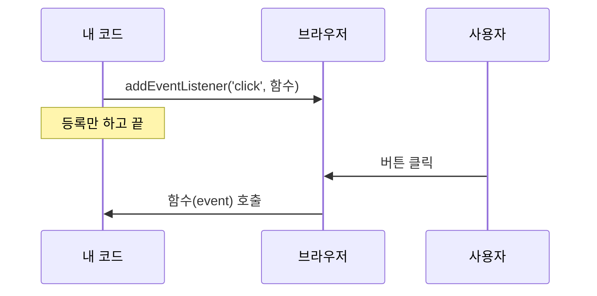
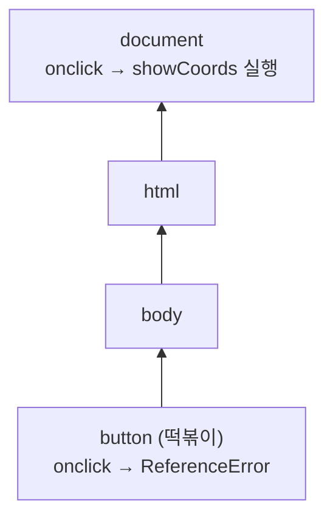

## 들어가며

지난 글에서 JavaScript 핵심 문법을 Java와 비교해 정리했다. 그때까지는 Node.js 콘솔에서만 코드를 돌렸는데, 이번 수업부터는 무대가 **브라우저**로 바뀌었다.

```html
<body>
  <!-- HTML 요소들 -->
  <script>
    // 여기서 HTML 요소를 찾아서 바꾼다
  </script>
</body>
```

`<script>`가 `<body>` 맨 아래에 있는 데도 이유가 있다. 브라우저는 HTML을 위에서부터 읽으며 요소를 만든다. 그래서 스크립트가 위에 있으면 아직 만들어지지 않은 요소를 찾게 되고 결과는 `null`이 된다.

이번 글은 세 가지 실습을 다룬다.

1. HTML 요소를 JavaScript로 **찾아오기** (DOM 요소 취득)
2. 클릭, 마우스 오버 같은 사건에 **반응하기** (이벤트 핸들러)
3. 그 사건의 **정보 읽기** (이벤트 객체와 `this`)

수업 파일을 Chromium(Playwright)에서 열어 콘솔 값을 직접 확인하면서 정리했다. 그러다 실습 코드에 있던 오타 하나와 주석 하나가 생각보다 많은 걸 알려줬다.

## 1. DOM 요소 취득: 무엇을 반환하는지가 더 중요했다

DOM(Document Object Model)은 브라우저가 HTML을 읽어서 만든 **객체 트리**다. `document`가 그 루트이고, JavaScript는 이 트리를 통해서 화면을 바꾼다.

```js
const $store = document.getElementById('store');
$store.style.backgroundColor = 'yellow';
```

변수 앞의 `$`는 문법이 아니라 관례다. "이 변수에는 DOM 요소가 들어 있다"는 표시다.

요소를 가져오는 메서드는 네 가지를 실습했다.

| 메서드 | 기준 | 반환 | 없을 때 |
|--------|------|------|---------|
| `getElementById('id')` | id | 요소 1개 | `null` |
| `getElementsByTagName('li')` | 태그 이름 | `HTMLCollection` | 빈 컬렉션 |
| `getElementsByClassName('menu')` | class | `HTMLCollection` | 빈 컬렉션 |
| `querySelector('.box')` | CSS 선택자 | 첫 번째 요소 1개 | `null` |
| `querySelectorAll('.box')` | CSS 선택자 | `NodeList` | 빈 NodeList |

수업에서는 CSS 선택자 방식(`querySelector`, `querySelectorAll`)을 권장했다. 이미 아는 CSS 문법으로 id, class, 태그, 자식 관계를 모두 표현할 수 있기 때문이다.

### id가 중복되면 첫 번째만 잡힌다

실습 HTML에는 일부러 `id="store"`가 두 개 들어 있었다.

```html
<div id="store" class="area">냠냠분식 본점 ...</div>
<div id="store" class="area">냠냠분식 2호점 (id 중복!)</div>
```

`getElementById('store')`로 배경을 노랗게 바꾸면 **본점만** 노래지고 2호점은 그대로다. 콘솔로 확인한 결과:

```js
document.querySelectorAll('#store').length;                              // 2
document.getElementById('store') === document.querySelectorAll('#store')[0]; // true
```

에러는 나지 않는다. 그래서 더 위험하다. HTML 명세상 id는 문서 안에서 유일해야 하는데, 브라우저는 이걸 막지 않고 조용히 첫 번째 요소만 돌려준다. 2호점 코드가 왜 안 바뀌는지 한참 찾게 되는 버그가 될 수 있다.

### HTMLCollection에는 forEach가 없다

태그 이름으로 가져온 `li` 목록에 바로 `forEach`를 쓰려고 하면 안 된다.

```js
const $snackLiList = document.getElementById('snack').getElementsByTagName('li');

Object.prototype.toString.call($snackLiList); // [object HTMLCollection]
Array.isArray($snackLiList);                  // false
typeof $snackLiList.forEach;                  // "undefined"
```

배열처럼 생겼지만 배열이 아니다. 인덱스와 `length`가 있는 **유사 배열 객체**다. 그래서 수업에서는 `Array.from()`으로 진짜 배열로 바꾼 뒤 `forEach`를 썼다.

```js
const liList = Array.from($snackLiList);
liList.forEach(li => li.style.color = 'red');
```

여기서 실습 주석을 조금 보완하고 싶어졌다. 주석에는 "JS에서 li list를 사용하기 위해서는 배열로 변환해주어야 한다"고 적혀 있었는데, 확인해 보니 **반복만 할 거라면 변환하지 않아도 된다.** HTMLCollection은 이터러블이라 `for...of`가 바로 동작한다.

```js
for (const li of $snackLiList) { /* 3번 돈다 */ }
```

변환이 꼭 필요한 건 `map`, `filter`처럼 **배열에만 있는 메서드**를 쓸 때다.

`querySelectorAll`이 돌려주는 `NodeList`는 또 다르다.

| | HTMLCollection | NodeList (`querySelectorAll`) |
|---|---|---|
| `forEach` | ❌ | ✅ |
| `map`, `filter` | ❌ | ❌ |
| `for...of` | ✅ | ✅ |
| DOM이 바뀌면 | **자동으로 반영 (live)** | 그대로 (static) |

마지막 줄이 흥미로웠다. 같은 `ul`에서 두 방식으로 `li`를 가져온 뒤 새 `li`를 하나 추가해 봤다.

```js
const live = ul.getElementsByTagName('li'); // 3개
const stat = ul.querySelectorAll('li');     // 3개

ul.appendChild(document.createElement('li'));

live.length; // 4 ← 다시 조회하지 않았는데 늘어남
stat.length; // 3 ← 가져온 시점 그대로
```

HTMLCollection은 DOM을 실시간으로 비추는 창이고, `querySelectorAll`의 NodeList는 그 순간을 찍은 사진이다. 반복문 안에서 요소를 추가하거나 지우는 코드라면 live 컬렉션은 길이가 계속 바뀌어서 예상하지 못한 결과를 낼 수 있다. `querySelectorAll`을 권장하는 이유가 하나 더 생긴 셈이다.

참고로 `getElementsByClassName('menu')`는 `#available`과 `#soldout` 두 목록에 있는 `.menu`를 모두 가져와서 6개였다. 특정 목록 안에서만 찾고 싶으면 `document`가 아니라 `$snack.getElementsByTagName('li')`처럼 **부모 요소에서** 호출하면 된다. `querySelectorAll('#available .menu')`처럼 선택자로 범위를 좁혀도 된다.

## 2. 이벤트 핸들러: 호출을 브라우저에게 맡긴다

이벤트 핸들러는 **이벤트가 발생했을 때 브라우저가 대신 호출해 주는 함수**다. 우리는 함수를 만들어 등록만 하고, 언제 부를지는 브라우저가 정한다.



Java로 치면 버튼에 `ActionListener`를 붙여 두고 이벤트 루프가 호출해 주길 기다리는 구조와 비슷하다. 내가 `main`에서 직접 부르는 함수가 아니다.

등록 방법은 세 가지를 실습했다.

### (1) 어트리뷰트 방식: 문자열이 함수 본문이 된다

```html
<button onclick="alert('주문 완료!'); console.log('주문 완료!');">주문하기</button>
<button onmouseover="recommend('김자바');">오늘의 추천 메뉴</button>
```

`on` + 이벤트 타입 이름의 HTML 속성에 코드를 쓴다. 수업에서는 "함수 참조가 아니라 **함수 호출문**을 쓴다"고 강조했는데, 왜 그런지는 브라우저가 이 속성을 어떻게 바꾸는지 보면 이해된다.

```js
String(document.querySelector('button[onclick*="handleClick2"]').onclick);
// "function onclick(event) {\nhandleClick2(this)\n}"
```

브라우저는 속성 문자열을 **함수의 본문**으로 넣어서 `onclick(event) { ... }`라는 함수를 만든다. 그래서 `onclick="recommend"`라고 쓰면 본문이 `recommend`라는 식 하나뿐이라 아무 일도 일어나지 않는다. 함수를 **호출**하는 코드가 들어가야 한다.

이 구조를 알면 3장에 나오는 `event`, `this`가 왜 어트리뷰트 안에서 바로 쓰이는지도 설명된다. `event`는 브라우저가 만든 함수의 매개변수 이름이고, `this`는 그 함수가 붙어 있는 요소다.

다만 HTML과 JavaScript가 섞이고, 전역 함수만 호출할 수 있어서 요즘은 잘 쓰지 않는다.

### (2) 프로퍼티 방식: 하나만 남는다

```js
const $btnProp = document.getElementById('btn-prop');

$btnProp.onclick = function () { alert('프로퍼티 방식으로 이벤트 핸들러 등록!!'); };
$btnProp.onclick = () => alert('두번째 이벤트 핸들러 등록!!');
```

DOM 요소의 `onclick` 프로퍼티에 함수를 **대입**한다. 대입이니까 두 번째 대입이 첫 번째를 덮어쓴다. 버튼을 누르면 "두번째"만 뜬다.

### (3) addEventListener 방식: 여러 개를 쌓는다 (권장)

```js
$btnListener.addEventListener('click', function () { alert('결제 완료!'); });
$btnListener.addEventListener('mouseover', function () { alert('2번째 addEvent 동작!'); });
```

같은 이벤트에 여러 개를 등록해도 덮어쓰지 않는다. 프로퍼티 방식과 섞으면 어떻게 될지 궁금해서 한 버튼에 모두 등록해 봤다.

```js
b.onclick = () => log.push('first');
b.onclick = () => log.push('second');
b.addEventListener('click', () => log.push('L1'));
b.addEventListener('click', () => log.push('L2'));
b.click();
// log: ['second', 'L1', 'L2']
```

`first`는 덮어써져서 사라졌고, `addEventListener`로 등록한 두 개는 **등록한 순서대로** 모두 실행됐다. 두 방식은 서로 덮어쓰지 않고 공존한다.

| | 어트리뷰트 | 프로퍼티 | addEventListener |
|---|---|---|---|
| 작성 위치 | HTML | JS | JS |
| 같은 이벤트에 여러 개 | ❌ | ❌ (덮어씀) | ✅ |
| 제거 | 속성 삭제 | `null` 대입 | `removeEventListener` |
| 세부 옵션 (`once` 등) | ❌ | ❌ | ✅ |

### 제거는 "같은 함수"여야 된다

```js
const handleMouseOver = () => alert('결제 버튼에 마우스 호버!');

$btnRemove.addEventListener('mouseover', handleMouseOver);
$btnRemove.removeEventListener('mouseover', handleMouseOver);
```

실습 코드가 핸들러를 굳이 **바깥 변수**에 담은 이유가 있다. `removeEventListener`는 등록할 때와 **같은 함수 참조**를 받아야 지울 수 있다. 익명 함수로 등록하면 어떻게 되는지 확인해 봤다.

```js
b.addEventListener('dblclick', function () { n++; });
b.removeEventListener('dblclick', function () { n++; }); // 모양은 같은 함수
b.dispatchEvent(new MouseEvent('dblclick'));
// n === 1 → 지워지지 않았다
```

코드가 똑같아도 `function () {}`를 쓸 때마다 **새 함수 객체**가 만들어진다. 지난 글에서 본 `{...order} === order`가 `false`였던 것과 같은 이유다. 객체 비교는 내용이 아니라 참조로 한다. 나중에 지울 핸들러는 이름을 붙여 두어야 한다.

## 3. 이벤트 객체: 읽을 수는 있지만 바꿀 수는 없다

이벤트가 발생하면 브라우저는 그 사건의 정보를 담은 **이벤트 객체**를 만들어 핸들러의 첫 번째 인자로 넘겨준다.

```js
const $msg = document.querySelector('.message');

function showCoords(e) {
  $msg.textContent = `배달 위치 : ${e.clientX} , ${e.clientY}`;
}

document.onclick = showCoords;
```

`clientX`, `clientY`는 클릭한 지점의 화면 좌표다. 콘솔에 `e`를 찍어 보니 클릭 이벤트의 타입은 `PointerEvent`였다.

어트리뷰트 방식에서는 `event`라는 이름으로 넘긴다.

```html
<div class="map" onmouseover="showMapCoords(event)">지도 영역 내부를 클릭해 보세요!</div>
```

앞에서 본 것처럼 브라우저가 만드는 함수가 `function onmouseover(event) { ... }`이기 때문에 `event`라는 이름이 정해져 있다. (덧붙이면 이 `div`는 안내문에 "클릭해 보세요"라고 적혀 있지만 실제 이벤트는 `mouseover`라서 마우스를 올리기만 해도 좌표가 바뀐다.)

### 이벤트 객체를 수정하면?

실습 코드 주석에는 이렇게 적혀 있었다.

> 이벤트 객체는 매개변수로 전달 받을 수 있으며, 해당 값을 참조하거나 변경하거나 제거할 수 있게 된다.

그리고 아래에 `e.pointerType = 'pen';`이 있었다. 정말 바뀌는지 확인해 봤다.

```js
const c = new PointerEvent('click', { pointerType: 'mouse', clientX: 10 });
c.pointerType = 'pen';
c.clientX = 999;

c.pointerType; // 'mouse' ← 그대로
c.clientX;     // 10      ← 그대로
```

**바뀌지 않았고, 에러도 나지 않았다.** 이유는 이 값들이 객체에 직접 저장된 값이 아니라 프로토타입에 정의된 **getter만 있는 접근자 프로퍼티**이기 때문이다.

```js
Object.getOwnPropertyDescriptor(PointerEvent.prototype, 'pointerType').set; // undefined
```

setter가 없으니 대입은 조용히 무시된다. strict mode에서는 이게 에러로 드러난다.

```js
'use strict';
c.pointerType = 'pen';
// TypeError: Cannot set property pointerType of #<PointerEvent> which has only a getter
```

더 헷갈리는 경우도 있었다. 실습 코드에서 `e.pointerType = 'pen'`을 실행하는 `showMapCoords`는 `mouseover` 핸들러다. `mouseover`는 `PointerEvent`가 아니라 `MouseEvent`라서 애초에 `pointerType`이 없다. 그래서 대입하면 **새 프로퍼티가 하나 추가되고**, 다시 읽으면 `'pen'`이 나온다.

```js
const m = new MouseEvent('mouseover');
m.pointerType = 'pen';
m.pointerType;                   // 'pen'
Object.hasOwn(m, 'pointerType'); // true ← 내가 만든 프로퍼티
```

바뀐 것처럼 보이지만 브라우저가 이 값을 쓰는 건 아니다. 그냥 객체에 임의의 값을 붙인 것뿐이다. 정리하면 이벤트 객체는 **사건을 기록한 영수증**에 가깝다. 읽는 건 자유지만 고쳐 쓴다고 해서 일어난 사건이 바뀌지는 않는다.

이벤트 객체로 할 수 있는 "변경"은 프로퍼티 대입이 아니라 메서드 호출이다. 예를 들어 `e.preventDefault()`는 기본 동작을 막고, `e.stopPropagation()`은 전파를 멈춘다. 이건 다음 시간 폼 이벤트에서 다룰 예정이다.

## 4. 오타 하나가 보여준 것: this와 이벤트 전파

`this` 실습 HTML에는 오타가 있었다.

```html
<button onclick="handleClxick1()">떡볶이</button>   <!-- handleClick1 이어야 함 -->
<button onclick="handleClick2(this)">순대</button>
```

떡볶이 버튼을 누르면 콘솔에 이렇게 찍힌다.

```text
ReferenceError: handleClxick1 is not defined
    at HTMLButtonElement.onclick
[LOG] PointerEvent      ← ?
```

에러는 예상대로였다. 흥미로운 건 그 **다음 줄**이었다. 버튼 핸들러가 에러로 죽었는데도 `document.onclick = showCoords`가 실행돼서 `PointerEvent`가 찍혔고, 화면의 배달 위치 문구도 바뀌었다.

### 이벤트는 위로 전파된다

버튼에서 발생한 클릭 이벤트는 버튼에서 끝나지 않고 부모 요소를 따라 `document`까지 올라간다. 이걸 **버블링(bubbling)** 이라고 한다.



그리고 한 핸들러에서 난 에러는 **그 핸들러만** 중단시킨다. 브라우저가 에러를 콘솔에 보고한 뒤 다음 핸들러를 계속 호출한다. Java 콘솔 프로그램에서 잡지 않은 예외가 호출 스택을 타고 올라가 `main`까지 멈추는 것과 다르다. 이벤트 핸들러는 내가 호출한 게 아니라 브라우저가 하나씩 따로 호출하기 때문이다.

이것도 장단점이 있다. 페이지 전체가 죽지 않는 건 좋지만, 콘솔을 열어 보지 않으면 버튼 하나가 고장 났다는 걸 모르고 지나칠 수 있다.

### 오타를 고치면: this는 누구인가

오타를 `handleClick1`로 고치고 두 버튼의 `this`를 비교했다.

```js
function handleClick1() {
  console.log('click1', this); // window
}

function handleClick2(btn) {
  console.log('click2', btn);  // <button>순대</button>
}
```

| 위치 | `this` | 이유 |
|------|--------|------|
| 어트리뷰트 안 (`onclick="...this..."`) | 버튼 요소 | 브라우저가 만든 `onclick` 함수가 버튼에 붙어 있음 |
| 어트리뷰트에서 호출한 일반 함수 (`handleClick1()`) | `window` | 그냥 함수 호출이라 `this`가 전역 객체 (non-strict) |

`handleClick1`은 버튼 클릭으로 실행됐지만, 실제로는 어트리뷰트 함수 **안에서 평범하게 호출된** 함수다. JavaScript의 `this`는 함수가 어디에 정의됐는지가 아니라 **어떻게 호출됐는지**로 정해진다. 그래서 요소가 필요하면 `handleClick2(this)`처럼 어트리뷰트 안의 `this`(버튼)를 인자로 넘겨줘야 한다.

Java의 `this`는 항상 "그 메서드를 가진 인스턴스"로 고정이라 이 부분이 가장 낯설었다. 지난 글에서 "화살표 함수는 자기만의 `this`가 없다"고 정리했는데, 이벤트 핸들러에서 이게 어떻게 차이를 만드는지는 실습 파일의 다음 섹션(프로퍼티/addEventListener/화살표 함수 버튼)에서 이어서 확인할 예정이다.

## 정리하며

1. **id가 중복돼도 에러는 없다.** `getElementById`는 첫 번째만 조용히 돌려준다.
2. **HTMLCollection은 배열이 아니고 live다.** 반복은 `for...of`로 충분하고, `map`/`filter`가 필요할 때 `Array.from()`으로 바꾼다. `querySelectorAll`은 정적이고 `forEach`가 있다.
3. **이벤트 핸들러는 브라우저가 호출한다.** 프로퍼티 방식은 덮어쓰고, `addEventListener`는 쌓인다. 제거하려면 같은 함수 참조가 필요하다.
4. **이벤트 객체는 읽기 전용 영수증이다.** 대입은 조용히 무시되거나 의미 없는 프로퍼티만 추가한다.
5. **핸들러 하나의 에러는 그 핸들러만 멈춘다.** 이벤트는 계속 `document`까지 전파된다.
6. **`this`는 호출 방식이 정한다.** 어트리뷰트 안에서는 요소, 그 안에서 부른 일반 함수에서는 `window`다.

Node 콘솔에서는 함수를 내가 호출했는데, 브라우저에서는 함수를 맡겨 두고 브라우저가 부를 때를 기다린다. 이 관점 하나로 에러 전파, `this`, 제거 규칙이 모두 이어져서 설명된다는 게 이번 실습의 가장 큰 수확이었다.

## 더 학습하면 좋은 개념

- **이벤트 전파 3단계와 이벤트 위임** — 캡처링 → 타깃 → 버블링 흐름을 알면 `li` 100개에 핸들러를 하나씩 다는 대신 부모 `ul`에 하나만 다는 이벤트 위임을 할 수 있다.
- **`e.target` vs `e.currentTarget`** — 버블링 중에 "실제로 클릭된 요소"와 "지금 핸들러가 붙은 요소"를 구분하는 방법이다.
- **이벤트 핸들러에서의 `this`와 화살표 함수** — 프로퍼티/`addEventListener` 핸들러의 `this`는 요소인데, 화살표 함수로 쓰면 달라진다. 실습 파일의 남은 섹션과 바로 연결된다.
- **`<script defer>`와 `DOMContentLoaded`** — 스크립트를 `<body>` 맨 아래에 두지 않고도 DOM이 준비된 뒤 실행하는 방법이다.
- **strict mode** — 이벤트 객체 대입이나 `this`가 `window`가 되는 문제처럼, 조용히 넘어가는 실수를 에러로 드러내 준다.

## 참고 자료

- [MDN - DOM 소개](https://developer.mozilla.org/ko/docs/Web/API/Document_Object_Model/Introduction)
- [MDN - Document.getElementById()](https://developer.mozilla.org/ko/docs/Web/API/Document/getElementById)
- [MDN - Document.querySelectorAll()](https://developer.mozilla.org/ko/docs/Web/API/Document/querySelectorAll)
- [MDN - HTMLCollection](https://developer.mozilla.org/ko/docs/Web/API/HTMLCollection)
- [MDN - NodeList](https://developer.mozilla.org/ko/docs/Web/API/NodeList)
- [MDN - EventTarget.addEventListener()](https://developer.mozilla.org/ko/docs/Web/API/EventTarget/addEventListener)
- [MDN - EventTarget.removeEventListener()](https://developer.mozilla.org/en-US/docs/Web/API/EventTarget/removeEventListener)
- [MDN - Event](https://developer.mozilla.org/ko/docs/Web/API/Event)
- [MDN - PointerEvent.pointerType](https://developer.mozilla.org/en-US/docs/Web/API/PointerEvent/pointerType)
- [MDN - 이벤트 입문 (이벤트 버블링)](https://developer.mozilla.org/ko/docs/Learn_web_development/Core/Scripting/Events)
- [MDN - this](https://developer.mozilla.org/ko/docs/Web/JavaScript/Reference/Operators/this)
