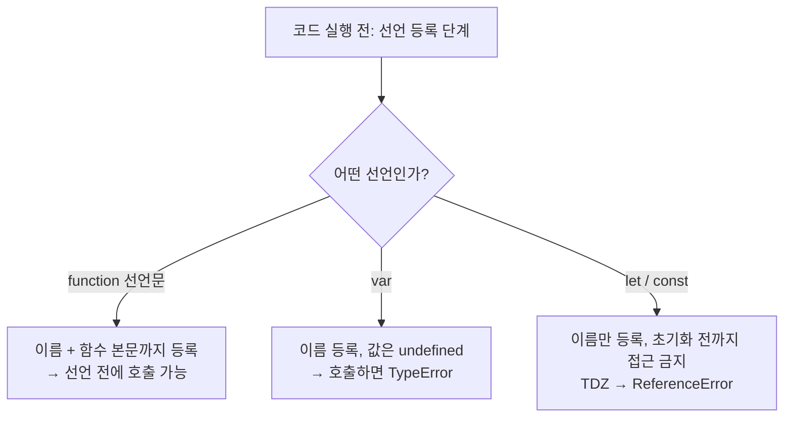
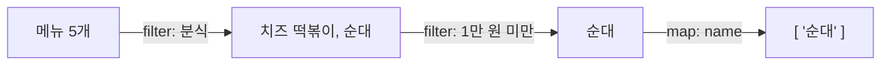
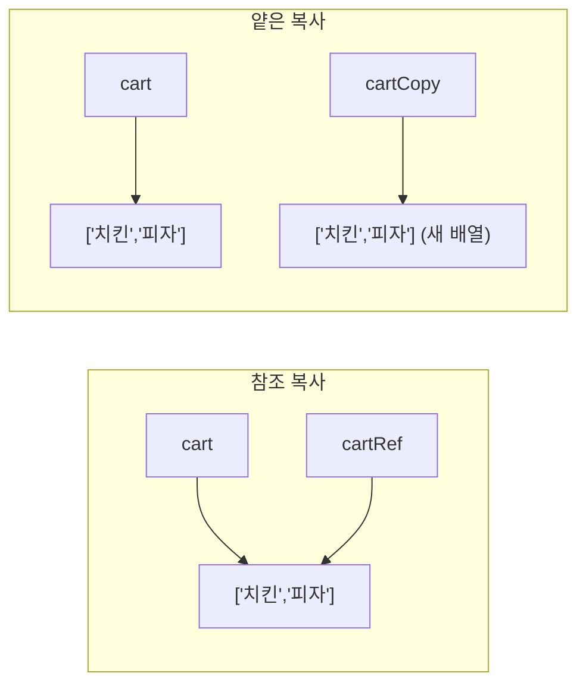

## 들어가며

Java로 Spring, JPA까지 배운 뒤 JavaScript 수업이 시작됐다. 첫 주제는 변수, 객체, 함수, 화살표 함수, 배열, 고차 함수, 스프레드 문법, 구조 분해 할당이었다.

문법 자체는 Java와 비슷해 보여서 금방 읽혔다. 그런데 **Java처럼 읽으면 결과를 틀리게 예측하는 코드**가 몇 군데 있었다. 수업 미션도 마침 "Java와 JavaScript의 동작 원리를 비교해서 설명할 수 있는 자료 만들기"였기 때문에, 실습 코드를 Node.js(v24)로 다시 실행해 보면서 그 지점들을 정리했다.

먼저 큰 그림부터 표로 비교하면 이렇다.

| 항목 | Java | JavaScript |
|------|------|------------|
| 타입 결정 시점 | 컴파일 타임 (정적 타입) | 런타임, 값이 할당될 때 (동적 타입) |
| 재할당 금지 | `final` | `const` |
| 객체 생성 | 클래스 정의 → `new` | 리터럴 `{}`로 바로 생성 |
| 필드 추가 | 클래스 수정 필요 | 실행 중 `obj.newKey = ...`로 추가 |
| 배열 요소 타입 | 한 가지 타입만 | 아무 값이나 섞을 수 있음 |
| 함수 | 클래스 안의 메서드 | 값(일급 객체), 변수에 담고 인자로 넘김 |
| 람다 | Java 8의 `(x) -> x * 2` | 화살표 함수 `x => x * 2` |

## 1. 변수: 타입은 변수가 아니라 값에 붙는다

Java의 `String str = "문자열"; str = 1;`은 컴파일 에러다. JavaScript에서는 아무 문제 없다.

```js
let test = 1;
test = "문자열";
console.log(test); // 문자열
```

JavaScript는 **변수에 타입이 없고 값에 타입이 있다.** `typeof`로 같은 변수에 여러 값을 넣어 보면 이게 잘 드러난다.

```js
let test1;
console.log(typeof test1); // undefined

test1 = 1;              // number
test1 = "java";         // string
test1 = true;           // boolean
test1 = null;           // object  ← ?
test1 = {};             // object
test1 = [];             // object  ← ?
test1 = function() {};  // function
```

여기서 걸린 건 두 줄이었다.

- `typeof null`이 `"object"`다. MDN에서도 JavaScript 초기 구현 때부터 남아 있는 동작이라고 설명한다. 그래서 null 체크는 `typeof`가 아니라 `value === null`로 한다.
- 배열도 `"object"`다. 배열인지 확인하려면 `Array.isArray(value)`를 쓴다.

동적 타입은 선언이 편한 대신, 값을 확인하기 전에는 타입을 확신할 수 없다. 문자열이라고 생각하고 `.length`를 쓰던 변수에 숫자가 들어오면 `undefined`가 나온다. 컴파일러가 잡아주던 실수를 이제 런타임에 직접 마주쳐야 한다. TypeScript가 왜 생겼는지 이해가 되는 지점이었다.

`const`는 Java의 `final`과 비슷하게 **재할당**을 막는다. 다만 `final`처럼 참조만 고정할 뿐, 객체 내부 값까지 막지는 않는다는 점도 같다. 이건 뒤의 객체 실습에서 다시 나온다.

## 2. 객체: 클래스 없이 만들고, 실행 중에 늘린다

Java에서 객체를 만들려면 클래스부터 정의해야 한다. JavaScript는 중괄호만으로 객체가 생긴다.

```js
const store = {
  name: '원티드 식당',
  category: '분식',
  getInfo: function () {
    return `${this.name} 은 ${this.category} 전문점 입니다!`;
  },
};

console.log(store.getInfo()); // 원티드 식당 은 분식 전문점 입니다!
```

Java로 치면 `name`, `category`는 필드, `getInfo`는 메서드다. JavaScript에서는 이걸 전부 **프로퍼티(key-value 쌍)** 라고 부르고, 객체는 프로퍼티의 집합이다. 메서드도 "값이 함수인 프로퍼티"일 뿐이다.

Java와 가장 다른 점은 실행 중에 프로퍼티를 붙일 수 있다는 것이다.

```js
const order = { menuName: '치킨' };
order.sauce = '뿌링클 시즈닝';   // 추가
order.sauce = '맛초킹 시즈닝';   // 수정
```

`order`가 `const`인데도 프로퍼티를 추가하고 바꿀 수 있다. `const`가 막는 건 `order = 다른객체` 같은 재할당뿐이기 때문이다.

> 프로퍼티 key는 문자열(또는 Symbol)이다. `{ 1: 'a' }`처럼 숫자로 써도 `Object.keys()`로 보면 `['1']`, 문자열로 바뀌어 있다.

## 3. 함수: 선언문은 되고 표현식은 안 됐다

실습 중 유일하게 **에러로 멈춘** 코드가 여기 있었다.

```js
console.log(cook('떡볶이'));      // 떡볶이 조리 시~작~!

function cook(menuName) {          // 함수 선언문
  return `${menuName} 조리 시~작~!`;
}

console.log(test1('떡볶이'));     // ReferenceError!

const test1 = function (menuName) { // 함수 표현식
  return `${menuName} 조리 시~작~!`;
};
```

실행 결과:

```text
떡볶이 조리 시~작~!
ReferenceError: Cannot access 'test1' before initialization
```

둘 다 "함수를 만들고 호출한다"는 같은 일을 하는데, 하나는 선언 전에 호출해도 되고 하나는 안 된다.

### 왜 이런 차이가 생길까

JavaScript 엔진은 코드를 한 줄씩 실행하기 전에 먼저 **선언**을 훑어서 스코프에 등록한다. 이걸 호이스팅(hoisting)이라고 부른다. 그런데 등록되는 방식이 선언 종류마다 다르다.



- **함수 선언문**은 함수 본문까지 통째로 미리 준비된다. 그래서 `cook`은 선언보다 위에서 호출해도 동작한다.
- **함수 표현식**은 "변수에 함수를 할당하는 것"이다. 함수가 아니라 **변수 `test1`의 규칙**을 따른다. `const`로 선언된 변수는 이름은 등록되지만 선언문이 실행되기 전까지 접근할 수 없는 구간에 있다. 이 구간을 TDZ(Temporal Dead Zone)라고 한다.

Java는 클래스 안의 메서드 순서가 상관없다. 컴파일러가 클래스 전체를 먼저 보기 때문이다. 그래서 "선언 위치와 관계없이 부를 수 있다"는 점만 보면 함수 선언문이 Java 메서드와 비슷해 보인다. 하지만 원리는 다르다. Java는 컴파일 단계의 이야기고, JavaScript는 실행 직전에 스코프를 만드는 런타임의 이야기다.

실무 관점에서는 표현식 + `const`가 오히려 안전하다고 느꼈다. 선언 전에 쓰면 바로 에러가 나니까, 정의되지 않은 함수를 조용히 부르는 실수를 일찍 잡을 수 있다.

### 이름 있는 함수 표현식

```js
const welcome3 = function hello(name) { ... };
welcome3('홍길동'); // OK
hello('홍길동');    // ReferenceError: hello is not defined
```

`hello`라는 이름은 함수 **내부**에서만 보인다(재귀 호출이나 스택 트레이스용). 바깥에서는 변수 이름인 `welcome3`으로만 부를 수 있다.

## 4. 화살표 함수: Java 람다의 사촌

`function` 키워드, 중괄호, `return`을 줄이는 문법이다.

```js
message = function () { return '주문 접수 OK!'; };
message = () => { return '주문 접수 OK!'; };
message = () => '주문 접수 OK!';                         // 본문이 식 하나면 {}와 return 생략
message = (menuName, price) => `${menuName} 의 가격 ${price}`;
message = menuName => `${menuName} !!`;                  // 매개변수가 1개면 () 생략
```

Java 8 람다 `price -> price * 0.9`와 거의 같은 모양이다. 차이는 Java 람다가 **함수형 인터페이스의 구현**인 반면, JavaScript 화살표 함수는 그 자체로 함수 값이라는 점이다. `Function<Integer, Double>` 같은 타입 선언이 필요 없다.

한 가지 주의할 점이 있다. 화살표 함수는 자기만의 `this`를 갖지 않는다. 그래서 2장의 `getInfo`처럼 `this.name`을 쓰는 객체 메서드를 화살표 함수로 바꾸면 `this`가 객체를 가리키지 않는다. 화살표 함수는 콜백에, 객체 메서드는 일반 함수나 메서드 축약 문법(`getInfo() { ... }`)에 쓰는 게 기본 원칙이다.

## 5. 배열과 고차 함수: for문 대신 "무엇을 할지"만 넘긴다

JavaScript 배열에는 아무 값이나 섞어서 넣을 수 있다.

```js
const menus = ['제육', '떡볶이', '순대', 1, { name: 'hi' }, function () {}];
```

가능은 하지만 실무에서 이렇게 섞을 일은 거의 없다. 실제로 많이 다루는 건 **같은 모양의 객체 배열**이고, 이걸 처리하는 도구가 고차 함수다.

고차 함수는 **함수를 인자로 받거나 함수를 반환하는 함수**다. 배열의 `forEach`, `map`, `filter`는 콜백 함수를 받아서 요소를 하나씩 넘겨준다.

| 메서드 | 콜백의 역할 | 반환값 | Java Stream 대응 |
|--------|-------------|--------|-----------------|
| `forEach` | 각 요소로 작업 수행 | 없음(`undefined`) | `forEach` |
| `map` | 요소를 다른 값으로 변환 | 같은 길이의 새 배열 | `map` |
| `filter` | `true`/`false` 판정 | 조건을 통과한 요소만 담은 새 배열 | `filter` |

메뉴 목록에서 "1만 원 미만 분식의 이름"만 뽑는 코드:

```js
const menus = [
  { name: '치즈 떡볶이', category: '분식', price: 14000 },
  { name: '순대',       category: '분식', price: 3000 },
  { name: '파스타',     category: '양식', price: 19000 },
  { name: '제육볶음',   category: '한식', price: 10000 },
  { name: '김치찜',     category: '한식', price: 8000 },
];

const result = menus
  .filter(menu => menu.category === '분식')
  .filter(menu => menu.price < 10000)
  .map(menu => menu.name);

console.log(result); // [ '순대' ]
```



Java Stream의 `menus.stream().filter(...).filter(...).map(...).toList()`와 생각하는 방식이 같다. 차이점은 JavaScript 배열 메서드는 **매 단계마다 새 배열을 바로 만든다**는 것이다. Java Stream은 최종 연산(`toList()`)을 만나기 전까지 실행을 미루는 지연 평가를 한다. 데이터가 작을 때는 차이가 없지만, 원리가 다르다는 건 알아둘 만하다.

### `==` vs `===`

`filter` 조건에서 `===`를 쓴 이유도 여기서 정리했다.

```js
1 == '1'   // true  — 타입을 맞춘 뒤 비교 (암묵적 형변환)
1 === '1'  // false — 타입과 값이 모두 같아야 함
```

동적 타입 언어에서 `==`는 예상 못 한 형변환을 일으키기 쉽다. 특별한 이유가 없으면 `===`를 쓴다.

## 6. 스프레드 문법: '깊은 복사'라고 적었던 게 사실은 아니었다

복사 실습 코드에는 원래 이런 주석이 달려 있었다.

```js
const cart = ['치킨', '피자'];
const cartRef = cart;        // 깊은 복사 (주소값을 복사)
const cartCopy = [...cart];  // 얕은 복사 (값만 복사해서 새로운 배열 생성)
```

실행 결과 자체는 예상대로였다.

```js
cartRef.push('파스타');
console.log(cart, cartRef);
// [ '치킨', '피자', '파스타' ] [ '치킨', '피자', '파스타' ]  ← 원본도 바뀜

cartCopy.push('빠네파스타');
console.log(cart, cartCopy);
// [ '치킨', '피자', '파스타' ] [ '치킨', '피자', '빠네파스타' ]  ← 원본 그대로
```

그런데 용어를 다시 확인해 보니 **`cartRef = cart`는 깊은 복사가 아니다.** 복사된 건 배열이 아니라 배열을 가리키는 참조(주소)뿐이다. 이건 그냥 **참조 복사(같은 객체를 두 변수가 공유)** 다. Java에서 `List<String> ref = list;`라고 쓴 것과 같다.

정확하게 나누면 세 가지다.

| 방식 | 코드 예 | 새 배열/객체가 생기나 | 안쪽 객체도 새로 생기나 |
|------|---------|----------------------|------------------------|
| 참조 복사 | `const b = a` | ❌ | ❌ |
| 얕은 복사 | `[...a]`, `{...obj}` | ✅ | ❌ (안쪽은 여전히 공유) |
| 깊은 복사 | `structuredClone(a)` | ✅ | ✅ |



얕은 복사의 "얕은"이 무슨 뜻인지는 배열 안에 객체가 있을 때 드러난다.

```js
const a = [{ n: 1 }];
const s = [...a];
s[0].n = 99;
console.log(a[0].n); // 99 — 바깥 배열은 새것이지만 안쪽 객체는 같은 것
```

`cart`처럼 문자열만 들어 있는 배열은 얕은 복사만으로도 충분했던 것이고, 중첩된 객체까지 분리하려면 `structuredClone()`이 필요하다.

객체 비교로도 확인할 수 있다. `===`는 객체끼리 비교할 때 **같은 객체인지(참조)** 를 본다. Java의 `==`와 같다.

```js
const order = { menuName: '뿌링클', qty: 2 };
console.log(order === order);      // true
console.log(order === { ...order }); // false — 내용은 같아도 다른 객체
```

참조 복사가 위험한 이유도 실습 주석에 잘 적혀 있었다. 같은 메뉴 데이터를 여러 곳에서 쓰는데 한 곳에서 수정하면, 다른 곳에서는 이유도 모른 채 값이 바뀐다. 원본을 보호하고 싶을 때 스프레드로 새 배열/객체를 만드는 패턴은 이후 React 상태 관리에서도 계속 쓰인다고 한다.

## 7. 구조 분해 할당: 꺼내는 코드를 한 줄로

배열과 객체에서 값을 꺼내 변수에 담는 코드를 줄여주는 문법이다.

```js
// 배열: 순서대로 꺼낸다
const menuArr = ['치킨', '피자'];
const [chi, piz] = menuArr;

// 객체: key 이름으로 꺼낸다
const menu = { name: '치즈알밥', price: 7500, category: '퓨전한식' };
const { name, price, category } = menu;
console.log(name, price, category); // 치즈알밥 7500 퓨전한식
```

배열은 **위치**, 객체는 **key 이름**이 기준이다. 그래서 객체 구조 분해에서 `const { name1 } = menu`라고 쓰면 `menu`에 `name1`이라는 key가 없으니 `undefined`가 들어간다. 다른 이름을 쓰고 싶으면 `const { name: menuName } = menu`처럼 별칭을 붙인다.

나머지를 모으는 `...`도 함께 쓸 수 있다.

```js
const { ...rest } = menu;
console.log(rest); // { name: '치즈알밥', price: 7500, category: '퓨전한식' }
```

모양은 스프레드와 같지만, 구조 분해 할당의 **왼쪽**에 오는 `...`은 MDN에서 **나머지 프로퍼티(rest property)** 라고 부른다. 오른쪽에서 펼치면 spread, 왼쪽에서 모으면 rest다. 실전에서는 `const { price, ...withoutPrice } = menu;`처럼 특정 key만 빼고 나머지로 새 객체를 만들 때 유용하다.

## 정리하며

Java 감각으로 JavaScript를 읽을 때 틀렸던 지점을 한 문장씩 정리하면 이렇다.

1. **타입은 값에 붙는다.** 같은 변수에 숫자도, 문자열도 들어간다. `typeof null`은 `"object"`다.
2. **`const`는 재할당만 막는다.** 객체 내부는 자유롭게 바뀐다. Java `final`과 같다.
3. **함수 표현식은 변수 규칙을 따른다.** `const`로 만든 함수를 선언 전에 부르면 TDZ 때문에 ReferenceError가 난다.
4. **`b = a`는 복사가 아니라 공유다.** 스프레드는 얕은 복사, 진짜 깊은 복사는 `structuredClone()`이다.
5. **비교는 `===`로.** 객체끼리의 `===`는 내용이 아니라 같은 객체인지를 본다.

문법은 짧아졌지만, 컴파일러가 잡아주던 실수를 이제는 내가 실행해 보고 잡아야 한다는 게 가장 큰 차이였다.

## 더 학습하면 좋은 개념

- **실행 컨텍스트와 스코프 체인** — 호이스팅과 TDZ가 "왜" 그렇게 동작하는지는 엔진이 실행 컨텍스트를 만드는 과정을 알아야 정확히 설명할 수 있다.
- **`this` 바인딩 규칙** — 일반 함수와 화살표 함수의 `this`가 왜 다른지 알아야 객체 메서드와 콜백을 올바르게 고를 수 있다.
- **클로저(Closure)** — "함수를 반환하는 함수"라는 고차 함수의 나머지 절반. 함수가 자신이 만들어진 스코프를 기억하는 원리다.
- **`reduce`와 불변성** — `map`/`filter` 다음 단계. 원본을 바꾸지 않고 새 값을 만드는 습관은 React 상태 관리로 바로 이어진다.
- **TypeScript** — 동적 타입의 단점을 정적 타입 검사로 보완하는 방법. Java 경험이 가장 직접적으로 살아나는 영역이다.

## 참고 자료

- [MDN - typeof](https://developer.mozilla.org/ko/docs/Web/JavaScript/Reference/Operators/typeof)
- [MDN - const](https://developer.mozilla.org/ko/docs/Web/JavaScript/Reference/Statements/const)
- [MDN - Hoisting (용어 사전)](https://developer.mozilla.org/en-US/docs/Glossary/Hoisting)
- [MDN - let: Temporal dead zone](https://developer.mozilla.org/en-US/docs/Web/JavaScript/Reference/Statements/let#temporal_dead_zone_tdz)
- [MDN - 화살표 함수 표현](https://developer.mozilla.org/ko/docs/Web/JavaScript/Reference/Functions/Arrow_functions)
- [MDN - Array.prototype.map()](https://developer.mozilla.org/ko/docs/Web/JavaScript/Reference/Global_Objects/Array/map)
- [MDN - Array.prototype.filter()](https://developer.mozilla.org/ko/docs/Web/JavaScript/Reference/Global_Objects/Array/filter)
- [MDN - 전개 구문 (Spread syntax)](https://developer.mozilla.org/ko/docs/Web/JavaScript/Reference/Operators/Spread_syntax)
- [MDN - 구조 분해 할당](https://developer.mozilla.org/ko/docs/Web/JavaScript/Reference/Operators/Destructuring_assignment)
- [MDN - structuredClone()](https://developer.mozilla.org/en-US/docs/Web/API/Window/structuredClone)
- [MDN - Shallow copy (용어 사전)](https://developer.mozilla.org/en-US/docs/Glossary/Shallow_copy)
