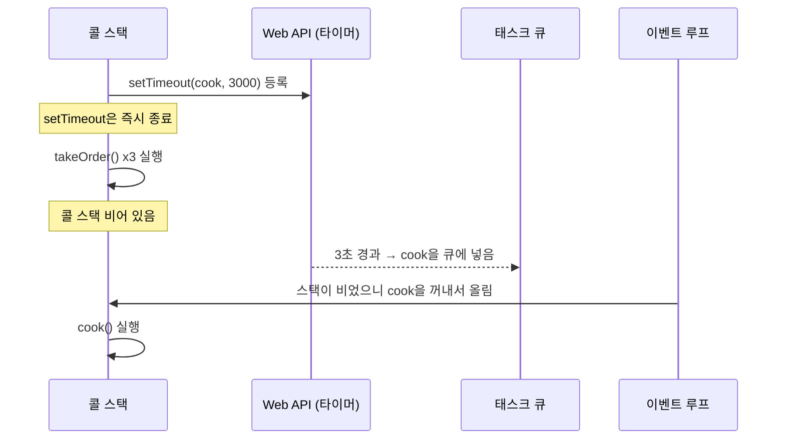
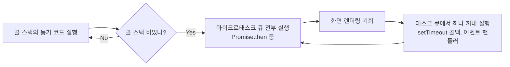

## 들어가며

JavaScript 비동기 수업은 떡볶이 가게 비유로 시작했다.

| 방식 | 가게 상황 |
|------|-----------|
| 동기 | 떡볶이 조리(3초)가 끝날 때까지 다음 손님 주문을 받을 수 없다 |
| 비동기 | 떡볶이를 조리하는 동안 다음 손님 주문을 먼저 받는다 |

비유는 직관적이었는데, 코드로 돌려보고 나니 질문이 하나 생겼다.
**JavaScript는 싱글 스레드라면서, 3초를 기다리는 일은 도대체 누가 하고 있는 걸까?**
이 질문을 따라가다 보면 콜 스택, 태스크 큐, 이벤트 루프라는 세 가지 개념을 만나게 된다.

## 동기: 3초 동안 아무것도 못 한다

먼저 수업에서 본 동기 방식이다. `sleep`은 `while` 문으로 지정한 시간 동안 CPU를 붙잡고 있다가 전달받은 함수를 실행한다.

```js
// 수업 코드 (매개변수 이름 오타만 고쳐서 옮김)
function sleep(func, delay) {
    const delayUntil = Date.now() + delay;
    while (Date.now() < delayUntil); // 3초 동안 여기서 빙빙 돈다
    func();
}

function cook() {
    console.log("떡볶이 조리 완료!!(3초)");
}

function takeOrder() {
    console.log("다음 손님 주문 하세요!");
}

sleep(cook, 3000);
takeOrder();
```

```text
(3초 동안 아무 출력 없음)
떡볶이 조리 완료!!(3초)
다음 손님 주문 하세요!
```

코드는 위에서 아래로 실행되고, `sleep`이 끝나기 전까지 `takeOrder()`는 시작조차 못 한다.
그리고 브라우저에서는 이 3초 동안 **콘솔 출력만 멈추는 게 아니다.** 메인 스레드가 `while`에 묶여 있으니 버튼 클릭 처리도, 화면 다시 그리기도 같이 멈춘다. 사용자 입장에서는 "페이지가 얼어붙은" 상태다.

## 비동기: 주문부터 받는다

같은 일을 `setTimeout`으로 바꾸면 순서가 달라진다.

```js
setTimeout(cook, 3000);
takeOrder();
takeOrder();
takeOrder();
```

```text
다음 손님 주문 하세요!
다음 손님 주문 하세요!
다음 손님 주문 하세요!
(약 3초 후)
떡볶이 조리 완료!!(3초)
```

`setTimeout`이 코드상으로는 먼저 있는데도 `cook`은 가장 나중에 실행된다.
여기서 처음의 질문이 다시 나온다. 메인 스레드는 `takeOrder()`를 실행하느라 바빴는데, 3초를 세고 있던 건 누구일까?

## 핵심 원리: JS 엔진 혼자서 하는 일이 아니다

답은 "JavaScript 엔진 바깥"이다. 브라우저 환경은 크게 네 부분으로 나눠서 보면 이해가 쉽다.

| 구성 요소 | 역할 | 떡볶이 가게로 치면 |
|-----------|------|---------------------|
| 콜 스택(Call Stack) | 지금 실행 중인 함수들이 쌓이는 곳. 한 번에 하나만 실행한다 | 주문을 받는 점원 한 명 |
| Web API (브라우저) | 타이머, 네트워크 요청, DOM 이벤트 등을 엔진 밖에서 처리 | 주방의 타이머 |
| 태스크 큐(Task Queue) | 실행 준비가 끝난 콜백 함수, 이벤트 핸들러가 잠시 대기하는 곳 | "조리 완료" 벨이 울린 주문서 꽂이 |
| 이벤트 루프(Event Loop) | 콜 스택이 비었는지, 큐에 대기 중인 함수가 있는지 반복 확인 | 점원이 손이 빌 때마다 주문서 꽂이를 확인하는 습관 |

JavaScript 엔진(콜 스택)은 정말로 한 번에 하나의 일만 한다. 대신 시간이 걸리는 일은 브라우저가 대신 맡아준다.
`setTimeout(cook, 3000)`을 호출하면 엔진은 "3초 뒤에 `cook`을 부탁해"라고 브라우저에 맡기고 바로 다음 줄로 넘어간다. 3초를 세는 건 브라우저의 타이머다.



정리하면 이렇다.

1. `setTimeout`은 타이머를 **등록만 하고** 바로 콜 스택에서 빠진다.
2. 콜 스택은 이어서 `takeOrder()`들을 실행한다.
3. 3초가 지나면 브라우저가 `cook`을 **태스크 큐에 넣는다.** 아직 실행된 게 아니다.
4. 이벤트 루프는 콜 스택이 비어 있고 큐에 대기 중인 함수가 있으면, 먼저 들어온 것부터(FIFO) 꺼내 콜 스택으로 올린다.
5. 그제서야 `cook()`이 실행된다.

이벤트 루프의 동작을 아주 단순화해서 의사 코드로 쓰면 다음과 같다.

```js
// 개념 설명용 의사 코드 (실제 구현 아님)
while (true) {
    if (callStack.isEmpty() && taskQueue.hasTask()) {
        const task = taskQueue.dequeue(); // FIFO
        callStack.push(task);
        run(task);
    }
}
```

## 흥미로운 지점: setTimeout(fn, 0)

이 구조를 알고 나니 궁금해진 게 있다. 지연 시간을 `0`으로 주면 바로 실행될까?

```js
// 예시 코드
setTimeout(() => console.log("타이머 0ms"), 0);
console.log("동기 코드");
```

```text
동기 코드
타이머 0ms
```

0ms인데도 나중에 찍힌다. 위 흐름대로 따라가 보면 당연한 결과다. 타이머가 0ms 만에 끝나도 콜백은 **태스크 큐로 갈 뿐**이고, 이벤트 루프는 콜 스택이 비기 전까지 큐에서 아무것도 꺼내지 않는다. 지금 실행 중인 스크립트 전체가 끝나야 순서가 돌아온다.

한 걸음 더 나가서, 앞에서 본 동기 `sleep`과 섞으면 어떻게 될까?

```js
// 예시 코드
setTimeout(() => console.log("1초 타이머"), 1000);
sleep(() => console.log("3초 동기 작업 끝"), 3000);
```

```text
3초 동기 작업 끝
1초 타이머
```

1초 타이머는 1초 뒤에 큐에 들어가 있었지만, 콜 스택이 `while`에 3초 동안 붙잡혀 있었기 때문에 3초가 지나서야 실행된다.
즉 `setTimeout`의 지연 시간은 **"이 시간 뒤에 실행"이 아니라 "최소한 이 시간 뒤에 큐에 넣어줌"**에 가깝다. MDN도 지연 시간이 실제로는 더 길어질 수 있다고 설명한다. 콜 스택을 오래 붙잡는 동기 코드가 있으면 비동기 콜백도 같이 밀린다는 뜻이다.

## 기존 지식과 연결: 왜 프론트엔드는 API 호출을 비동기로 할까

수업에서는 이 내용을 프론트엔드와 백엔드의 관계로 연결했다.

- 프론트엔드는 사용자의 화면을 구성한다.
- 백엔드는 그 화면에 표시될 데이터를 돌려준다.

프론트엔드가 백엔드에 데이터를 요청했는데 응답이 느리다면? 요청을 동기로 기다리면 위의 `sleep`처럼 메인 스레드가 멈추고, 사용자는 이유도 모른 채 화면이 굳는 경험을 하게 된다.
그래서 브라우저에서의 API 호출(`fetch` 등)은 비동기로 처리한다. 네트워크 대기는 브라우저에 맡기고, 응답이 오면 콜백이 큐를 거쳐 실행되는 구조라 그동안에도 화면은 계속 반응한다.

이전에 서블릿을 공부할 때는 "요청마다 스레드를 하나씩 배정해서" 동시에 여러 요청을 처리했다. JavaScript는 반대로 **스레드는 하나만 두고, 기다리는 일을 밖으로 넘겨서** 동시성을 만든다. 같은 문제를 푸는 방법이 꽤 다르다는 점이 재미있었다.

| 항목 | 서블릿 (Java) | 브라우저 JavaScript |
|------|---------------|----------------------|
| 실행 스레드 | 요청마다 스레드 할당 | 메인 스레드 하나 |
| 기다리는 동안 | 그 스레드는 블로킹되어도 다른 스레드가 일함 | 기다리는 일은 Web API에 맡기고 다음 코드 실행 |
| 주의할 점 | 공유 자원 동시 접근 (`synchronized`) | 메인 스레드를 오래 붙잡는 동기 코드 |

## 발전 방향: 태스크 큐는 하나가 아니다

수업에서는 "태스크 큐" 하나로 설명했지만, 실제로는 큐가 더 나뉘어 있다. 다음 수업 주제인 Promise의 `then` 콜백은 **마이크로태스크 큐**라는 별도 큐에 들어가고, 이벤트 루프는 태스크 하나를 처리한 뒤 마이크로태스크 큐를 **전부** 비우고 나서야 다음 태스크로 넘어간다.

```js
// 예시 코드
setTimeout(() => console.log("setTimeout"), 0);
Promise.resolve().then(() => console.log("Promise.then"));
console.log("동기 코드");
```

```text
동기 코드
Promise.then
setTimeout
```



`setTimeout`이 코드상 먼저 등록됐는데도 `Promise.then`이 먼저 찍히는 이유가 이것이다. Promise와 `async/await`를 배울 때 이 순서를 다시 확인해볼 생각이다.

## 더 학습하면 좋은 개념

- **마이크로태스크 큐 (Microtask Queue)** — Promise, `queueMicrotask`의 콜백이 들어가는 큐. `async/await`의 실행 순서를 이해하려면 필수다.
- **Promise와 async/await** — 콜백을 중첩하지 않고 비동기 흐름을 표현하는 방법. 결국 내부에서는 위 큐 구조 위에서 동작한다.
- **requestAnimationFrame** — 렌더링 직전에 실행되는 콜백. 애니메이션을 `setTimeout`으로 만들면 왜 끊기는지 이해할 수 있다.
- **Web Worker** — 정말로 무거운 계산이 필요할 때 메인 스레드가 아닌 별도 스레드에서 실행하는 방법. "싱글 스레드"의 한계를 넘는 정식 경로다.
- **Node.js 이벤트 루프** — 브라우저와 큐 구성(phase)이 다르다. 백엔드에서 JavaScript를 쓸 때 차이를 알아두면 좋다.

## 참고 자료

- [MDN - JavaScript execution model (이벤트 루프)](https://developer.mozilla.org/en-US/docs/Web/JavaScript/Event_loop)
- [MDN - setTimeout() 지연 시간이 길어지는 이유](https://developer.mozilla.org/en-US/docs/Web/API/Window/setTimeout#reasons_for_delays_longer_than_specified)
- [MDN - Using microtasks in JavaScript with queueMicrotask()](https://developer.mozilla.org/en-US/docs/Web/API/HTML_DOM_API/Microtask_guide)
- [HTML Living Standard - Event loops](https://html.spec.whatwg.org/multipage/webappapis.html#event-loops)
