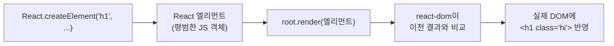

## 들어가며

[DOM 요소 취득과 이벤트 핸들러]({{ site.baseurl }}/posts/dom-select-and-event-handler/), [폼 이벤트]({{ site.baseurl }}/posts/form-events-focus-change-input-submit/)까지 바닐라 JS로 DOM을 직접 다뤘다. 이번엔 드디어 React다.

첫 수업은 빌드 도구도, JSX도 없이 **HTML 파일 하나**에서 시작했다. 예제는 두 개였다.

- `01_createElement.html`: `React.createElement`로 `<h1>` 하나 그리기
- `02_component.html`: 같은 `<h1>`을 함수형 컴포넌트로 감싸서 그리기

JSX를 쓰면 한 줄이면 될 걸 왜 굳이 이렇게 하나 싶었는데, 오히려 이 방식이라서 "React가 실제로 뭘 하는지"가 보였다.

## 1. React를 쓰는 두 가지 방법

| 방법 | 특징 | 이번 실습 |
|------|------|-----------|
| React 앱 생성 (Vite 등) | 빌드 도구, JSX 변환, 모듈 시스템 포함 | ✕ |
| `<script>`로 라이브러리 직접 로드 | 설치 없이 HTML 하나로 동작. JSX는 못 씀 | ○ |

```html
<script crossorigin src="https://unpkg.com/react@18.3.1/umd/react.development.js"></script>
<script crossorigin src="https://unpkg.com/react-dom@18.3.1/umd/react-dom.development.js"></script>
```

스크립트가 두 개라는 점이 흥미로웠다.

- `react`: 엘리먼트와 컴포넌트를 **만드는** 쪽 (`React.createElement`)
- `react-dom`: 그걸 브라우저 DOM에 **그리는** 쪽 (`ReactDOM.createRoot`)

React 자체는 "화면을 어떻게 생겨야 하는지 기술하는 라이브러리"이고, 실제 DOM 조작은 `react-dom`의 몫이다. 같은 React로 모바일 앱(React Native)을 만들 수 있는 것도 이 분리 덕분이다.

> 참고: UMD 빌드는 React 18까지만 제공되고 React 19부터는 제거됐다. 그래서 버전을 `18.3.1`로 고정해서 쓴다.

## 2. createElement: 세 개의 인자

```js
const hiElement = React.createElement('h1', { className: 'hi' }, 'helloworld!!');

ReactDOM.createRoot(document.getElementById('root')).render(hiElement);
```

| 인자 | 의미 | 예 |
|------|------|----|
| 1번째 `type` | 만들 요소의 타입 (태그 이름 또는 컴포넌트) | `'h1'` |
| 2번째 `props` | 요소의 프로퍼티 | `{ className: 'hi' }` |
| 3번째 이후 `children` | 자식 요소 | `'helloworld!!'` |

`class`가 아니라 `className`인 이유는 DOM 프로퍼티 이름을 따르기 때문이다. 바닐라 JS에서 `$h1.className = 'hi'`라고 썼던 것과 같다.

### 흥미로운 지점: hiElement를 찍어보면 DOM이 아니다

수업 메모에 "엘리먼트 = 요소 노드, 어트리뷰트 노드, 텍스트 노드"라고 적었는데, 콘솔에 찍어보면 조금 다르다.

```js
console.log(hiElement);
// { $$typeof: Symbol(react.element), type: 'h1', key: null,
//   props: { className: 'hi', children: 'helloworld!!' }, ... }
```

`document.createElement('h1')`이 돌려주는 건 실제 `HTMLHeadingElement`지만, `React.createElement`가 돌려주는 건 **"h1을 이렇게 그려줘"라는 설명이 담긴 평범한 JS 객체**다. 아직 문서 어디에도 `<h1>`은 없다.

| | `document.createElement` | `React.createElement` |
|---|---|---|
| 반환값 | 실제 DOM 노드 | 화면을 설명하는 JS 객체 (React 엘리먼트) |
| 만들자마자 비용 | DOM 노드 생성 | 객체 하나 생성 (가벼움) |
| 화면 반영 | `appendChild` 등으로 직접 | `render()`에 넘기면 React가 처리 |

DOM 개념으로 정리했던 "요소/어트리뷰트/텍스트 노드"는 이 객체가 **나중에 변환될 결과물**에 가깝다. 수업에서 말한 "메모리 상에 존재하는 DOM(가상 DOM)"이 바로 이런 객체들의 트리다.



바닐라 JS에서는 "무엇을 바꿀지"를 내가 직접 DOM API로 지시했다면, React에서는 "최종적으로 이렇게 생겨야 한다"는 객체만 넘기고 바꾸는 방법은 React에 맡긴다.

## 3. 컴포넌트: 엘리먼트를 반환하는 함수

```js
function Helloworld() {
  return React.createElement('h1', { className: 'hi' }, 'helloworld!!');
}

ReactDOM.createRoot(document.getElementById('root'))
  .render(React.createElement(Helloworld)); // 컴포넌트를 엘리먼트화
```

| 용어 | 정체 | 비유 |
|------|------|------|
| 엘리먼트 | 화면 한 조각을 설명하는 객체 | 완성된 설계도 한 장 |
| 컴포넌트 | 엘리먼트를 반환하는 함수 | 설계도를 찍어내는 틀 |

여기서 눈여겨볼 건 `render(Helloworld())`가 아니라 `render(React.createElement(Helloworld))`라는 점이다. `type` 자리에 문자열 대신 **함수 자체**를 넘겼다.

```js
React.createElement(Helloworld);
// { type: Helloworld, props: {}, ... }  ← 함수가 아직 호출되지 않았다
```

함수를 내가 호출하는 게 아니라, "이 함수를 실행해서 나온 걸 그려줘"라고 React에 맡기는 것이다. 언제 호출할지를 React가 쥐고 있어야 나중에 상태(state)가 바뀌었을 때 그 컴포넌트만 다시 호출할 수 있다. 이후에 배울 Hook이 "컴포넌트 안에서만 쓸 수 있다"는 규칙도 여기서 출발한다.

## 4. "앞글자 대문자"는 정말 암묵적 규칙일까?

수업에서는 "컴포넌트 함수는 일반 함수와 구분하려고 앞글자를 대문자로 쓰는 암묵적 규칙"이라고 배웠다. 궁금해서 소문자로 바꿔봤다.

```js
function helloworld() { /* 동일 */ }
root.render(React.createElement(helloworld)); // 잘 그려진다
```

**createElement를 직접 쓸 때는 소문자여도 동작한다.** `type`에 함수 참조를 넘기니 React는 이름과 상관없이 함수로 인식한다.

그런데 JSX로 넘어가면 얘기가 달라진다. JSX는 결국 `createElement` 호출로 변환되는데, 이때 **이름의 첫 글자로 type을 결정**한다.

```jsx
<Helloworld />   // → React.createElement(Helloworld)   함수 참조
<helloworld />   // → React.createElement('helloworld') 문자열 = HTML 태그로 취급
```

소문자로 쓰면 `<helloworld>`라는 존재하지 않는 HTML 태그가 만들어지고, 컴포넌트는 실행조차 되지 않는다. 그래서 대문자는 "보기 좋으라고 지키는 관례"를 넘어서 **JSX에서는 동작을 가르는 필수 규칙**이다. 공식 문서도 "React components must start with a capital letter"라고 못박고 있다.

## 정리

- React는 `react`(엘리먼트 생성)와 `react-dom`(DOM 반영)으로 나뉜다.
- `React.createElement`는 DOM 노드가 아니라 **화면을 설명하는 JS 객체**를 만든다. 이 객체 트리가 가상 DOM이다.
- 컴포넌트는 엘리먼트를 반환하는 함수이고, 호출은 내가 아니라 React가 한다.
- 컴포넌트 이름 대문자는 JSX에서 HTML 태그와 컴포넌트를 구분하는 기준이라 사실상 필수다.

## 다음에 이어서 볼 것

- **JSX와 Babel 변환**: 수업 주석에도 "createElement로 매번 만들면 복잡하다 → JSX"라고 적혀 있다. JSX가 어떤 `createElement` 호출로 바뀌는지 직접 변환 결과를 보면 이번 내용이 그대로 연결된다.
- **props**: 이번엔 `createElement(Helloworld)`의 두 번째 인자를 비워뒀다. 여기에 값을 넣으면 컴포넌트 함수의 매개변수로 들어간다.
- **재조정(Reconciliation)**: `render()`를 다시 호출했을 때 React가 이전 엘리먼트와 무엇을 비교해서 어떤 DOM만 바꾸는지.
- **state와 Hook**: 컴포넌트 호출을 React가 쥐고 있는 이유가 실제로 드러나는 지점.

## 참고 자료

- [React 공식 문서 - createElement](https://react.dev/reference/react/createElement)
- [React 공식 문서 - createRoot](https://react.dev/reference/react-dom/client/createRoot)
- [React 공식 문서 - Your First Component](https://react.dev/learn/your-first-component)
- [React 공식 문서 - Writing Markup with JSX](https://react.dev/learn/writing-markup-with-jsx)
