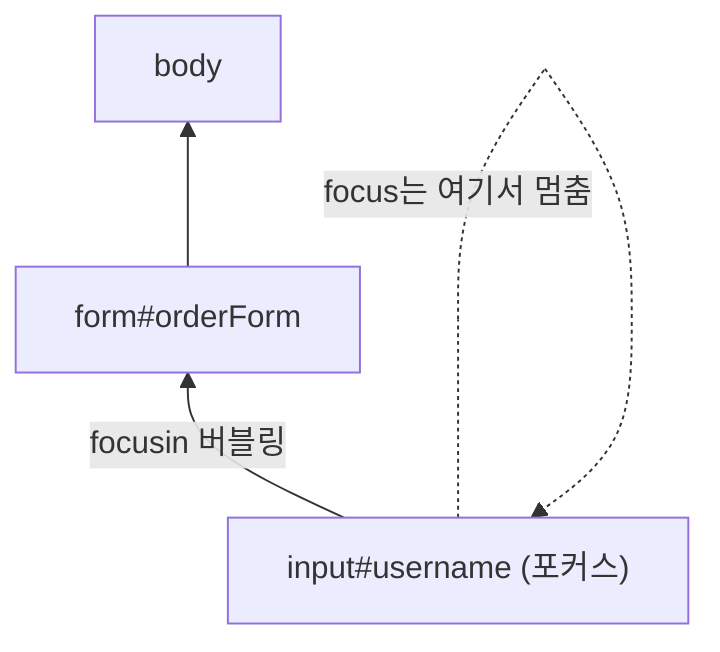
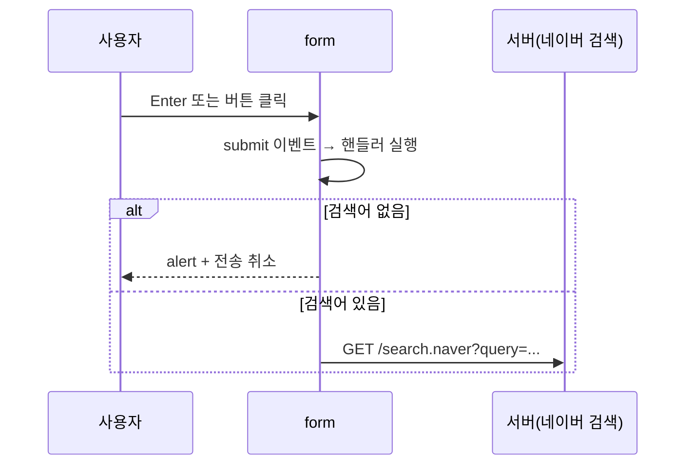

## 들어가며

[DOM 요소 취득과 이벤트 핸들러]({{ site.baseurl }}/posts/dom-select-and-event-handler/)에 이어, 이번에는 **폼(form) 이벤트**를 실습했다. 실습 예제는 두 개였다.

- **분식집 주문서**: 주문자(text), 결제 수단(radio), 메뉴(select), 요청사항(textarea)
- **맛집 검색**: 검색어를 입력하면 네이버 검색으로 GET 요청을 보내는 폼

이벤트 이름만 보면 `focus`/`focusin`, `change`/`input`처럼 비슷한 게 짝으로 있어서 헷갈렸다. 그래서 "언제 발생하고, 버블링되는가"를 기준으로 비교해 봤다.

## 1. 폼 요소 값 다루기: name으로 바로 꺼낸다

`document.forms`는 문서 안의 모든 폼을 `HTMLCollection`으로 돌려준다. 인덱스로도, `name` 속성으로도 꺼낼 수 있다.

```js
const $form = document.forms.orderForm;   // name="orderForm"
console.log(document.forms[0]);            // 인덱스로도 가능

console.log($form.elements);               // HTMLFormControlsCollection
const $username = $form.username;          // $form.elements.username 의 축약
```

`getElementById`나 `querySelector` 없이 `form.name값`으로 바로 입력 요소에 접근할 수 있다는 게 편했다. 요소 종류별로 값을 다루는 속성은 다르다.

| 요소 | 값 읽기/쓰기 | 예시 |
|------|-------------|------|
| text, textarea | `value` | `$username.value = '김코틀린'` |
| radio, checkbox | `checked` | `$form.payment[1].checked = true` |
| select | `value`, `selectedIndex`, `options[i].selected` | `$menu.value = 'ramen'` |

radio는 같은 `name`을 가진 요소가 여러 개라서 `$form.payment`가 단일 요소가 아니라 **`RadioNodeList`**(컬렉션)로 나온다. 그래서 `$payment[1]`처럼 인덱스로 접근했다.

select는 세 가지 방법이 모두 같은 일을 한다.

```js
$menu.options[2].selected = true;  // 튀김
$menu.selectedIndex = 3;           // 김밥
$menu.value = 'ramen';             // 라면 (최종 선택)
```

## 2. focus/blur vs focusin/focusout: 버블링 차이

두 쌍 모두 "포커스를 얻고 잃을 때" 발생한다. 차이는 **버블링 여부**다.

| 이벤트 | 발생 시점 | 버블링 |
|--------|----------|--------|
| `focus` / `blur` | 포커스 획득 / 상실 | X |
| `focusin` / `focusout` | 포커스 획득 / 상실 | O |

실습 코드에서도 이 차이가 등록 위치로 드러난다.

```js
// focus는 버블링되지 않으니 해당 입력 요소에 직접 등록
$username.onfocus = (e) => e.target.classList.toggle('lightgray');
$username.onblur  = (e) => e.target.classList.toggle('lightgray');

// focusin은 버블링되니 form 하나에만 등록해도 모든 입력 요소에 적용
$form.addEventListener('focusin',  (e) => e.target.classList.add('focused'));
$form.addEventListener('focusout', (e) => e.target.classList.remove('focused'));
```



흥미로웠던 점은 `focusin` 쪽이 **이벤트 위임**이라는 것이다. 입력 요소가 4개든 40개든 `form`에 리스너 하나만 달면 되고, `e.target`으로 실제 포커스된 요소를 알 수 있다. 같은 일을 `focus`로 하려면 요소마다 리스너를 달아야 한다.

한 가지 더: `focus` 핸들러에서 `toggle`을 쓰면 focus와 blur가 항상 짝으로 발생한다는 가정에 기대게 된다. 여기서는 문제가 없지만, 의도를 명확히 하려면 `focusin`/`focusout` 예제처럼 `add`/`remove`로 나누는 편이 안전하다고 느꼈다.

## 3. change vs input: "끝났을 때"와 "바뀔 때마다"

| 이벤트 | select / radio / checkbox | text / textarea |
|--------|--------------------------|-----------------|
| `change` | 선택이 바뀐 직후 | 값을 바꾸고 **포커스를 잃었을 때** |
| `input` | 값이 바뀔 때마다 | 값이 바뀔 때마다 (키보드, 붙여넣기, 음성 입력 등 모두) |

```js
$menu.addEventListener('change', () => alert('메뉴 변경!'));       // 고르자마자
$request.addEventListener('change', () => alert('요청사항 변경!')); // 다 쓰고 밖을 클릭해야

$request.addEventListener('input', (e) => {
    const len = e.target.value.trim().length;
    $form.querySelector('span').textContent = len;  // 실시간 글자 수
});
```

글자 수 카운터는 `input`이 맞다. `keydown`/`keyup`으로 만들면 마우스로 붙여넣기한 경우를 놓치지만, `input`은 **값이 바뀌는 방법과 상관없이** 발생하기 때문이다.

### 코드를 다시 읽으며 발견한 것

실습 코드를 다시 보니 카운터가 처음에 `0`으로 표시된다. textarea에는 이미 "맵지 않게 해주세요!"가 들어 있고, 스크립트에서 `$request.value = '단무지 많이 주세요!'`로 값까지 바꾸는데도 그렇다.

원인은 **JavaScript로 `value`를 바꾸면 `input`/`change` 이벤트가 발생하지 않는다**는 것이다. 이벤트는 사용자 조작으로 값이 바뀔 때 발생한다. 그래서 초기 글자 수는 직접 한 번 계산해 줘야 한다.

```js
// 개선 예시 코드
const $count = $form.querySelector('span');
const updateCount = () => { $count.textContent = $request.value.trim().length; };

$request.addEventListener('input', updateCount);
updateCount(); // 초기값 반영
```

또 화면에는 `/200자`라고 적혀 있지만 실제로 200자를 막는 코드는 없다. 이건 JS보다 HTML의 `maxlength="200"` 속성 하나로 해결하는 게 간단하다.

## 4. submit: 전송 전에 검증하고 취소하기

폼 전송은 (1) submit 버튼 클릭, (2) 입력 필드에서 Enter 키, 두 가지로 일어난다. 둘 다 `submit` 이벤트를 발생시키니, 검증은 버튼의 `click`이 아니라 **폼의 `submit`**에 거는 게 맞다.

```js
$searchForm.onsubmit = function () {
    const keyword = this.querySelector('input[name=query]').value;
    if (!keyword) {
        alert('검색할 메뉴를 입력하지 않았습니다!');
        return false; // 전송 취소
    }
};
```

여기서 `return false`가 통하는 건 **`on이벤트` 프로퍼티 방식이라서**다. `addEventListener`로 등록한 리스너의 반환값은 무시되기 때문에, 그때는 `e.preventDefault()`를 써야 한다.

| 등록 방식 | 기본 동작 취소 |
|----------|---------------|
| `form.onsubmit = function () {...}` | `return false` 또는 `e.preventDefault()` |
| `form.addEventListener('submit', ...)` | `e.preventDefault()`만 |

`this`도 같이 볼 만하다. 일반 `function`으로 등록했기 때문에 `this`가 이벤트가 바인딩된 `form`을 가리킨다. 화살표 함수였다면 `this`는 form이 아니게 된다(이전 글에서 다룬 this 바인딩과 같은 이야기).



### 놓친 점: 공백만 입력하면 통과한다

`!keyword`는 빈 문자열(`''`)만 걸러낸다. 스페이스만 몇 번 입력하면 `'   '`은 truthy라서 그대로 전송된다. 글자 수 카운터에서는 `trim()`을 썼으니, 검증에서도 똑같이 쓰는 게 일관적이다.

```js
// 개선 예시 코드
const keyword = this.querySelector('input[name=query]').value.trim();
```

단순히 비어 있는지만 막을 거라면 HTML의 `required` 속성도 있다. 다만 `required`는 공백만 있는 값은 통과시키기 때문에, 공백까지 막으려면 결국 JS 검증이 필요하다.

## 정리하며

- 폼 요소는 `document.forms.폼이름.요소이름`으로 바로 접근할 수 있다.
- `focus`/`blur`는 버블링되지 않고, `focusin`/`focusout`은 버블링된다. 그래서 후자는 폼 하나에 위임할 수 있다.
- 텍스트 입력에서 `change`는 포커스를 잃을 때, `input`은 값이 바뀔 때마다 발생한다.
- **JS로 값을 바꾸면 이 이벤트들은 발생하지 않는다.** 초기 상태는 직접 반영해야 한다.
- `return false`는 `on이벤트` 프로퍼티에서만 통한다. `addEventListener`에서는 `e.preventDefault()`.

이벤트 이름을 외우는 것보다 "언제 발생하고, 버블링되는가, 기본 동작을 어떻게 막는가" 세 가지 질문으로 정리하니 훨씬 덜 헷갈렸다.

## 더 학습하면 좋은 개념

- **이벤트 위임(Event Delegation)** — `focusin`을 form에 단 것처럼, 부모 하나로 자식 이벤트를 처리하는 패턴. 동적으로 추가되는 요소를 다룰 때 특히 유용하다.
- **Constraint Validation API (`required`, `pattern`, `setCustomValidity`)** — JS 검증을 짜기 전에 브라우저 내장 검증으로 어디까지 되는지 알면 코드가 줄어든다.
- **`FormData`** — 폼 값을 요소마다 꺼내지 않고 한 번에 모아 `fetch`로 보낼 때 쓴다.
- **`dispatchEvent`** — JS로 값을 바꾼 뒤 `input`/`change` 이벤트를 직접 발생시키고 싶을 때 쓰는 방법.

## 참고 자료

- [MDN - HTMLFormElement](https://developer.mozilla.org/ko/docs/Web/API/HTMLFormElement)
- [MDN - focusin 이벤트](https://developer.mozilla.org/en-US/docs/Web/API/Element/focusin_event)
- [MDN - change 이벤트](https://developer.mozilla.org/en-US/docs/Web/API/HTMLElement/change_event)
- [MDN - input 이벤트](https://developer.mozilla.org/en-US/docs/Web/API/Element/input_event)
- [MDN - submit 이벤트](https://developer.mozilla.org/en-US/docs/Web/API/HTMLFormElement/submit_event)
- [MDN - Event.preventDefault()](https://developer.mozilla.org/ko/docs/Web/API/Event/preventDefault)
