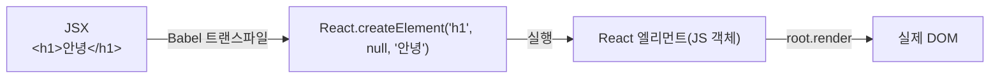
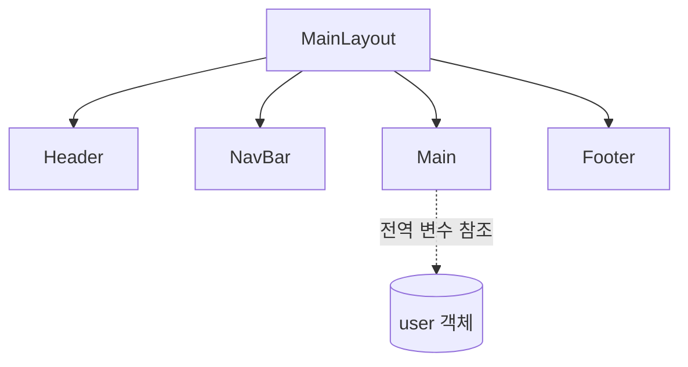

## 들어가며

[지난 글]({{ site.baseurl }}/posts/react-create-element-and-component/)에서는 JSX 없이 `React.createElement`만으로 화면을 그렸다. 그때 결론은 "`createElement`는 DOM이 아니라 화면을 설명하는 **JS 객체**를 만든다"였다.

문제는 이걸 매번 손으로 쓰기엔 너무 번거롭다는 것이다. 그래서 이번 수업에서 **JSX**를 배웠다. 실습은 네 가지였다.

| 실습 | 내용 |
|------|------|
| JSX 소개 | Babel을 붙이고 `<h1>` 안에 `{}`로 JS 표현식 넣기 |
| Fragment | 최상위 요소가 둘이면 에러, `<></>`로 해결 |
| 함수형 컴포넌트 | `<Header/>`로 컴포넌트 렌더링 |
| 컴포넌트 합성 | `Header`, `NavBar`, `Main`, `Footer`를 `MainLayout`으로 조립 |

처음엔 각각 외워야 할 규칙처럼 보였는데, **"JSX는 `createElement` 호출로 바뀐다"** 하나만 붙잡고 보니 거의 다 같은 이유로 설명됐다.

## 1. JSX를 브라우저에서 쓰려면 Babel이 필요하다

브라우저는 JSX를 모른다. `<h1>`을 JS 코드 한가운데 쓰면 그냥 문법 에러다. 그래서 수업에서는 CDN으로 Babel을 붙이고, 스크립트 타입을 바꿨다.

```html
<script crossorigin src="https://unpkg.com/@babel/standalone@7.29.15/babel.min.js"></script>

<script type="text/babel">
    // 이 안의 JSX를 Babel이 일반 JS로 바꿔서 실행한다
</script>
```



`type="text/babel"`이 붙은 스크립트는 브라우저가 직접 실행하지 않는다. Babel이 그 내용을 읽어서 변환한 뒤 실행한다. 다만 매번 브라우저에서 변환하니 느려서, 공식 문서도 이 방식은 학습·프로토타입용이라고 한다. 실제 프로젝트에서는 Vite 같은 빌드 도구가 미리 변환해 둔다.

## 2. 중괄호 `{}` 안에는 "표현식"만

```jsx
function formatName() {
    return `${user.lastName} ${user.firstName}`;
}

const user = { firstName: '평훈', lastName: '조' };

const element = <h1 class="test">안녕!! {formatName(user)}</h1>;
```

Babel이 바꾼 결과는 대략 이렇다.

```js
// 변환 결과 (예시)
const element = React.createElement(
    "h1",
    { class: "test" },
    "안녕!! ",
    formatName(user)
);
```

`{}` 안의 내용이 **함수 인자 자리**에 그대로 들어간다. 그래서 `if`나 `for` 같은 문(statement)은 못 쓰고, 값으로 평가되는 표현식(변수, 함수 호출, 삼항 연산자, `map` 등)만 쓸 수 있다.

### 코드를 다시 보다가 발견한 것

- **`formatName()`은 매개변수가 없다.** `formatName(user)`로 넘긴 인자는 사실 안 쓰이고, 함수 안의 `user`는 바깥 변수를 그대로 참조한다. `user`가 `const`로 함수보다 **아래**에 선언됐는데도 에러가 안 나는 건, 함수를 *호출하는 시점*에는 이미 `user`가 초기화돼 있기 때문이다. [JS 핵심 문법 글]({{ site.baseurl }}/posts/javascript-core-for-java-developers/)에서 본 호이스팅/TDZ가 여기서도 나온다. 의도를 분명히 하려면 `formatName(user)`의 인자를 실제로 받는 게 맞다.

  ```jsx
  // 개선 예시 코드
  function formatName(user) {
      return `${user.lastName} ${user.firstName}`;
  }
  ```

- **`class` 대신 `className`.** JSX 속성은 결국 JS 객체의 키가 되고, DOM 프로퍼티 이름도 `className`이다. React 18 개발 모드에서 `class`를 쓰면 화면은 그려지지만 콘솔에 `Invalid DOM property 'class'. Did you mean 'className'?` 경고가 뜬다.

## 3. 최상위 요소는 왜 하나여야 할까: Fragment

수업 주석에 "동일 레벨의 요소가 연달아 정의되면 문법 에러"라고 적혀 있었다.

```jsx
// 문법 에러
const element = (
    <h1>{user.name}</h1>
    <h3>{user.phone}</h3>
);
```

이것도 변환해 보면 이유가 보인다.

```js
// 이렇게 바뀌어야 하는데...
const element = (
    React.createElement("h1", null, user.name)
    React.createElement("h3", null, user.phone)
);
```

괄호 안에 **값이 두 개** 나란히 있는 꼴이라 JS 문법으로 성립하지 않는다. 함수가 값을 두 개 반환할 수 없는 것과 같다. 그래서 하나로 감싸야 한다.

| 방법 | 코드 | 결과 DOM |
|------|------|----------|
| `div`로 감싸기 | `<div>...</div>` | 불필요한 `<div>`가 하나 더 생김 |
| Fragment | `<>...</>` | 감싸는 요소 없이 `h1`, `h3`만 들어감 |

Fragment는 `React.createElement(React.Fragment, null, ...)`로 변환된다. 하나의 값으로 묶어주지만 실제 DOM에는 아무것도 남기지 않는다. 레이아웃이나 CSS 선택자(`ul > li`, flex 자식 등)가 쓸데없는 `div` 때문에 깨지는 걸 막을 수 있다.

### 실습하다 막힌 곳: 화면이 아예 안 뜬다

Fragment 실습 파일을 열었을 때 화면이 하얗게 비어 있었다. 원인은 JSX가 아니라 HTML 오타였다.

```html
<div is="root"></div>   <!-- id가 아니라 is -->
```

`document.getElementById('root')`가 `null`을 반환하고, `createRoot(null)`에서 **"Target container is not a DOM element"** 에러가 난다. 코드가 틀린 줄 알고 JSX부터 의심하기 쉬운데, 이럴 땐 콘솔 에러 메시지를 먼저 보는 게 빠르다. `id="root"`로 고치면 정상적으로 렌더링된다.

## 4. 함수형 컴포넌트: `<Header/>`는 `createElement(Header)`다

지난 글에서는 컴포넌트를 `React.createElement(Header)`로 렌더링했다. JSX에서는 이렇게 쓴다.

```jsx
function Header() {
    return (
        <>
            <h1>헤더입니다!!</h1>
            <h3>사이트 이름~~~</h3>
        </>
    );
}

root.render(<Header/>);   // == React.createElement(Header)
```

여기서 **"컴포넌트 이름은 대문자"** 규칙이 왜 필요한지가 확실해진다. Babel은 태그 이름의 첫 글자로 변환 방식을 정한다.

| JSX | 변환 결과 | 의미 |
|-----|----------|------|
| `<header/>` | `createElement("header")` | 문자열 → HTML `<header>` 태그 |
| `<Header/>` | `createElement(Header)` | 변수 참조 → 내가 만든 함수 |

소문자로 쓰면 **문자열**로 바뀌어서 내 함수가 아니라 HTML 태그로 취급된다. 지난 글에서 "대문자는 정말 암묵적 규칙일 뿐인가?"라고 물었던 것의 답이 여기 있다. `createElement`를 직접 쓸 때는 함수를 넘기니 상관없지만, **JSX를 쓰는 순간 대문자가 필수**가 된다.

## 5. 컴포넌트 합성: 작은 함수를 조립해서 화면 만들기

마지막 실습은 화면을 네 조각으로 나누고, 하나의 레이아웃 컴포넌트로 조립했다.

```jsx
function MainLayout() {
    return (
        <div style={{ border: '1px solid black', backgroundColor: 'yellow' }}>
            <Header/>
            <NavBar/>
            <Main/>
            <Footer/>
        </div>
    );
}

root.render(<MainLayout/>);
```



Java로 치면 큰 메서드를 작은 메서드로 쪼개고 조합하는 것과 비슷하다. 각 컴포넌트는 자기 화면 조각만 책임지고, `MainLayout`은 배치만 한다.

### `style={{ }}` 중괄호가 두 겹인 이유

처음엔 오타인 줄 알았다. 바깥 `{}`는 "여기부터 JS 표현식"이라는 JSX 문법이고, 안쪽 `{}`는 **스타일 객체 리터럴**이다. 객체라서 CSS 속성명도 `background-color`가 아니라 JS 키 이름 규칙에 맞춘 카멜 케이스 `backgroundColor`를 쓴다.

### 아쉬운 점: Main이 전역 변수에 기대고 있다

```jsx
const user = { name: "조평훈", phone: "010-1234-5678", age: 20, gender: '남' };

function Main() {
    return <h3>이름 : {user.name}</h3>;  // 바깥 user를 직접 참조
}
```

지금 `Main`은 바깥의 `user`가 없으면 동작하지 않는다. 다른 사용자 정보를 보여주려면 `Main` 함수를 새로 만들어야 한다. 함수가 매개변수 없이 전역 변수에 의존하는 것과 같은 문제다.

이걸 해결하는 게 다음 주제인 **props**다. `<Main user={user}/>`처럼 넘기면 `createElement(Main, { user })`가 되고, 그 두 번째 인자가 `Main` 함수의 매개변수로 들어간다. 지금까지 비워둔 `createElement`의 두 번째 인자가 드디어 쓰이게 된다.

## 정리

- JSX는 브라우저가 모르는 문법이라 Babel이 `React.createElement` 호출로 변환한다.
- `{}` 안은 함수 인자 자리에 들어가므로 **표현식**만 쓸 수 있다.
- 최상위 요소가 하나여야 하는 건 JS 표현식이 값 하나여야 하기 때문이다. 불필요한 `div` 대신 Fragment(`<></>`)를 쓴다.
- JSX에서 대문자 태그는 변수(컴포넌트), 소문자 태그는 문자열(HTML 태그)로 변환된다. 그래서 컴포넌트 이름은 대문자가 필수다.
- 컴포넌트는 작은 함수로 나눠서 합성한다. 데이터는 전역 변수 대신 props로 받는 게 다음 단계다.

## 다음에 이어서 볼 것

- **props** — 컴포넌트에 데이터를 넘기는 방법. `Main`의 전역 변수 의존을 없애는 직접적인 해결책이다.
- **리스트 렌더링과 `key`** — `{}` 안에서 `map`으로 엘리먼트 배열을 만들 때 React가 `key`를 요구하는 이유.
- **조건부 렌더링** — `{}` 안에 `if`를 못 쓰니 삼항 연산자와 `&&`를 쓰는 패턴.
- **Vite 같은 빌드 도구** — 브라우저 Babel 대신 미리 변환하는 실제 개발 환경.

## 참고 자료

- [React 공식 문서 - Writing Markup with JSX](https://react.dev/learn/writing-markup-with-jsx)
- [React 공식 문서 - JavaScript in JSX with Curly Braces](https://react.dev/learn/javascript-in-jsx-with-curly-braces)
- [React 공식 문서 - Fragment](https://react.dev/reference/react/Fragment)
- [React 공식 문서 - Your First Component](https://react.dev/learn/your-first-component)
- [React 공식 문서 - Common components (style, className)](https://react.dev/reference/react-dom/components/common)
- [Babel 공식 문서 - @babel/standalone](https://babeljs.io/docs/babel-standalone)
