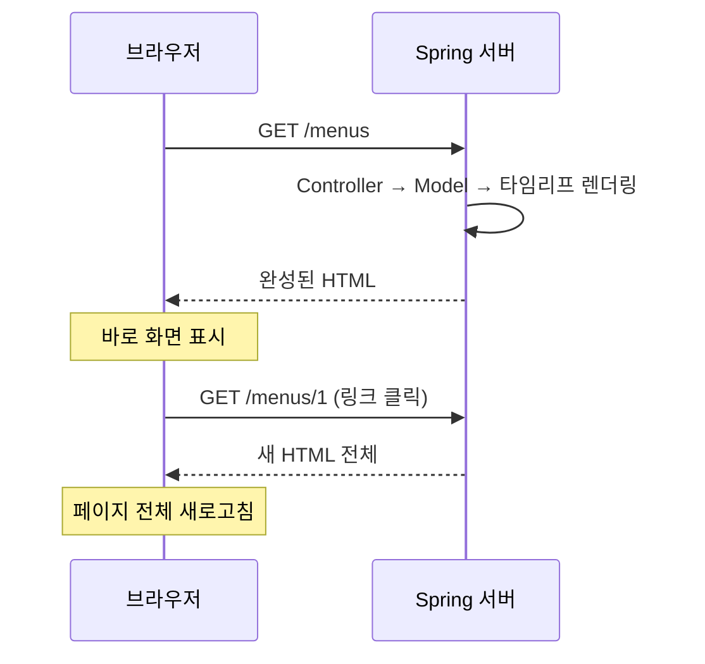
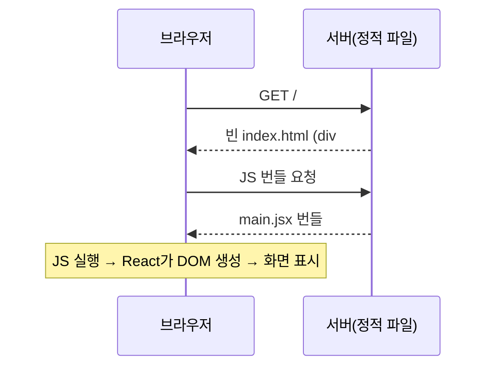
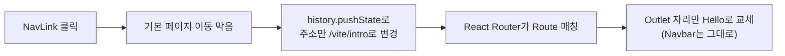
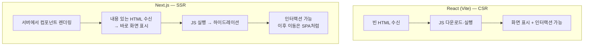

## 들어가며

지금까지 Spring 수업에서는 **타임리프(Thymeleaf)**로 화면을 만들었다. 컨트롤러가 모델에 데이터를 담고, 템플릿이 그걸 받아 HTML을 완성해서 내려주는 방식이다.

그런데 React 프로젝트(Vite)를 만들고 `index.html`을 열어보니 이게 전부였다.

```html
<body>
  <div id="root"></div>
  <script type="module" src="/src/main.jsx"></script>
</body>
```

본문이 **텅 빈 `div` 하나**다. 그런데 브라우저에서는 메뉴도, 페이지도 다 보인다. 그럼 그 화면은 누가, 어디서 만든 걸까? 이 질문이 이번 글의 출발점이다.

## 1. 핵심 차이: HTML을 "어디서" 완성하느냐

| 항목 | SSR (Server-Side Rendering) | CSR (Client-Side Rendering) |
|------|------------------------------|------------------------------|
| HTML을 완성하는 곳 | 서버 | 브라우저 (JS 실행) |
| 서버가 보내는 것 | 내용이 채워진 HTML | 빈 HTML + JS 번들 |
| 첫 화면 | 응답 오자마자 내용이 보임 | JS 다운로드·실행 후 보임 |
| 페이지 이동 | 보통 새 HTML 요청 (전체 새로고침) | JS가 화면 일부만 교체 |
| 예시 | 타임리프, JSP | React (Vite로 만든 앱) |

### 타임리프 = SSR

타임리프는 **서버 안에서** 템플릿과 데이터를 합쳐 HTML 문자열을 만든다. 브라우저는 완성된 HTML을 받아서 그대로 그리기만 한다.

```java
// 예시 코드
@GetMapping("/menus")
public String list(Model model) {
    model.addAttribute("menus", menuService.findAll());
    return "menu/list"; // templates/menu/list.html
}
```

```html
<!-- 예시 코드: templates/menu/list.html -->
<ul>
  <li th:each="menu : ${menus}" th:text="${menu.name}">메뉴명</li>
</ul>
```

브라우저가 받는 응답에는 `th:each`가 이미 다 풀려서 `<li>김치찌개</li><li>된장찌개</li>...`처럼 **데이터가 박힌 HTML**이 들어 있다. 다른 메뉴를 누르면 다시 서버에 요청하고, 서버는 또 새 HTML 한 장을 통째로 만들어 보낸다.



### React = CSR

React 앱에서 서버(Vite 개발 서버, 또는 배포 후 정적 파일 서버)는 HTML을 "만들지" 않는다. 위의 빈 `index.html`과 JS 번들을 **그대로 전달**할 뿐이다. 화면은 브라우저에서 이 코드가 실행되면서 만들어진다.

```jsx
// main.jsx
createRoot(document.getElementById('root')).render(
    <App />
)
```

[createElement 글]({{ site.baseurl }}/posts/react-create-element-and-component/)에서 정리했던 것처럼, 컴포넌트는 화면을 설명하는 객체를 만들고 `render`가 그걸 실제 DOM으로 바꿔 `#root` 안에 넣는다. 이 과정이 전부 **브라우저 안에서** 일어난다.



## 2. React의 특징 SPA, 직접 확인해 보기

CSR과 짝으로 나오는 개념이 **SPA(Single Page Application)**다. HTML 문서는 처음에 딱 한 장만 받고, 그 뒤 페이지 이동은 JS가 주소와 화면만 바꾸는 방식이다.

실습 앱에서는 `react-router-dom`으로 라우팅을 구성했다.

```jsx
// App.jsx
<BrowserRouter>
    <Routes>
      <Route path="/" element={<Layout/>}>
         <Route index element={<Main/>}/>
         <Route path="vite/intro" element={<Hello/>}/>
         <Route path="vite/module" element={<UserInfo/>}/>
      </Route>
    </Routes>
</BrowserRouter>
```

```jsx
// Layout.jsx
<div className={styles.layout}>
    <Navbar/>
    <main className={styles.content}>
        <Outlet/>  {/* 주소에 맞는 하위 Route 컴포넌트가 여기 들어온다 */}
    </main>
</div>
```

메뉴는 `<a href>`가 아니라 `NavLink`로 만들었다.

```jsx
// NavBar.jsx
<NavLink to="/vite/intro" style={activeStyle}>프로젝트 생성</NavLink>
<NavLink to="/vite/module" style={activeStyle}>모듈</NavLink>
```

`<a href>`는 브라우저 기본 동작대로 새 문서를 요청한다. `Link`/`NavLink`는 클릭 시 그 기본 동작을 막고, History API로 **주소만 바꾼 뒤** React Router가 그 주소에 맞는 컴포넌트로 `Outlet` 자리를 교체한다.



### 확인 방법

SPA인지 눈으로 확인하는 방법은 간단하다.

| 확인 항목 | 방법 | SPA라면 |
|-----------|------|---------|
| 페이지 소스 | `Ctrl+U` (페이지 소스 보기) | `div#root`가 비어 있다. 화면에 보이는 메뉴 텍스트가 소스에는 없다 |
| 메뉴 이동 시 요청 | 개발자 도구 Network 탭 → `Doc` 필터 후 메뉴 클릭 | 새 문서(HTML) 요청이 생기지 않는다 |
| 새로고침 여부 | 메뉴 클릭 시 브라우저 탭의 로딩 표시 | 깜빡임 없이 `main` 영역만 바뀐다 |
| `<a href>`와 비교 | `NavLink`를 `<a href="/vite/intro">`로 잠깐 바꿔 보기 | 이번엔 Network에 문서 요청이 찍히고 전체가 다시 로드된다 |

특히 **페이지 소스 보기**와 **개발자 도구 Elements 탭**을 나란히 놓고 보면 차이가 확실하다. 소스(서버가 보낸 HTML)에는 빈 `div`뿐인데, Elements(현재 DOM)에는 `nav`, `main`, `h1`이 다 들어 있다. 그 차이만큼이 브라우저에서 JS가 만든 부분이다.

> 타임리프 화면에서 똑같이 `Ctrl+U`를 눌러 보면, 소스에 이미 데이터가 다 들어 있다. 이게 SSR과 CSR을 가장 빠르게 구분하는 방법이었다.

### 덤: 실습 코드에서 발견한 대소문자 불일치

코드를 다시 보다가 파일 이름은 `NavBar.jsx`, `NavBar.module.css`인데 import는 이렇게 되어 있었다.

```jsx
import Navbar from '../components/Navbar';      // 실제 파일은 NavBar.jsx
import styles from './Navbar.module.css';       // 실제 파일은 NavBar.module.css
```

Windows 파일 시스템은 대소문자를 구분하지 않아서 로컬에서는 잘 돌아간다. 하지만 Linux 기반 서버나 CI에서 빌드하면 파일을 못 찾아 실패할 수 있다. import 경로는 실제 파일명과 **대소문자까지** 맞춰 두는 게 안전하다.

## 3. 심화: React(CSR) vs Next.js(SSR)

### CSR의 약점

CSR은 첫 요청에서 빈 HTML이 오기 때문에 생기는 약점이 있다.

- **첫 화면이 늦다**: JS 번들을 받고 실행해야 내용이 나온다. 번들이 클수록 빈 화면 시간이 길어진다.
- **SEO에 불리할 수 있다**: 검색 엔진·링크 미리보기 봇이 JS를 실행하지 않으면 빈 `div`만 보게 된다.

반대로 한 번 로드된 뒤에는 페이지 이동이 빠르고, 앱처럼 부드러운 화면 전환이 가능하다는 장점이 있다.

### Next.js는 서버에서 먼저 HTML을 만든다

Next.js는 React 기반 프레임워크인데, 컴포넌트를 **서버에서 먼저 렌더링해서 내용이 채워진 HTML**을 보낸다. 페이지 소스를 열어 보면 타임리프처럼 내용이 이미 들어 있다.

그렇다고 타임리프로 돌아간 건 아니다. HTML이 도착한 뒤 브라우저에서 React가 그 HTML에 이벤트 핸들러를 연결하는 **하이드레이션(hydration)**이 일어나고, 그 다음부터는 SPA처럼 동작한다.



| 항목 | 타임리프 | React (Vite) | Next.js |
|------|----------|--------------|---------|
| 첫 HTML | 서버가 완성 | 빈 `div#root` | 서버가 완성 |
| 렌더링 위치 | 서버 | 브라우저 | 서버 + 브라우저 |
| 페이지 이동 | 전체 새로고침 | JS로 일부 교체 | JS로 일부 교체 |
| 페이지 소스에 내용 | 있음 | 없음 | 있음 |
| 서버 필요 여부 | Spring 서버 필수 | 정적 파일 호스팅이면 충분 | 서버 렌더링을 쓰면 Node 서버 필요 |

### "Next = SSR"은 절반만 맞다

정리하다 보니 "React는 CSR, Next는 SSR"이라는 문장은 출발점으로는 좋지만 정확하진 않았다.

- **React 자체**는 렌더링 위치를 정하지 않는 라이브러리다. `createRoot().render()`로 쓰면 CSR이고, `react-dom/server`로 서버에서 HTML을 만들 수도 있다. 우리가 Vite로 만든 앱이 CSR인 것이다.
- **Next.js**도 SSR만 하는 게 아니다. 요청마다 렌더링하는 SSR 외에, 빌드 시점에 HTML을 미리 만들어 두는 **SSG(정적 생성)**, 일정 주기로 다시 만드는 **ISR**도 쓸 수 있다. App Router에서는 컴포넌트가 기본적으로 **서버 컴포넌트**이고, 클릭 같은 상호작용이 필요한 부분만 `'use client'`로 클라이언트 컴포넌트로 만든다.

즉 Next.js는 "SSR 프레임워크"라기보다 **페이지마다 서버/클라이언트 렌더링을 골라 섞을 수 있게 해 주는 프레임워크**에 가깝다.

## 정리

- 렌더링 방식의 차이는 결국 **"HTML을 누가 완성하느냐"**다. 서버면 SSR, 브라우저면 CSR.
- 타임리프는 서버가 데이터를 채운 HTML을 매번 새로 보내는 SSR이다.
- Vite로 만든 React 앱은 빈 HTML 위에 JS가 화면을 그리는 CSR이고, `react-router-dom`의 `Link`/`NavLink`로 새로고침 없이 화면만 바꾸는 SPA다. `Ctrl+U`와 Network 탭으로 직접 확인할 수 있다.
- Next.js는 서버에서 먼저 HTML을 만들고(SSR/SSG), 브라우저에서 하이드레이션해서 SPA처럼 이어 간다. 두 방식의 장점을 섞은 셈이다.

## 더 학습하면 좋은 개념

- **하이드레이션(Hydration)** — 서버가 만든 HTML에 React가 이벤트를 연결하는 과정. 서버와 클라이언트 렌더링 결과가 다르면 생기는 hydration mismatch 경고를 이해하려면 꼭 알아야 한다.
- **SSG / ISR** — 요청 시점이 아니라 빌드 시점에 HTML을 만드는 방식. 블로그처럼 내용이 자주 안 바뀌는 페이지는 SSR보다 SSG가 더 효율적이다. (이 블로그의 Jekyll도 SSG다.)
- **React Server Components** — Next.js App Router의 기본 컴포넌트. "서버에서만 실행되고 JS 번들에 포함되지 않는 컴포넌트"라는 개념이 CSR/SSR 구분을 한 단계 더 세분화한다.
- **History API (`pushState`, `popstate`)** — `Link`가 새로고침 없이 주소를 바꾸는 원리. React Router 없이 직접 써 보면 SPA 라우팅이 어떻게 동작하는지 감이 온다.
- **SPA 배포 시 새로고침 404 문제** — `/vite/intro`에서 새로고침하면 서버에 그 경로의 파일이 없어서 404가 날 수 있다. 정적 호스팅에서 모든 경로를 `index.html`로 돌려주는 설정(fallback)이 왜 필요한지와 연결된다.

## 참고 자료

- [web.dev - Rendering on the Web](https://web.dev/articles/rendering-on-the-web)
- [MDN - SPA (Single-page application)](https://developer.mozilla.org/en-US/docs/Glossary/SPA)
- [MDN - SSR (Server-side rendering)](https://developer.mozilla.org/en-US/docs/Glossary/SSR)
- [Thymeleaf 공식 문서 - Using Thymeleaf](https://www.thymeleaf.org/doc/tutorials/3.1/usingthymeleaf.html)
- [React 공식 문서 - createRoot](https://react.dev/reference/react-dom/client/createRoot)
- [React 공식 문서 - hydrateRoot](https://react.dev/reference/react-dom/client/hydrateRoot)
- [React Router 공식 문서](https://reactrouter.com/)
- [Next.js 공식 문서 - Server and Client Components](https://nextjs.org/docs/app/getting-started/server-and-client-components)
