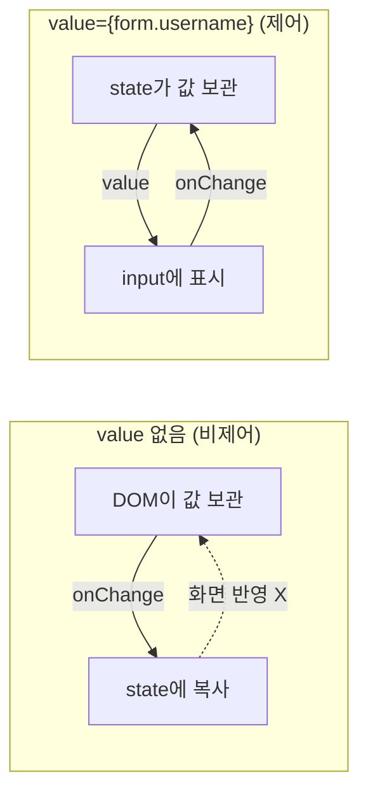
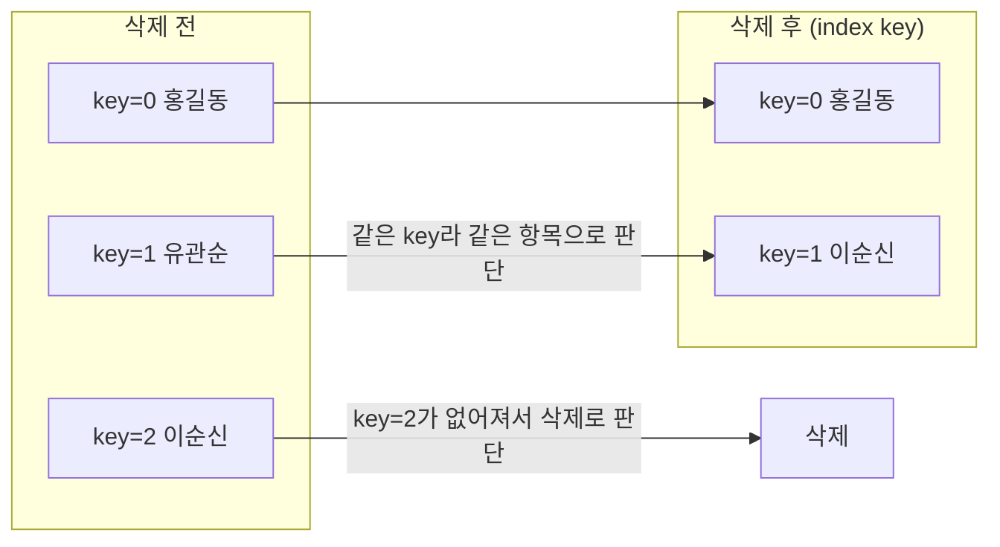
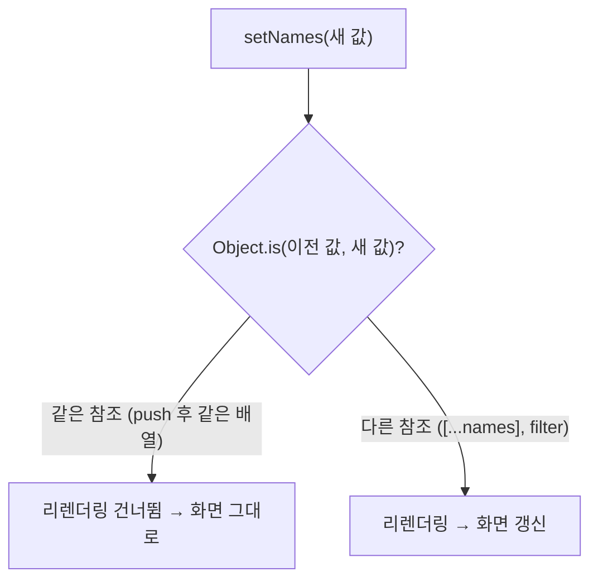

## 들어가며

[지난 글]({{ site.baseurl }}/posts/react-props-state-rerender/)에서는 숫자 하나짜리 state를 다뤘다. `setCount(count + 1)`처럼 새 숫자를 넘기면 끝이었다.

이번 실습은 state가 **객체**와 **배열**이 됐다.

| 파일 | 내용 | state |
|------|------|-------|
| `03_event.jsx` | 회원가입 폼, 입력값 관리, 초기화 버튼 | `{ username, email }` 객체 |
| `04_iteration.jsx` | 이름 목록 출력, 추가, 더블클릭 삭제 | `[{ id, name }, ...]` 배열 |

두 파일 주석에 공통으로 나오는 말이 있었다. "기존 값을 복사해서 새로 만들어라", "원본 배열을 수정(`push`, `splice`)하지 말아라". 처음엔 그냥 규칙처럼 읽었는데, 왜 그래야 하는지 따라가 보니 React가 **state 변경을 알아채는 방식**과 연결돼 있었다.

## 1. React 이벤트는 DOM 이벤트와 조금 다르다

실습 파일 맨 위에 이벤트 규칙이 세 줄 적혀 있었다.

| 규칙 | DOM (지난 JS 수업) | React |
|------|-------------------|-------|
| 이름 | `onclick`, `onchange` | `onClick`, `onChange` (카멜 케이스) |
| 넘기는 것 | 문자열 `"handle()"` 또는 `addEventListener` | 함수 `{handle}` |
| 붙는 곳 | DOM 요소 | DOM 요소(`button`, `input` 등)만 |

두 번째 규칙은 지난 글의 `onClick={setCount(0)}` 무한 렌더링과 같은 얘기다. 함수 **호출 결과**가 아니라 **함수 자체**를 넘겨야 한다.

세 번째 규칙이 처음엔 의외였다. 내가 만든 컴포넌트에 `onClick`을 붙이면 이벤트가 연결되는 게 아니라 **그냥 props로 전달된다.**

```jsx
// 예시 코드
function MyButton({ onClick, children }) {
    return <button onClick={onClick}>{children}</button>;  // 여기서 진짜 DOM에 연결
}

<MyButton onClick={() => alert('클릭')}>눌러보기</MyButton>
```

지난 글에서 본 대로 `<MyButton onClick={...}/>`은 `createElement(MyButton, { onClick: ... })`일 뿐이다. `MyButton`은 함수라서 클릭될 수 없다. 받은 함수를 안쪽 `<button>`에 다시 연결해야 클릭이 동작한다. 이름이 `onClick`인 건 관례일 뿐이고 `onPress`라고 지어도 된다.

### `onChange`는 `change`가 아니라 `input`처럼 동작한다

[폼 이벤트 글]({{ site.baseurl }}/posts/form-events-focus-change-input-submit/)에서 텍스트 입력의 `change`는 **포커스를 잃을 때**, `input`은 **값이 바뀔 때마다** 발생한다고 정리했었다. 그런데 React의 `onChange`는 한 글자 칠 때마다 호출된다. 이름은 `change`지만 동작은 DOM의 `input` 이벤트에 가깝다. 공식 문서도 `onChange`가 "입력 값이 바뀔 때마다(예: 키 입력마다)" 호출된다고 적고 있다.

## 2. 제어 컴포넌트: input의 값 주인을 state로 바꾸기

회원가입 폼은 TODO 순서대로 진행했다.

1. 두 input에 `onChange={onChangeHandler}` 연결
2. 핸들러에서 `form` state 갱신
3. input에 `value={form.username}` 연결
4. 초기화 버튼

### 핸들러 하나로 input 두 개 처리하기

```jsx
const [form, setForm] = useState({
    username: '',
    email: ''
});

const onChangeHandler = e => {
    setForm({
        ...form,
        [e.target.name]: e.target.value
    });
};
```

```jsx
<input name="username" placeholder="이름" value={form.username} onChange={onChangeHandler}/>
<input name="email" placeholder="이메일" value={form.email} onChange={onChangeHandler}/>
```

`[e.target.name]`은 **계산된 프로퍼티 이름(computed property name)** 이다. 대괄호 안의 값이 그대로 키가 된다. 이름 칸에 입력하면 `e.target.name`이 `"username"`이니 `{ username: 입력값 }`, 이메일 칸이면 `{ email: 입력값 }`이 된다. input마다 핸들러를 따로 만들 필요가 없다. input의 `name` 속성이 state 객체의 키와 같아야 동작하는 방식이다.

### `...form`을 빼면 어떻게 될까

주석에는 "복사하지 않으면 다른 값이 초기화된다"라고 적어뒀는데, 정확히 따라가 보면 이렇다.

```jsx
// 스프레드를 뺀 경우 (예시 코드)
setForm({ [e.target.name]: e.target.value });
```

| 순서 | 동작 | `form` |
|------|------|--------|
| 1 | 이름에 "홍" 입력 | `{ username: "홍" }` |
| 2 | 이메일에 "a" 입력 | `{ email: "a" }` |

setter는 객체를 **합쳐주지 않고 통째로 교체**한다. 2번에서 `username` 키 자체가 사라진다. 그러면 `form.username`은 `undefined`가 되고, `value={undefined}`인 input은 React 입장에서 "값을 안 정해준 input"이 된다. 개발 모드에서는 `A component is changing a controlled input to be uncontrolled` 경고가 뜬다. 빈 문자열(`''`)로 돌아가는 게 아니라 **키가 없어지는** 것이다.

`...form`으로 기존 키들을 먼저 펼쳐 놓고, 바뀐 키 하나만 뒤에 덮어써야 나머지 값이 유지된다. 같은 키가 두 번 나오면 뒤의 값이 이긴다.

### 막힌 곳 1: 쉼표 하나로 폼 전체가 안 됐다

TODO 2를 작성하고 나서 입력해도 아무 반응이 없었다. 핸들러 로직을 의심했는데, 원인은 쉼표였다.

```jsx
setForm({
    ...form     // 기존 값을 스프레드 문법으로 복사하지 않으면
                // form에 묶여있는 다른 값을 수정하면 기존값이
                // 초기화된다.
    [e.target.name] : e.target.value
});
```

객체 리터럴의 항목은 쉼표로 구분해야 하는데 `...form` 뒤에 쉼표가 없다. 그래서 **파일 전체가 문법 에러**라 실행조차 안 됐다. 주석을 세 줄이나 붙여서 쉼표 자리가 눈에 안 띄었다. `...form,`으로 고치니 바로 동작했다.

핸들러가 "말을 안 듣는" 게 아니라 코드가 아예 실행되지 않은 상태였다. 지난 두 글과 같은 결론이다. 동작이 이상하면 로직보다 **콘솔과 Vite 에러 화면부터** 본다.

### 막힌 곳 2: 초기화 버튼이 input을 못 비운다

```jsx
const onResetHandler = () => {
    setForm({ username: '', email: '' });
};
```

TODO 3(`value` 연결) 전에 초기화 버튼을 먼저 만들었더니, 아래 `<p>`의 "입력한 이름"은 비워지는데 **input 칸의 글자는 그대로** 남았다.

`value`를 연결하기 전 input은 값을 **DOM이 직접 들고 있는** 상태다. state가 `''`로 바뀌어도 input은 state를 보지 않으니 모른다. `value={form.username}`을 연결해야 input이 state를 그대로 보여주게 된다.



| | 비제어 컴포넌트 | 제어 컴포넌트 |
|---|---------------|-------------|
| 값의 주인 | DOM | React state |
| 코드로 값 바꾸기 | DOM에 직접 접근해야 함 | `setForm(...)`만 하면 됨 |
| 초기화 버튼 | state만 비워지고 input은 그대로 | input까지 같이 비워짐 |

반대로 `value`만 연결하고 `onChange`를 빼면 input은 state 값에 고정돼서 **타이핑이 안 된다.** React도 개발 모드에서 `onChange` 없이 `value`만 준 폼 필드에 경고를 띄운다. 제어 컴포넌트는 `value`와 `onChange`가 항상 짝이다.

## 3. 반복 렌더링: map으로 엘리먼트 배열 만들기

```jsx
const [names, setNames] = useState([
    { id: 1, name: '홍길동' },
    { id: 2, name: '유관순' },
    { id: 3, name: '이순신' }
]);
```

```jsx
<ul>
    {names.map(name => <li key={name.id} onDoubleClick={() => onRemove(name.id)}>{name.name}</li>)}
</ul>
```

[JSX 글]({{ site.baseurl }}/posts/react-jsx-fragment-component-composition/)에서 `{}` 안에는 `for` 같은 문(statement)이 못 들어가고 **표현식**만 된다고 정리했었다. `map`은 새 배열을 **반환하는 표현식**이라 `{}` 안에 들어갈 수 있다. 데이터 배열이 `<li>` 엘리먼트 배열로 바뀌고, React는 엘리먼트 배열을 받으면 순서대로 렌더링한다.

`onDoubleClick`에서 `() =>`로 한 번 감싼 이유도 지난 글과 같다. `onDoubleClick={onRemove(name.id)}`로 쓰면 렌더링하는 순간 모든 항목에 대해 `onRemove`가 실행된다. 인자를 넘겨야 하니 화살표 함수로 감싸서 **함수를 넘긴다.**

### key는 왜 필요할까

TODO 1은 key 없이 먼저 써보라고 했다. key를 빼면 화면은 정상적으로 나오지만 콘솔에 경고가 뜬다.

```
Each child in a list should have a unique "key" prop.
```

React는 state가 바뀌면 새 엘리먼트 목록과 이전 목록을 비교해서 **바뀐 부분만** 실제 DOM에 반영한다. 이때 "이전의 이 `<li>`가 새 목록의 어느 `<li>`인지"를 구분할 기준이 key다.

| key | 문제 |
|-----|------|
| 없음 | React가 순서(index)로 대신 비교하고 경고를 띄운다 |
| `index` | 앞쪽 항목을 지우면 뒤 항목들의 key가 전부 한 칸씩 당겨진다 |
| `name.id` | 항목이 추가·삭제돼도 각 항목의 key가 변하지 않는다 |

`유관순`(index 1)을 지우는 경우를 보면 차이가 분명하다.



index를 key로 쓰면 React는 "key=1 항목의 내용이 바뀌었고, key=2 항목이 지워졌다"고 판단한다. 실제로는 유관순이 지워진 건데 말이다. 지금처럼 텍스트만 보여주는 목록은 결과 화면이 같아서 티가 안 나지만, 각 `<li>` 안에 체크박스나 입력칸처럼 **자기 상태**가 있으면 그 상태가 엉뚱한 항목에 붙어 남는다. 실습 주석대로 DB 데이터라면 PK를 key로 쓰는 게 맞다.

key는 **형제 사이에서만** 고유하면 된다. 다른 `<ul>`에 같은 key가 있어도 상관없다.

## 4. 배열 state: push 대신 새 배열

### 추가: 스프레드로 새 배열

```jsx
const [inputText, setInputText] = useState('');
const [nextId, setNextId] = useState(4);

const onClickHandler = () => {
    setNames([...names, { id: nextId, name: inputText }]);
    setNextId(nextId + 1);
    setInputText('');
};
```

`nextId`를 state로 따로 두고 추가할 때마다 1씩 올린다. 그래야 새 항목의 key가 겹치지 않는다. 입력칸은 `value={inputText}`로 제어 컴포넌트로 만들어 뒀으니 `setInputText('')`만으로 비워진다. 2절에서 정리한 내용이 여기서 바로 쓰였다.

### 삭제: filter로 새 배열

```jsx
const onRemove = id => {
    setNames(names.filter(name => name.id !== id));
};
```

`filter`는 조건이 참인 항목만 모아 **새 배열**을 반환한다. 지울 `id`와 다른 항목만 남기면 그 항목만 빠진다. 원본 `names`는 그대로다.

### 왜 push나 splice를 쓰면 안 될까

```jsx
// 하면 안 되는 예시 코드
const onClickHandler = () => {
    names.push({ id: nextId, name: inputText });
    setNames(names);
};
```

`push`는 원본 배열에 바로 항목을 넣는다. `names`에 새 항목이 들어가긴 했지만, `setNames(names)`에 넘긴 건 **이전과 같은 배열(같은 참조)** 이다. React는 setter에 넘어온 값이 이전 state와 같은지 `Object.is`로 비교하고, 같으면 리렌더링을 건너뛸 수 있다. 배열 안을 하나하나 열어보지 않고 **참조만 비교**하는 것이다.



[JS 핵심 문법 글]({{ site.baseurl }}/posts/javascript-core-for-java-developers/)에서 "`b = a`는 복사가 아니라 공유다"라고 정리했던 게 여기서 이어진다. 같은 배열을 가리키는 변수끼리는 내용이 달라져도 참조가 같다.

`03_event.jsx`의 `{ ...form, ... }`도 똑같다. `form.username = '홍'`처럼 객체를 직접 고치면 참조가 그대로라 React가 변화를 모를 수 있다. 그래서 객체든 배열든 **새로 만들어서 통째로 교체**한다.

| 하고 싶은 것 | 원본을 바꾸는 방법 (X) | 새로 만드는 방법 (O) |
|-------------|-------------------|-------------------|
| 배열에 추가 | `push`, `unshift` | `[...arr, item]` |
| 배열에서 삭제 | `splice`, `pop` | `filter` |
| 배열 항목 수정 | `arr[i] = x` | `map` |
| 객체 필드 수정 | `obj.key = x` | `{ ...obj, key: x }` |

## 정리

- React 이벤트는 카멜 케이스 이름에 **함수**를 넘기고, DOM 요소에만 실제로 연결된다. 컴포넌트에 준 `onClick`은 props일 뿐이다.
- React `onChange`는 DOM `change`와 달리 키 입력마다 호출된다.
- 제어 컴포넌트는 `value`와 `onChange`를 짝으로 연결해서 input 값의 주인을 state로 옮긴다. 그래야 초기화 같은 코드 쪽 변경이 화면에 반영된다.
- 객체 state를 일부만 바꿀 때는 `{ ...form, [name]: value }`로 기존 키를 유지한다. setter는 합치지 않고 교체한다.
- 목록은 `map`으로 렌더링하고, key는 변하지 않는 고유값(`id`)으로 준다.
- 배열·객체 state는 원본을 수정하지 않고 새로 만든다. React는 참조가 같으면 변경을 알아채지 못할 수 있다.

## 다음에 이어서 볼 것

- **useEffect** — 다음 실습 주제. 렌더링 후에 서버 요청 같은 부수 효과를 실행하는 방법.
- **useRef** — `nextId`는 화면에 표시되지 않으니 state가 아니라 ref로 둬도 된다. 바뀌어도 리렌더링이 필요 없는 값을 다루는 방법.
- **중첩 객체 state 갱신** — `{ user: { address: { city } } }`처럼 깊은 객체는 스프레드를 여러 겹 써야 한다. Immer 같은 라이브러리가 왜 쓰이는지와 연결된다.
- **입력 검증** — 지금은 빈 문자열도 목록에 추가된다. [폼 이벤트 글]({{ site.baseurl }}/posts/form-events-focus-change-input-submit/)에서 다룬 공백 검색어 처리를 React 방식으로 옮겨볼 만하다.

## 참고 자료

- [React 공식 문서 - Responding to Events](https://react.dev/learn/responding-to-events)
- [React 공식 문서 - `<input>` (Controlling an input with a state variable)](https://react.dev/reference/react-dom/components/input)
- [React 공식 문서 - Updating Objects in State](https://react.dev/learn/updating-objects-in-state)
- [React 공식 문서 - Updating Arrays in State](https://react.dev/learn/updating-arrays-in-state)
- [React 공식 문서 - Rendering Lists](https://react.dev/learn/rendering-lists)
- [React 공식 문서 - useState (setter의 Object.is 비교)](https://react.dev/reference/react/useState)
- [MDN - 계산된 속성 이름](https://developer.mozilla.org/ko/docs/Web/JavaScript/Reference/Operators/Object_initializer#%EA%B3%84%EC%82%B0%EB%90%9C_%EC%86%8D%EC%84%B1_%EC%9D%B4%EB%A6%84)
