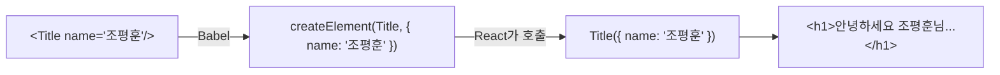
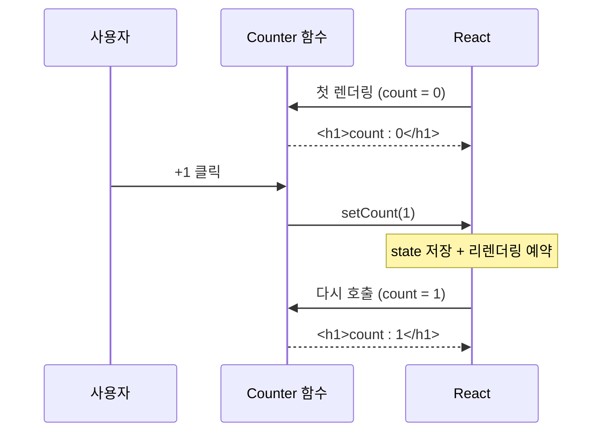
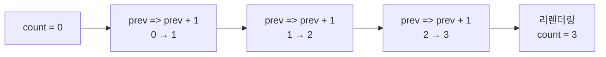
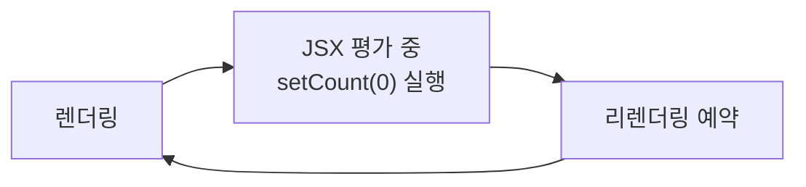

## 들어가며

[지난 글]({{ site.baseurl }}/posts/react-jsx-fragment-component-composition/)은 `Main` 컴포넌트가 바깥의 전역 변수 `user`에 기대고 있다는 아쉬움으로 끝났다. 그 해결책이 이번 수업에서 배운 **props**다.

이번 수업부터는 CDN + 브라우저 Babel 대신 Vite 프로젝트에서 실습했다. 라우터와 메뉴는 미리 만들어져 있고, `src/chap` 아래 파일만 채우는 방식이다.

| 파일 | 내용 |
|------|------|
| `01_props.jsx` | 부모가 자식에게 값 넘기기, 구조 분해 할당, `children` |
| `02_state.jsx` | `let` 대신 `useState`, `setCount`를 여러 번 부를 때의 동작 |

props는 "밖에서 들어오는 값", state는 "안에서 바뀌는 값"이다. 이 둘을 같이 보니 React가 **언제 컴포넌트 함수를 다시 실행하는지**가 보이기 시작했다.

## 1. props는 createElement의 두 번째 인자다

```jsx
function Title(props) {
    console.log(props);
    return <h1>안녕하세요 {props.name}님 반갑습니다.</h1>;
}

export default function Props() {
    return (
        <>
            <Title name="조평훈"/>
            <Title name="Raccoon"/>
        </>
    );
}
```

콘솔에는 `{name: '조평훈'}`, `{name: 'Raccoon'}`이 차례로 찍힌다. 지난 글에서 본 변환 규칙을 그대로 적용하면 이유가 바로 보인다.

```js
// 변환 결과 (예시)
React.createElement(Title, { name: "조평훈" });
```



JSX 속성들이 **객체 하나**로 묶여서 `createElement`의 두 번째 인자가 되고, React가 컴포넌트를 렌더링할 때 그 객체를 함수의 첫 번째 매개변수로 넘긴다. 지난 두 글 내내 `null`로 비워뒀던 자리가 바로 props였다.

같은 `Title` 함수를 두 번 쓰면서 이름만 바꿀 수 있다는 게 핵심이다. 지난 글의 `Main`처럼 전역 변수에 기대면 다른 사용자를 보여주려고 함수를 새로 만들어야 했는데, 이제는 호출하는 쪽에서 값만 바꾸면 된다. 일반 함수에 매개변수를 두는 것과 정확히 같은 이유다.

### 구조 분해 할당으로 받기

`props.name`, `props.age`를 계속 쓰는 대신 매개변수 자리에서 바로 꺼낼 수 있다.

```jsx
function Profile({ name, age }) {
    return <h3>{name}님은 {age}세입니다.</h3>;
}

<Profile name="조평훈" age={20}/>
```

JSX 문법이 아니라 그냥 JS의 객체 구조 분해 할당이다. 매개변수로 들어오는 게 객체니까 `{ name, age }`로 키 이름에 맞춰 꺼낼 수 있다. 실무 코드에서 가장 많이 보이는 형태라고 한다.

### `age="20"`과 `age={20}`은 다르다

| JSX | props에 들어가는 값 | 타입 |
|-----|-------------------|------|
| `age="20"` | `"20"` | 문자열 |
| `age={20}` | `20` | 숫자 |
| `age={[1, 2]}` | `[1, 2]` | 배열 |

따옴표는 HTML처럼 **문자열 리터럴**만 넣을 수 있다. 숫자, 배열, 객체, 함수처럼 문자열이 아닌 값은 지난 글에서 본 대로 `{}` 안에 JS 표현식으로 넣어야 한다. `age="20"`으로 넘기면 화면에는 똑같이 `20`이 보이지만, `age + 1`을 하면 `"201"`이 된다.

### props는 읽기 전용

공식 문서는 props를 **immutable**이라고 설명한다. 자식이 받은 props를 직접 바꾸면 안 되고, 값이 바뀌어야 한다면 부모가 새 props를 넘겨야 한다. 그럼 컴포넌트 안에서 스스로 바뀌는 값은 어떻게 다룰까? 그게 아래 state다.

## 2. children: 태그 사이에 쓴 내용도 props다

```jsx
<Box>텍스트 노드</Box>
<Box><Profile name="강감찬" age={30}/></Box>
```

태그 사이에 넣은 내용은 `children`이라는 이름으로 props에 들어간다. 변환해 보면 `createElement`의 **세 번째 이후 인자**인데, React는 이걸 `props.children`으로 넣어준다.

```js
// 변환 결과 (예시)
React.createElement(Box, null, "텍스트 노드");
// Box가 받는 props → { children: "텍스트 노드" }
```

### 실습 코드에서 헷갈린 부분: `Box(children)`

TODO는 "매개변수를 `{children}`으로 받아서 div 안에 출력하자"였는데, 처음 코드는 이랬다.

```jsx
function Box(children) {
    console.log(children);
    return <div style={{ border: '1px solid orangered', padding: 10, margin: 5 }}></div>;
}
```

두 가지가 빠져 있다.

1. **매개변수에 중괄호가 없다.** 매개변수 이름이 `children`일 뿐, 실제로 들어오는 건 props 객체 전체다. 그래서 콘솔에는 `"텍스트 노드"`가 아니라 `{children: '텍스트 노드'}`가 찍힌다. 이름은 마음대로 붙일 수 있으니, 꺼내려면 `{ children }`으로 구조 분해를 해야 한다.
2. **`<div>` 안에서 `children`을 렌더링하지 않는다.** 그래서 주황색 테두리만 있는 빈 상자가 두 개 그려진다.

```jsx
// 수정 예시 코드
function Box({ children }) {
    return (
        <div style={{ border: '1px solid orangered', padding: 10, margin: 5 }}>
            {children}
        </div>
    );
}
```

두 번째 `Box`에서는 `children`이 문자열이 아니라 `<Profile/>` 엘리먼트(객체)다. `Box`는 안에 뭐가 들어오는지 몰라도 그냥 자기 자리에 꽂아주기만 하면 된다. 모달, 카드, 레이아웃처럼 **틀만 제공하고 내용은 밖에서 받는** 컴포넌트를 이렇게 만든다.

## 3. state: 왜 `let`으로는 화면이 안 바뀔까

state 실습의 첫 TODO는 일부러 실패해 보는 것이었다.

```jsx
function Counter() {
    console.log('렌더링!');
    let count = 0;

    const onClickPlusOne = () => {
        count = count + 1;
        console.log(`count: ${count}`);
    };

    return (
        <>
            <h1>count : {count}</h1>
            <button onClick={onClickPlusOne}>+ 1</button>
        </>
    );
}
```

버튼을 누르면 콘솔에는 `count: 1`, `count: 2`...가 찍히는데 화면은 계속 `0`이다. `렌더링!`도 처음 한 번만 찍힌다.

이유는 두 가지로 볼 수 있다.

| 문제 | 설명 |
|------|------|
| React가 모른다 | `count`는 그냥 지역 변수다. 값이 바뀌어도 React에게 "다시 그려라"라고 알리는 코드가 없다. |
| 다시 그려도 소용없다 | 설령 다시 렌더링되더라도 `Counter` 함수가 처음부터 다시 실행되니 `let count = 0`이 또 실행돼서 0으로 돌아간다. |

두 번째가 특히 흥미로웠다. 컴포넌트는 그냥 함수라서, 렌더링할 때마다 지역 변수는 새로 만들어진다. 그러니 **값을 함수 밖 어딘가(React 내부)에 기억해 두고**, **바뀌었을 때 다시 그려달라고 알리는** 두 기능이 필요하다. `useState`가 이 둘을 한 번에 준다.

```jsx
const [count, setCount] = useState(0);

const onClickPlusOne = () => {
    setCount(count + 1);
};
```



이제 버튼을 누를 때마다 `렌더링!`이 찍힌다. `useState(0)`의 `0`은 **첫 렌더링에만** 쓰이고, 그 뒤로는 React가 기억해 둔 값을 돌려준다.

## 4. `setCount(count + 1)`을 세 번 불러도 1만 오른다

두 번째 TODO는 +3 버튼이었다.

```jsx
const onClickPlusThree = () => {
    setCount(count + 1);
    setCount(count + 1);
    setCount(count + 1);
};
```

결과는 1만 증가한다. `count`가 0일 때 이 핸들러 안의 `count`는 **세 줄 모두 0**이기 때문이다.

| 호출 | 핸들러 안의 `count` | 요청한 값 |
|------|-------------------|----------|
| 1번째 `setCount(count + 1)` | 0 | 1 |
| 2번째 `setCount(count + 1)` | 0 | 1 |
| 3번째 `setCount(count + 1)` | 0 | 1 |

공식 문서는 이걸 **state는 스냅샷처럼 동작한다**고 설명한다. `count`는 이번 렌더링 때 `useState`가 돌려준 `const` 값이고, `setCount`를 호출해도 이미 만들어진 변수가 바뀌지는 않는다. 바뀐 값은 **다음 렌더링 때** `useState`가 새로 돌려준다. 그리고 React는 이벤트 핸들러 안의 setter 호출들을 모았다가 핸들러가 끝난 뒤 한 번에 처리한다(batching). 그래서 "1로 바꿔줘"를 세 번 요청한 셈이다.

같은 이유로 이런 코드도 항상 **이전 값**을 찍는다.

```jsx
setCount(count + 1);
console.log(count);   // 0이 찍힌다. 버그가 아니다.
```

### 함수를 넘기면 누적된다

```jsx
const onClickPlusThree = () => {
    setCount(prev => prev + 1);
    setCount(prev => prev + 1);
    setCount(prev => prev + 1);
};
```

값 대신 **업데이트 함수**를 넘기면 React가 이 함수들을 큐에 쌓아뒀다가, 다음 렌더링 때 앞 결과를 다음 함수의 `prev`로 넘기면서 순서대로 실행한다.



정리하면, **이전 state를 바탕으로 다음 state를 계산할 때는 업데이트 함수**를 쓰는 게 안전하다. `+1` 버튼처럼 한 번만 호출할 때는 `setCount(count + 1)`도 결과는 같지만, 습관적으로 `prev =>` 형태를 쓰는 사람도 많다고 한다.

## 5. 실습하다 막힌 곳

### 화면이 통째로 안 뜬다: `ReferenceError`

TODO 1의 `let` 버전 코드를 주석 처리하고 `useState` 버전을 쓰다가, +3 버튼 핸들러만 만들고 실행했더니 페이지가 아예 안 떴다. 처음엔 +3 버튼 로직이 틀린 줄 알았는데, 콘솔에는 이 에러가 있었다.

```
ReferenceError: onClickPlusOne is not defined
```

`onClickPlusOne`은 `let` 버전과 함께 주석 처리됐는데, JSX의 `<button onClick={onClickPlusOne}>`은 그대로 남아 있었던 것이다. 이 에러는 버튼을 누를 때가 아니라 **렌더링하는 순간** JSX를 평가하다가 난다. 컴포넌트 함수가 끝까지 실행되지 못하니 +3 버튼은 눌러볼 기회도 없었다.

이번에도 결론은 지난 글과 같았다. 화면이 하얗게 나오면 로직을 의심하기 전에 **콘솔부터** 본다.

### 초기화 버튼: `onClick={setCount(0)}`

TODO 3은 초기화 버튼이었다. 처음에 이렇게 썼다.

```jsx
<button onClick={setCount(0)}>초기화</button>
```

결과는 다음 에러였다.

```
Too many re-renders. React limits the number of renders to prevent an infinite loop.
```

`{}` 안은 JS 표현식이라 렌더링할 때 **바로 평가**된다. 그러니 `setCount(0)`이 클릭이 아니라 렌더링 도중에 실행된다.



`onClick`에 넘겨야 하는 건 함수 호출의 **결과**가 아니라 **함수 자체**다.

```jsx
<button onClick={() => setCount(0)}>초기화</button>
```

| 코드 | `onClick`에 들어가는 것 | 실행 시점 |
|------|----------------------|----------|
| `onClick={onClickPlusOne}` | 함수 | 클릭할 때 |
| `onClick={() => setCount(0)}` | 새로 만든 화살표 함수 | 클릭할 때 |
| `onClick={setCount(0)}` | `setCount(0)`의 반환값(`undefined`) | **렌더링할 때** |

`onClick={onClickPlusOne}`이 잘 동작한 것도 이름 뒤에 `()`가 없어서였다. 인자를 넘겨야 할 때만 화살표 함수로 한 번 감싸면 된다.

## 정리

| | props | state |
|---|-------|-------|
| 어디서 오나 | 부모가 JSX 속성으로 넘김 | 컴포넌트 안에서 `useState`로 만듦 |
| 바꿀 수 있나 | 읽기 전용 | setter로만 변경 |
| 바뀌면 | 부모가 다시 렌더링하며 새 값을 넘김 | 해당 컴포넌트가 리렌더링 |
| 정체 | `createElement`의 두 번째 인자 | 렌더링마다 고정된 스냅샷 값 |

- JSX 속성은 객체 하나로 묶여 컴포넌트 함수의 매개변수로 들어온다. 구조 분해 할당으로 받는 게 일반적이다.
- 태그 사이 내용은 `props.children`이다. 매개변수에서 `{ children }`으로 꺼내야 한다.
- 지역 변수(`let`)는 React에게 변경을 알리지 못하고, 렌더링마다 초기화된다. 그래서 `useState`가 필요하다.
- setter는 변수를 즉시 바꾸지 않고 다음 렌더링을 예약한다. 이전 값 기반 계산은 `prev => ...`로 한다.
- 이벤트 속성에는 함수를 넘긴다. `onClick={fn()}`은 렌더링 중에 실행된다.

## 다음에 이어서 볼 것

- **이벤트와 제어 컴포넌트** — input의 `value`를 state에 묶고 `onChange`로 바꾸는 패턴. 객체 state를 `...form`으로 복사해야 하는 이유가 오늘 본 "새 값으로 교체"와 이어진다.
- **리스트 렌더링과 `key`** — `map`으로 만든 엘리먼트 배열에서 React가 항목을 구분하는 방법.
- **state 끌어올리기(Lifting State Up)** — 형제 컴포넌트가 같은 값을 써야 할 때, state를 부모로 올리고 props로 내려주는 방식. props와 state가 실제로 만나는 지점이다.
- **렌더링과 커밋** — "리렌더링"이 실제 DOM을 전부 다시 그리는 게 아니라는 점. 지난 글에서 본 엘리먼트 객체 비교와 연결된다.

## 참고 자료

- [React 공식 문서 - Passing Props to a Component](https://react.dev/learn/passing-props-to-a-component)
- [React 공식 문서 - State: A Component's Memory](https://react.dev/learn/state-a-components-memory)
- [React 공식 문서 - State as a Snapshot](https://react.dev/learn/state-as-a-snapshot)
- [React 공식 문서 - Queueing a Series of State Updates](https://react.dev/learn/queueing-a-series-of-state-updates)
- [React 공식 문서 - Responding to Events](https://react.dev/learn/responding-to-events)
- [React 공식 문서 - useState (Troubleshooting: Too many re-renders)](https://react.dev/reference/react/useState#im-getting-an-error-too-many-re-renders)
- [MDN - 구조 분해 할당](https://developer.mozilla.org/ko/docs/Web/JavaScript/Reference/Operators/Destructuring_assignment)
