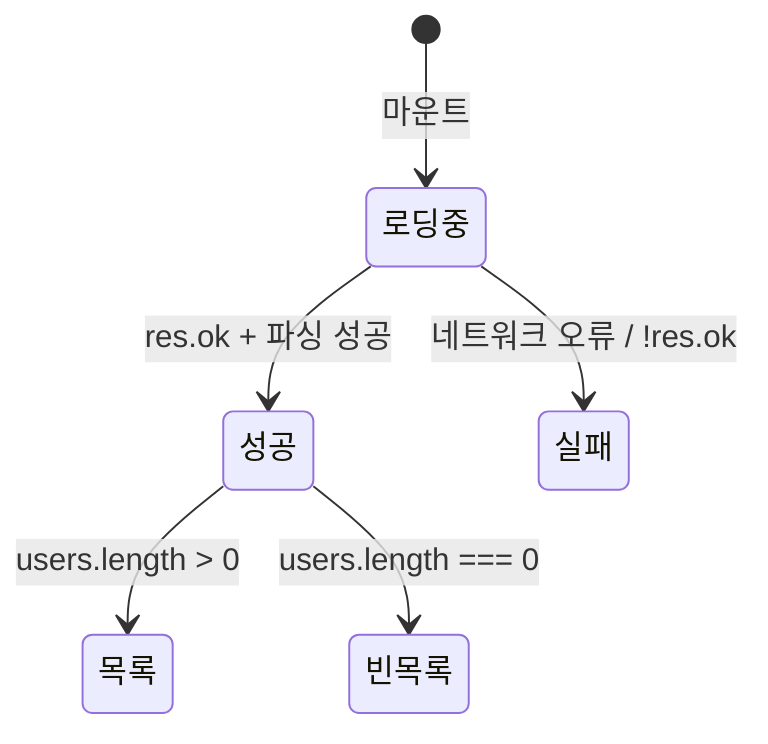

## 들어가며

[지난 글]({{ site.baseurl }}/posts/react-use-effect-dependency-cleanup/)에서 `useEffect`가 "화면을 그린 다음에 할 일"을 등록하는 곳이라는 걸 정리했다. 이번 실습 `06_fetch.jsx`는 거기에 실제 API 호출을 얹는다. 테스트용 API로 [JSONPlaceholder](https://jsonplaceholder.typicode.com/)의 `/users`를 썼다.

수업에서 정리한 기본 흐름은 세 단계다.

1. 데이터를 담을 state를 빈 값으로 만든다. — `useState([])`
2. 마운트 시 한 번만 API를 호출한다. — `useEffect(() => {...}, [])`
3. 응답이 오면 state에 저장한다. → 리렌더링되며 목록이 그려진다.

TODO는 금방 채웠고 화면도 잘 나왔다. 그런데 "요청이 실패하면 어떻게 되지?"를 따라가 보니 생각보다 구멍이 많았다.

## 1. 처음 완성한 코드

```jsx
function UserList() {
    const [users, setUsers] = useState([]);

    useEffect(() => {
        async function loadUsers() {
            const res = await fetch("https://jsonplaceholder.typicode.com/users");
            const json = await res.json();
            setUsers(json);
        }
        loadUsers();
    }, []);

    if (users.length === 0) return <h3>불러오는 중...</h3>;

    return (
        <div>
            {users.map(user => <UserCard key={user.id} user={user}/>)}
        </div>
    );
}
```

`UserList`는 API를 호출해서 배열을 들고 있고, 한 명분의 데이터는 `UserCard`에 props로 넘긴다. 데이터를 가져오는 컴포넌트와 그리는 컴포넌트가 나뉘어 있다.

### 왜 useEffect 콜백에 바로 async를 안 붙일까

처음엔 이렇게 쓰면 더 짧지 않나 싶었다.

```jsx
// 예시 코드 — 이렇게 쓰면 안 된다
useEffect(async () => {
    const res = await fetch(...);
    ...
}, []);
```

[지난 글]({{ site.baseurl }}/posts/react-use-effect-dependency-cleanup/)에서 본 것처럼 Effect 콜백이 **return 하는 값은 정리 함수 자리**다. 그런데 `async` 함수는 항상 Promise를 반환한다. React 입장에서는 정리 함수(또는 아무것도 없음)를 기대한 자리에 Promise가 들어오는 셈이라, 공식 문서도 콜백을 async로 만들지 말라고 한다. 그래서 안쪽에 `async function loadUsers()`를 만들고 바로 호출하는 형태가 된다.

### `await`가 두 번인 이유

```js
const res = await fetch(url);   // 1) 응답 헤더 도착까지 대기 → Response 객체
const json = await res.json();  // 2) 본문을 끝까지 읽고 JSON 파싱 → JS 배열
```

`fetch`가 resolve되는 시점은 **헤더가 도착했을 때**고, 본문은 아직 다 안 왔을 수 있다. `res.json()`이 본문을 끝까지 읽고 JSON 텍스트를 JS 객체/배열로 바꾸는데, 이것도 시간이 걸리니 Promise를 반환한다. 수업 중에 "문자열 json을 진짜 json으로 변경"이라고 주석을 달았는데, JSON은 원래 텍스트 형식이니 "JSON 텍스트를 JS 값으로 파싱"이 더 정확한 표현이다.

## 2. 다시 보니 보인 두 가지 구멍

### 구멍 1: 실패하면 영원히 "불러오는 중..."

코드에 실패 경로가 하나도 없다. 네트워크가 끊기면 `fetch`가 reject되고, `loadUsers()`는 Promise를 아무도 받지 않으니 콘솔에 `Uncaught (in promise)`만 남는다. `users`는 계속 `[]`이니 화면은 로딩 문구에서 멈춘다.

그럼 서버가 404나 500을 돌려주면? 당연히 에러가 날 줄 알았는데 아니었다. 실제로 존재하지 않는 주소에 요청을 보내봤다.

```js
fetch('https://jsonplaceholder.typicode.com/users')
    .then(r => console.log(r.status));
fetch('https://jsonplaceholder.typicode.com/users-nope')
    .then(r => console.log('404 test:', r.status, 'ok=', r.ok));
```

```
200
404 test: 404 ok= false
```

404인데도 `.then`으로 들어온다. MDN 설명에 따르면 `fetch`의 Promise는 **네트워크 오류일 때만 reject**되고, 서버가 응답을 돌려줬다면 상태 코드가 뭐든 resolve된다. "요청-응답 왕복 자체는 성공했다"는 뜻이다. 상태 코드가 200번대인지는 `res.ok`(200~299이면 `true`)로 직접 확인해야 한다.

| 상황 | `fetch` Promise | `res.ok` |
|------|----------------|---------|
| 200 OK | resolve | `true` |
| 404 Not Found | **resolve** | `false` |
| 500 Internal Server Error | **resolve** | `false` |
| 네트워크 끊김, CORS 차단 | reject | — |

이 상태로 404가 오면 `res.json()`이 에러 페이지 본문을 파싱하다 실패하거나, 파싱에 성공하더라도 배열이 아닌 값이 `users`에 들어가 `users.map`에서 터진다. 어느 쪽이든 원인과 동떨어진 에러 메시지를 보게 된다.

참고로 axios는 기본 설정에서 2xx가 아니면 reject한다. 수업 주석에 "실무에서는 axios도 많이 쓴다"고 적힌 이유 중 하나가 이 차이인 것 같다.

### 구멍 2: 빈 배열과 로딩 중을 구분할 수 없다

```jsx
if (users.length === 0) return <h3>불러오는 중...</h3>;
```

`users`가 빈 배열인 경우는 두 가지다.

- 아직 요청 중이라 초기값 `[]` 그대로인 경우
- 요청이 끝났는데 서버가 진짜로 `[]`을 돌려준 경우 (회원이 0명)

두 번째 경우에도 "불러오는 중..."이 뜬다. 하나의 값(`users.length`)으로 두 가지 의미를 표현하려다 생긴 문제다.

## 3. loading / error state 분리하기

화면이 가질 수 있는 상태를 먼저 나눠봤다.



화면이 구분해야 하는 상태가 네 개인데 state는 `users` 하나뿐이었다. 그래서 `loading`과 `error`를 따로 둔다.

```jsx
function UserList() {
    const [users, setUsers] = useState([]);
    const [loading, setLoading] = useState(true);
    const [error, setError] = useState(null);

    useEffect(() => {
        async function loadUsers() {
            try {
                const res = await fetch("https://jsonplaceholder.typicode.com/users");
                // fetch는 404/500이어도 reject하지 않는다 → 직접 에러로 던진다
                if (!res.ok) throw new Error(`HTTP ${res.status}`);
                const json = await res.json();
                setUsers(json);
            } catch (e) {
                // 네트워크 오류(reject) + 위에서 던진 HTTP 에러가 모두 여기로 온다
                setError(e.message);
            } finally {
                // 성공이든 실패든 요청은 끝났다
                setLoading(false);
            }
        }
        loadUsers();
    }, []);

    if (loading) return <h3>불러오는 중...</h3>;
    if (error) return <h3>불러오기 실패: {error}</h3>;
    if (users.length === 0) return <h3>회원이 없습니다.</h3>;

    return (
        <div>
            {users.map(user => <UserCard key={user.id} user={user}/>)}
        </div>
    );
}
```

포인트는 세 가지다.

1. **`if (!res.ok) throw`** — `fetch`가 구분해주지 않는 HTTP 에러를 직접 reject 경로로 바꾼다. 이렇게 하면 네트워크 오류와 HTTP 에러를 `catch` 하나에서 같이 처리할 수 있다.
2. **`finally`에서 `setLoading(false)`** — 성공/실패 양쪽에 똑같은 코드를 쓰지 않아도 된다.
3. **`loading`의 초기값이 `true`** — 마운트하자마자 요청을 보내니, 첫 렌더링부터 로딩 상태가 맞다. `false`로 두면 첫 렌더링에서 `users.length === 0`에 걸려 "회원이 없습니다."가 잠깐 보인다.

`if`를 위에서부터 순서대로 검사하는 것도 의미가 있다. 로딩 → 에러 → 빈 목록 → 정상 목록 순서로 걸러내니, 아래로 내려갈수록 "앞의 조건들이 다 아니다"가 보장된다.

변경 후 `vite build`로 문법 오류가 없는 것까지 확인했다.

## 정리

- Effect 콜백 자체를 `async`로 만들지 않는다. return 자리는 정리 함수용이라, 안쪽에 async 함수를 만들어 호출한다.
- `await fetch()`는 헤더까지, `await res.json()`은 본문 파싱까지 기다린다.
- `fetch`는 **네트워크 오류일 때만 reject**한다. 404/500은 resolve되니 `res.ok`로 직접 확인해서 throw한다.
- 화면 상태가 여러 개면 state도 나눈다. 데이터 하나로 "로딩 중"과 "비어 있음"을 동시에 표현하려고 하면 둘 중 하나가 깨진다.

## 다음에 이어서 볼 것

- **요청 경쟁 상태와 AbortController** — 지금은 `[]`라 요청이 한 번뿐이지만, `[keyword]`처럼 의존성이 생기면 이전 요청 응답이 늦게 도착해 최신 결과를 덮어쓸 수 있다. 정리 함수에서 `ignore` 플래그를 세우거나 `AbortController`로 요청을 취소하는 방법이 지난 글의 정리 함수와 이어진다.
- **axios** — 2xx가 아니면 reject, JSON 자동 파싱(`res.data`), 인터셉터 등. `fetch`로 직접 해본 걸 비교해 보면 어떤 수고를 덜어주는지 보인다.
- **커스텀 훅 (`useFetch`)** — `loading`/`error`/`data` 세 state와 Effect가 API마다 반복된다. 이걸 훅으로 묶는 게 다음 단계다.
- **React Query / SWR** — 캐싱, 재시도, 화면 복귀 시 재요청까지 처리해주는 라이브러리. 이번에 직접 만든 loading/error 처리가 이 라이브러리들이 기본으로 주는 것들이다.

## 참고 자료

- [MDN - Using the Fetch API (Checking response status)](https://developer.mozilla.org/en-US/docs/Web/API/Fetch_API/Using_Fetch#checking_response_status)
- [MDN - Response.ok](https://developer.mozilla.org/en-US/docs/Web/API/Response/ok)
- [MDN - Response.json()](https://developer.mozilla.org/en-US/docs/Web/API/Response/json)
- [React 공식 문서 - useEffect (Fetching data with Effects)](https://react.dev/reference/react/useEffect#fetching-data-with-effects)
- [React 공식 문서 - Synchronizing with Effects](https://react.dev/learn/synchronizing-with-effects)
- [axios - Handling Errors](https://axios-http.com/docs/handling_errors)
