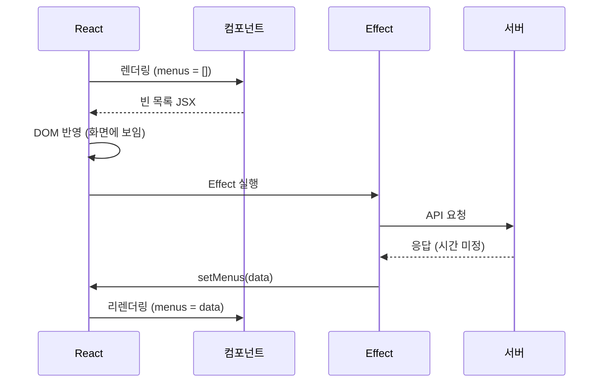
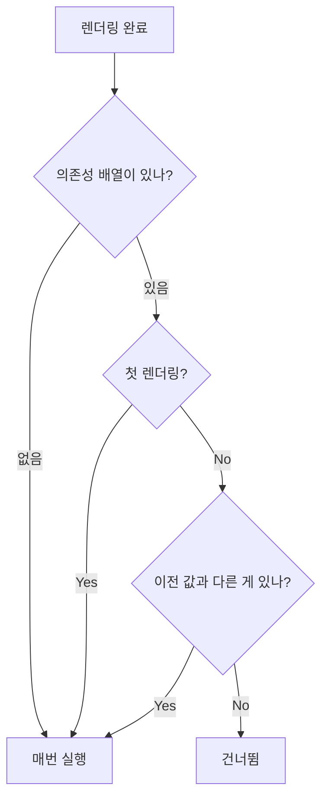
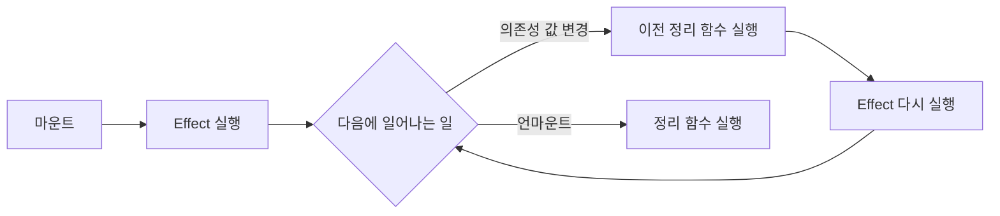

## 들어가며

[지난 글]({{ site.baseurl }}/posts/react-props-state-rerender/)에서 state가 바뀌면 컴포넌트 함수가 **처음부터 다시 실행**된다는 걸 봤다. 그럼 이런 코드는 어떻게 될까?

```jsx
// 예시 코드 (이렇게 쓰면 안 되는 형태)
function MenuList() {
    const [menus, setMenus] = useState([]);
    fetch('/api/menus').then(res => res.json()).then(setMenus);
    return <ul>...</ul>;
}
```

렌더링 → `fetch` → 응답 도착 → `setMenus` → 리렌더링 → 또 `fetch` → ... 끝없이 요청을 보낸다. 컴포넌트 본문은 **화면에 뭘 그릴지 계산하는 곳**이지, 서버 요청이나 타이머 같은 바깥 작업을 시작하는 곳이 아니다.

이번 수업의 `05_useEffect.jsx`는 그 바깥 작업을 어디에 둬야 하는지를 다룬다. 다음 파일이 `06_fetch.jsx`인 걸 보면, 실제 API 호출 전에 거쳐가는 단계다.

| 컴포넌트 | 실습 내용 |
|---------|----------|
| `EffectTest` | 의존성 배열 3가지 형태를 콘솔로 비교 |
| `Timer` | `setInterval` + 정리 함수, 토글로 마운트/언마운트 |

## 1. useEffect는 "그린 다음에" 실행된다

```jsx
useEffect(() => { /* 실행할 코드 */ }, [/* 의존성 배열 */]);
```

공식 문서 표현으로는 Effect는 **커밋이 끝나고 화면이 갱신된 뒤** 실행된다. API 호출은 비동기라 언제 끝날지 모른다. 그래서 일단 빈 화면(또는 로딩 화면)을 먼저 띄우고, 응답이 도착하면 state에 넣어 다시 그리는 흐름이 된다.



실습 코드에서도 이 순서가 그대로 보인다. 컴포넌트 본문에 있는 `console.log("EffectTest 컴포넌트 렌더링!")`가 코드상으로는 `useEffect`들보다 **아래**에 있는데, 콘솔에는 항상 **먼저** 찍힌다. `useEffect`는 함수를 "등록"만 해두고, 실행은 렌더링이 끝난 뒤에 하기 때문이다.

## 2. 의존성 배열 3가지를 콘솔로 비교하기

`EffectTest`에 세 가지 형태를 나란히 적었다.

```jsx
// 1. 의존성 배열 없음
useEffect(() => {
    console.log("백엔드에서 메뉴 전체조회 API 호출함!!");
    console.log("[의존성 배열 없음.] 렌더링 이후에 시작");
});

// 2. 빈 배열
useEffect(() => {
    console.log("[빈 배열.] 마운트 시 1번만 실행된다.");
}, []);

// 3. [count]
useEffect(() => {
    console.log("[count] 관리하는 count가 바뀔 때만 실행된다.");
}, [count]);

console.log("EffectTest 컴포넌트 렌더링!");
```

화면에는 `count`를 올리는 버튼과, `text` state에 묶인 input이 있다. 세 가지 상황에서 콘솔을 비교했다.

| 상황 | 렌더링 로그 | 배열 없음 | `[]` | `[count]` |
|------|:---:|:---:|:---:|:---:|
| 처음 화면에 나타남 (마운트) | O | O | O | O |
| `+1` 버튼 클릭 (`count` 변경) | O | O | | O |
| input에 입력 (`text` 변경) | O | O | | |

React는 리렌더링할 때마다 의존성 배열의 값을 **이전 렌더링 때 값과 비교**(`Object.is`)해서, 하나라도 달라졌으면 Effect를 다시 실행한다.



`[]`는 비교할 값이 하나도 없으니 "달라진 게 있나?"가 항상 No가 되고, 결과적으로 마운트 때 한 번만 실행된다. `[]`가 특별한 문법이 아니라 비교 규칙에서 자연스럽게 나오는 결과라는 게 흥미로웠다.

### 배열이 없으면 왜 문제일까

1번 Effect에 일부러 "메뉴 전체조회 API 호출" 로그를 넣은 이유가 표에서 보인다. input에 글자 하나 칠 때마다 `text`가 바뀌어 리렌더링되고, 그때마다 API를 호출한다. 메뉴 목록은 입력과 아무 상관이 없는데도 그렇다.

여기에 Effect 안에서 `setMenus`까지 하면 앞에서 본 무한 요청이 그대로 재현된다. Effect가 state를 바꾸고 → 리렌더링 → Effect 다시 실행 → state 변경 → ...

## 3. `[]`와 `[값]`은 언제 쓰나

수업 중에 적은 주석을 다시 보니 이 부분이 조금 섞여 있었다. 빈 배열 쪽에 "실시간성이 중요한 경우"라고 적고, `[count]` 쪽에 "대부분의 API 호출은 빈 배열"이라고 적어 두었다. 앞의 비교표를 기준으로 다시 정리하면 이렇다.

| 형태 | 언제 다시 실행되나 | 쓰는 곳 |
|------|------------------|--------|
| `[]` | 마운트 1번 | 화면 진입 시 목록 한 번 불러오기 (대부분의 조회 API) |
| `[keyword]` | `keyword`가 바뀔 때마다 | 검색어·필터·페이지 번호처럼 **값이 바뀌면 다시 불러와야** 하는 조회 (실시간 검색 등) |
| 생략 | 매 렌더링 | 거의 쓸 일이 없다 |

"실시간 검색"은 검색어가 바뀔 때마다 다시 요청해야 하니 `[]`가 아니라 `[keyword]` 쪽이다. 빈 배열은 한 번만 실행되니까 실시간으로 따라갈 수가 없다.

그리고 의존성 배열은 "내가 원하는 실행 시점"을 고르는 스위치가 아니라는 점도 공식 문서에서 강조한다. **Effect 안에서 읽는 props/state는 전부 배열에 넣는 게 원칙**이고, 그러면 실행 시점은 그 값들이 바뀔 때로 저절로 정해진다. Effect 안에서 `keyword`를 쓰면서 배열을 `[]`로 두면, 검색어가 바뀌어도 첫 검색어로만 요청하는 버그가 된다.

## 4. 정리 함수: 시작한 건 끝내야 한다

두 번째 실습은 1초마다 시각을 갱신하는 `Timer`다. 부모의 토글 버튼으로 `{isShow && <Timer/>}`를 켰다 껐다 할 수 있다.

```jsx
function Timer() {
    // 함수를 넘기면 첫 렌더링 때만 계산한다 (지연 초기화)
    const [time, setTime] = useState(() => new Date().toLocaleTimeString());

    return <h2>현재 시간: {time}</h2>;
}
```

TODO는 마운트 때 `setInterval`을 시작하되, **먼저 정리 함수 없이** 토글해 보는 것이었다.

```jsx
// 예시 코드 — 정리 함수 없는 버전
useEffect(() => {
    setInterval(() => {
        console.log('tick');
        setTime(new Date().toLocaleTimeString());
    }, 1000);
}, []);
```

토글을 끄면 `<h2>`는 사라지는데, 콘솔에는 `tick`이 계속 찍힌다. 컴포넌트가 화면에서 빠져도 브라우저에 등록한 타이머는 React가 알아서 치워주지 않기 때문이다. 다시 켜면 새 타이머가 하나 더 생겨서, 껐다 켤 때마다 `tick`이 1초에 2번, 3번... 늘어난다.

Effect에서 **함수를 return 하면** 그게 정리(clean-up) 함수가 된다.

```jsx
// 예시 코드 — 정리 함수 추가
useEffect(() => {
    const id = setInterval(() => {
        console.log('tick');
        setTime(new Date().toLocaleTimeString());
    }, 1000);

    return () => clearInterval(id);
}, []);
```

이제 토글을 끄면 `tick`도 같이 멈추고, 몇 번을 껐다 켜도 타이머는 항상 하나다.

정리 함수가 실행되는 시점은 두 가지다.



1. **언마운트될 때** — 이번 타이머 실습의 경우
2. **의존성이 바뀌어서 Effect를 다시 실행하기 직전** — 이전 실행이 남긴 것을 먼저 치운다

2번이 의미 있는 건 `[keyword]` 같은 경우다. 검색어가 `a` → `ab`로 바뀌면 `a`로 걸어둔 작업을 정리하고 `ab`로 새로 시작한다. 정리 함수를 "언마운트 전용"으로만 생각하면 놓치기 쉬운 부분이다.

### 개발 모드에서 두 번 실행되는 경우

이 프로젝트의 `main.jsx`는 `<App />`을 `StrictMode`로 감싸지 않아서 `[]` Effect가 정확히 한 번 찍혔다. 그런데 Vite 템플릿 기본값처럼 `<StrictMode>`로 감싸면, 개발 모드에서 React가 **마운트 → 정리 → 다시 마운트**를 한 번 더 돌린다. 정리 함수를 빠뜨렸는지 일부러 드러내려는 장치다. 정리 함수가 제대로 있으면 두 번 돌아도 결과는 같다.

## 정리

- 컴포넌트 본문은 렌더링 계산만 한다. API 호출·타이머처럼 바깥 세계와 연결하는 작업은 `useEffect`에 둔다.
- Effect는 화면이 갱신된 **다음**에 실행된다. 그래서 렌더링 로그가 항상 먼저 찍힌다.
- 의존성 배열은 이전 렌더링 값과 비교하는 기준이다. 생략 → 매번, `[]` → 마운트 1번, `[a, b]` → 마운트 + 값이 바뀔 때.
- Effect 안에서 쓰는 props/state는 배열에 넣는다. 배열은 실행 시점을 고르는 스위치가 아니다.
- Effect에서 시작한 건(`setInterval`, 구독, 요청 등) 정리 함수로 끝낸다. 정리 함수는 언마운트 때와 재실행 직전에 돈다.

## 다음에 이어서 볼 것

- **fetch로 데이터 불러오기** — 다음 실습(`06_fetch.jsx`). Effect 안에서는 `async` 함수를 바로 넘길 수 없어서(정리 함수 자리에 Promise가 반환되므로) 안쪽에 async 함수를 만들어 호출하는 패턴을 쓴다.
- **요청 경쟁 상태(race condition)** — 검색어를 빠르게 바꾸면 늦게 보낸 요청의 응답이 먼저 올 수 있다. 정리 함수에서 `ignore` 플래그나 `AbortController`로 이전 요청 결과를 버리는 방법이 오늘 배운 정리 함수와 바로 이어진다.
- **You Might Not Need an Effect** — props나 state로 계산할 수 있는 값을 Effect + state로 만들면 렌더링만 한 번 더 늘어난다. Effect는 "바깥 시스템과 동기화"할 때만 쓰라는 공식 문서 가이드.
- **React Query / SWR** — 캐싱, 재요청, 로딩/에러 상태를 Effect로 매번 직접 구현하는 대신 맡기는 라이브러리. Effect로 직접 해본 뒤에 보면 왜 쓰는지 보인다.

## 참고 자료

- [React 공식 문서 - useEffect](https://react.dev/reference/react/useEffect)
- [React 공식 문서 - Synchronizing with Effects](https://react.dev/learn/synchronizing-with-effects)
- [React 공식 문서 - Lifecycle of Reactive Effects](https://react.dev/learn/lifecycle-of-reactive-effects)
- [React 공식 문서 - You Might Not Need an Effect](https://react.dev/learn/you-might-not-need-an-effect)
- [React 공식 문서 - StrictMode](https://react.dev/reference/react/StrictMode)
- [MDN - setInterval()](https://developer.mozilla.org/ko/docs/Web/API/Window/setInterval)
