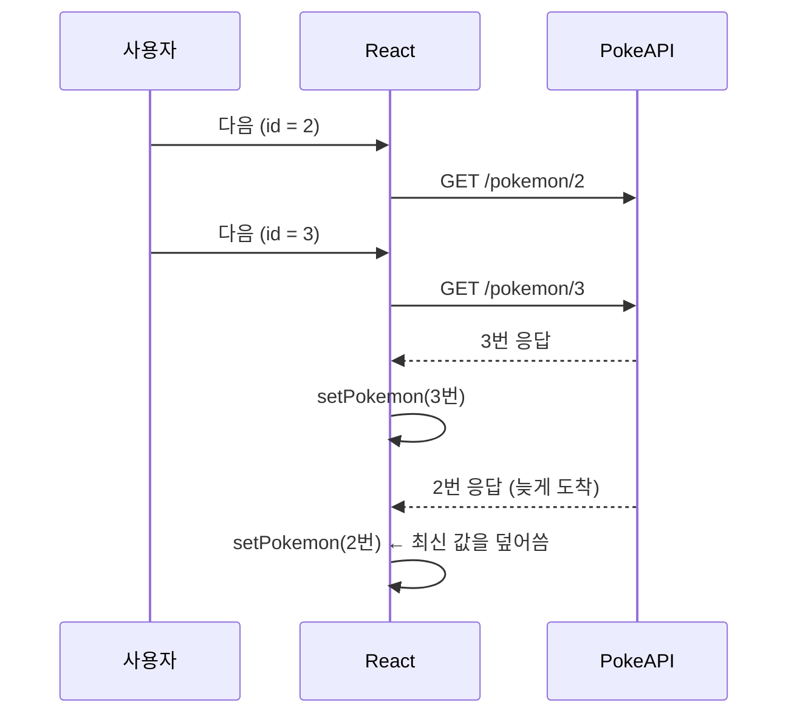
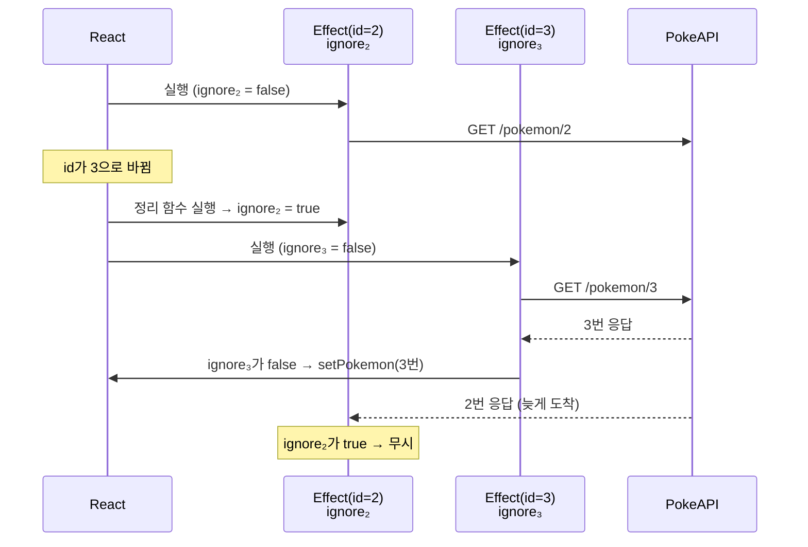

## 들어가며

[useEffect 글]({{ site.baseurl }}/posts/react-use-effect-dependency-cleanup/)에서 정리 함수는 **언마운트될 때**뿐 아니라 **의존성이 바뀌어 Effect를 다시 실행하기 직전**에도 실행된다고 정리했다. 그때는 두 번째 경우를 쓸 일이 별로 없을 것 같았는데, [fetch 글]({{ site.baseurl }}/posts/react-fetch-loading-error-state/) 다음 실습인 `07_pokemon.jsx`에서 바로 나왔다.

단원 종합 실습이라 지금까지 배운 게 다 들어간다.

| 개념 | 쓰인 곳 |
|------|--------|
| state | 현재 번호 `id`, 받아온 데이터 `pokemon` |
| event | 이전/다음 버튼 |
| useEffect | `id`가 바뀔 때마다 다시 요청 — `[id]` |
| props | 받아온 데이터를 `PokemonCard`에 전달 |
| 반복 렌더링 | 타입 목록 |

API는 키 없이 쓸 수 있는 [PokeAPI](https://pokeapi.co/)를 썼다. `https://pokeapi.co/api/v2/pokemon/1`을 요청하면 1번 포켓몬 정보가 온다.

## 1. 기본 구조: `[id]`로 다시 요청하기

[fetch 글]({{ site.baseurl }}/posts/react-fetch-loading-error-state/)의 회원 목록은 `[]`라서 마운트 때 한 번만 요청했다. 이번에는 버튼을 누를 때마다 다른 포켓몬을 불러와야 하니 `id`를 의존성 배열에 넣는다.

```jsx
const [id, setId] = useState(1);
const [pokemon, setPokemon] = useState(null);

useEffect(() => {
    async function loadPokemon() {
        const res = await fetch(`https://pokeapi.co/api/v2/pokemon/${id}`);
        const json = await res.json();
        setPokemon(json);
    }
    loadPokemon();
}, [id]);
```

버튼은 [props/state 글]({{ site.baseurl }}/posts/react-props-state-rerender/)에서 본 업데이트 함수 형태로 썼다.

```jsx
<button disabled={id === 1} onClick={() => setId(prev => prev - 1)}>이전</button>
<span> No.{id} </span>
<button onClick={() => setId(prev => prev + 1)}>다음</button>
```

타입 목록은 응답의 `types` 배열을 `map`으로 그린다. 1번 포켓몬의 응답을 직접 찍어보니 `['grass', 'poison']`처럼 타입이 여러 개일 수 있고, 한 포켓몬 안에서 타입 이름이 겹치지 않으니 `key`로 쓸 수 있다.

```jsx
타입: {pokemon.types.map(t => <span key={t.type.name}>{t.type.name} </span>)}
```

여기까지만 해도 버튼을 천천히 누르면 잘 동작한다.

## 2. 버튼을 빠르게 누르면 생기는 일

수업 주석에 이런 경고가 있었다.

> 버튼을 빠르게 누르면 이전 요청의 응답이 나중에 도착해 화면을 덮어쓸 수 있다.

네트워크 응답은 **보낸 순서대로 도착한다는 보장이 없다.** 1번에서 "다음"을 두 번 빠르게 눌러 2번, 3번 요청이 연달아 나갔고, 2번 응답이 늦게 왔다고 가정해 보자.



마지막에 화면의 번호는 `No.3`인데 `pokemon` state에는 2번 데이터가 들어 있다. 이런 걸 **경쟁 상태(race condition)**라고 한다. 결과가 코드 순서가 아니라 "어느 응답이 먼저 오느냐"에 따라 달라지는 상황이다.

### 화면 쪽 조건만으로는 부족하다

실습 코드에는 처음부터 이런 렌더링 조건이 있었다.

```jsx
{pokemon?.id === id ? <PokemonCard pokemon={pokemon}/> : <h3>불러오는 중...</h3>}
```

처음엔 "번호가 다르면 카드를 안 그리니까 이걸로 해결된 거 아닌가?" 싶었다. 위 시나리오를 그대로 대입해 보면 그렇지 않다.

| 시점 | `id` | `pokemon` | 화면 |
|------|:---:|:---:|------|
| 3번 응답 도착 | 3 | 3번 | 3번 카드 |
| 2번 응답 도착 | 3 | **2번** | 불러오는 중... |
| 이후 | 3 | 2번 | **계속** 불러오는 중... |

3번 응답은 이미 도착했다가 2번에게 덮어쓰였다. 더 올 응답이 없으니 화면은 "불러오는 중..."에서 멈춘다. 이 조건은 **틀린 카드를 그리는 것**은 막아주지만 **state가 덮어쓰이는 것**은 막지 못한다. 그래서 문제의 원인인 "늦게 온 응답이 `setPokemon`까지 가는 것" 자체를 막아야 한다.

## 3. ignore 플래그: 정리 함수로 이전 요청 결과 버리기

```jsx
useEffect(() => {
    let ignore = false;

    async function loadPokemon() {
        const res = await fetch(`https://pokeapi.co/api/v2/pokemon/${id}`);
        const json = await res.json();
        if (!ignore) setPokemon(json);
    }
    loadPokemon();

    return () => {
        ignore = true;
    };
}, [id]);
```

코드는 세 줄 늘었을 뿐인데, 처음 봤을 때는 이게 왜 동작하는지 바로 와닿지 않았다. `ignore`는 Effect가 실행될 때마다 `false`로 새로 만들어지는데, 그럼 매번 `false`인 거 아닌가?

### 핵심은 Effect 실행마다 따로 생기는 변수

Effect 함수는 `id`가 바뀔 때마다 **새로 실행**된다. 그러니 `let ignore`도 실행마다 **별개의 변수**로 하나씩 생긴다. 그리고 `loadPokemon`과 정리 함수는 자기가 만들어진 그 실행의 `ignore`를 기억한다. JS의 **클로저**다.



1. `id = 2`로 Effect가 실행되면서 `ignore₂ = false`가 생기고 요청을 보낸다.
2. `id`가 3으로 바뀌면 React는 새 Effect를 실행하기 **직전에** 이전 실행의 정리 함수를 부른다. 이 정리 함수가 바꾸는 건 `ignore₂`다.
3. 새 Effect가 실행되면서 `ignore₃ = false`가 새로 생긴다. `ignore₂`와는 다른 변수다.
4. 2번 응답이 늦게 와도 `loadPokemon`(2번용)이 보는 `ignore₂`는 이미 `true`라서 `setPokemon`을 건너뛴다.

"매번 `false`로 새로 만들어지는데 왜 동작하지?"라는 의문이 바로 답이었다. 매번 새로 만들어지기 때문에 **실행마다 자기만의 플래그**를 가질 수 있는 것이다. 정리 함수가 "의존성이 바뀌어 다시 실행하기 직전"에 돈다는 규칙이 여기서 정확히 들어맞는다.

이 방식은 요청 자체를 취소하지는 않는다. 2번 요청은 끝까지 다녀오고, 결과만 버린다. 요청까지 끊고 싶으면 `AbortController`를 쓴다(아래 "다음에 볼 것" 참고).

## 4. 에러도 "어느 번호의 에러인지" 같이 기억하기

[fetch 글]({{ site.baseurl }}/posts/react-fetch-loading-error-state/)에서 정리한 `res.ok` 확인도 넣었다. 이번에는 실제로 필요한 상황이 있다. 1026번을 요청해 보니 응답이 `404`였다. 마지막 번호에서 "다음"을 누르면 404가 오는데, 에러 처리가 없으면 화면은 "불러오는 중..."에서 멈춘다.

에러 state를 넣다가 한 가지 고민이 생겼다. 1026번에서 에러가 난 뒤 "이전"을 눌러 1025번으로 돌아가면, 에러를 언제 지워야 할까? Effect 시작할 때 `setError(null)`을 하거나 버튼 핸들러마다 초기화할 수도 있지만, 기존의 `pokemon?.id === id` 조건과 같은 방식을 쓰면 지울 필요 자체가 없어진다.

```jsx
const [error, setError] = useState(null);   // { id, message }

useEffect(() => {
    let ignore = false;

    async function loadPokemon() {
        try {
            const res = await fetch(`https://pokeapi.co/api/v2/pokemon/${id}`);
            if (!res.ok) throw new Error(`HTTP ${res.status}`);
            const json = await res.json();
            if (!ignore) setPokemon(json);
        } catch (e) {
            if (!ignore) setError({ id, message: e.message });
        }
    }
    loadPokemon();

    return () => {
        ignore = true;
    };
}, [id]);
```

```jsx
{error?.id === id
    ? <h3>불러오기 실패: {error.message}</h3>
    : pokemon?.id === id
        ? <PokemonCard pokemon={pokemon}/>
        : <h3>불러오는 중...</h3>}
```

에러에 **번호를 같이 저장**하면, 화면은 "지금 번호의 에러인가?"만 보면 된다. 1025번으로 돌아가면 `error.id`(1026)와 `id`(1025)가 달라서 에러 문구가 저절로 사라진다. 에러 저장도 `ignore`를 확인하는 것도 같은 이유다. 이전 번호 요청의 실패가 지금 화면에 영향을 주면 안 된다.

| 방식 | 장점 | 단점 |
|------|------|------|
| Effect 시작 시 `setError(null)` | 직관적 | 에러가 있던 상태라면 화면을 그린 뒤 렌더링이 한 번 더 일어난다 |
| 버튼 핸들러마다 초기화 | 원인 지점에서 처리 | `id`를 바꾸는 곳이 늘면 빠뜨리기 쉽다 |
| `{ id, message }`로 저장 | 초기화 코드 없음, `pokemon`과 같은 규칙 | 객체 형태라 조금 더 낯설다 |

최대 번호(지금은 1025)를 `disabled={id === 1025}`처럼 코드에 박아두는 방법도 있지만, PokeAPI에 포켓몬이 추가되면 고쳐야 한다. 404를 에러 화면으로 처리하는 쪽이 그런 의존이 없다.

변경 후에는 `vite build`로 문법 오류가 없는 것과, 실제 API 응답에서 `id`가 숫자 타입이라 `=== id` 비교가 맞는 것까지 확인했다.

## 정리

- 의존성 배열에 `id`를 넣으면 버튼을 누를 때마다 Effect가 다시 실행되고 새 요청이 나간다.
- 네트워크 응답은 보낸 순서대로 오지 않는다. 늦게 온 이전 요청 응답이 최신 state를 덮어쓸 수 있다(경쟁 상태).
- 화면에서 `pokemon.id === id`로 거르는 건 틀린 카드만 막을 뿐, state 덮어쓰기는 못 막는다. 오히려 로딩 화면에서 멈출 수 있다.
- `let ignore`는 Effect 실행마다 별개로 생기고, 정리 함수는 **자기 실행의** `ignore`만 `true`로 바꾼다. 클로저 덕분에 실행마다 자기 플래그를 가진다.
- 에러도 `{ id, message }`로 저장하면 초기화 없이 "지금 번호의 에러"만 보여줄 수 있다.

## 다음에 이어서 볼 것

- **AbortController** — `fetch(url, { signal })`로 요청을 보내고 정리 함수에서 `controller.abort()`를 부르면 결과를 버리는 것을 넘어 요청 자체를 취소한다. 취소된 요청은 `AbortError`로 reject되니 `catch`에서 구분해야 한다.
- **클로저와 stale closure** — 이번엔 클로저가 문제를 해결했지만, 반대로 Effect나 타이머 안에서 옛날 state 값을 계속 보는 버그의 원인이 되기도 한다. 같은 원리의 양면이다.
- **useReducer** — `pokemon`, `error`, (로딩) 상태가 서로 연결되어 함께 바뀐다. 상태 전이가 늘어나면 하나의 reducer로 묶는 편이 읽기 쉽다.
- **React Query / SWR** — 경쟁 상태 처리, 캐싱(이미 본 번호로 돌아갈 때 재요청 안 함), 재시도를 기본으로 해준다. 이번에 직접 만든 ignore 플래그가 이 라이브러리들이 내부에서 처리해주는 것 중 하나다.

## 참고 자료

- [React 공식 문서 - useEffect (Fetching data with Effects)](https://react.dev/reference/react/useEffect#fetching-data-with-effects)
- [React 공식 문서 - Synchronizing with Effects (Fetching data)](https://react.dev/learn/synchronizing-with-effects#fetching-data)
- [React 공식 문서 - You Might Not Need an Effect (Fetching data)](https://react.dev/learn/you-might-not-need-an-effect#fetching-data)
- [MDN - 클로저](https://developer.mozilla.org/ko/docs/Web/JavaScript/Closures)
- [MDN - AbortController](https://developer.mozilla.org/en-US/docs/Web/API/AbortController)
- [PokeAPI 문서](https://pokeapi.co/docs/v2)
